# DevOps Wiki

83 hands-on articles and cheatsheets on AWS, Kubernetes, Terraform, Docker, Ansible, Linux and terminal tools.

[AWS](#aws) (19) · [Kubernetes](#kubernetes) (19) · [Terraform](#terraform) (11) · [Docker](#docker) (9) · [Ansible](#ansible) (4) · [Linux & Bash](#linux--bash) (15) · [Terminal & macOS](#terminal--macos) (6)

## AWS

<table>
<tr>
<td width="33%" valign="top"><a href="aws-cli-install/index.md">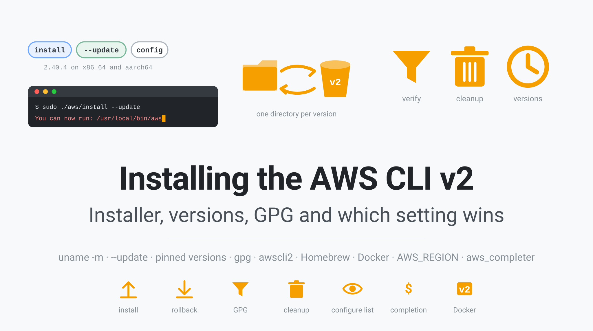</a> <a href="aws-cli-install/index.md">Installing the AWS CLI v2 on Linux, macOS and Docker</a></td>
<td width="33%" valign="top"><a href="aws-global-accelerator-guide/index.md">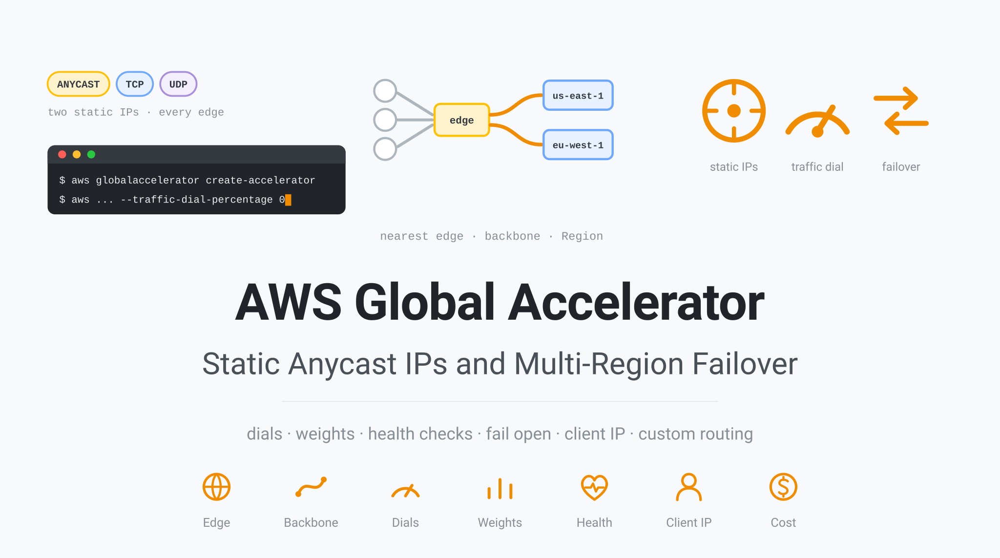</a> <a href="aws-global-accelerator-guide/index.md">AWS Global Accelerator: Static Anycast IPs and Multi-Region Failover</a></td>
<td width="33%" valign="top"><a href="aws-network-firewall-guide/index.md">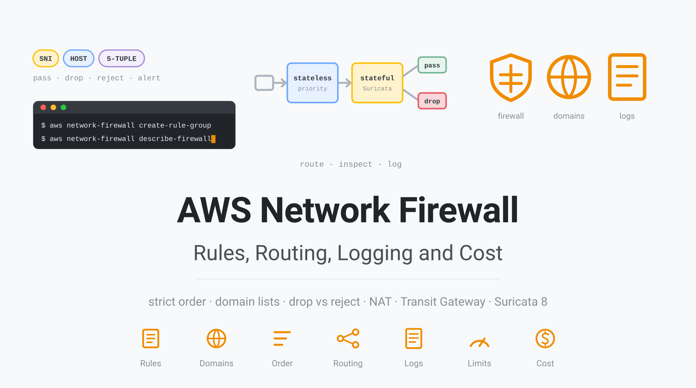</a> <a href="aws-network-firewall-guide/index.md">AWS Network Firewall: Rules, Routing, Logging and Cost</a></td>
</tr>
<tr>
<td width="33%" valign="top"><a href="aws-asg-min-desired-max-capacity/index.md">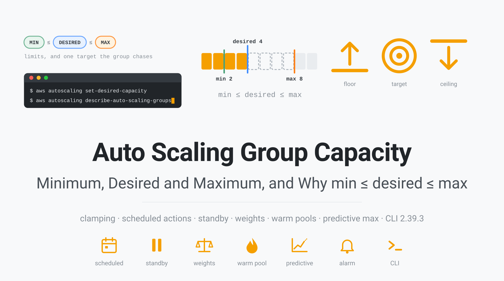</a> <a href="aws-asg-min-desired-max-capacity/index.md">Auto Scaling Group Capacity: Minimum, Desired and Maximum</a></td>
<td width="33%" valign="top"><a href="aws-ec2-billing-purchasing-options/index.md">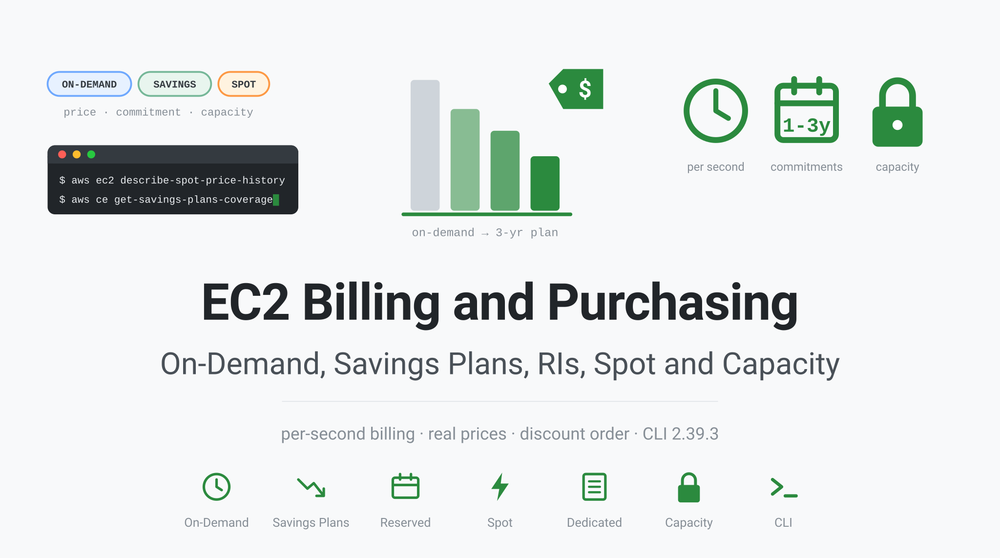</a> <a href="aws-ec2-billing-purchasing-options/index.md">Amazon EC2 Billing and Purchasing Options: On-Demand, Savings Plans, Reserved Instances, Spot, Dedicated and Capacity Reservations</a></td>
<td width="33%" valign="top"><a href="aws-route53-cheatsheet/index.md">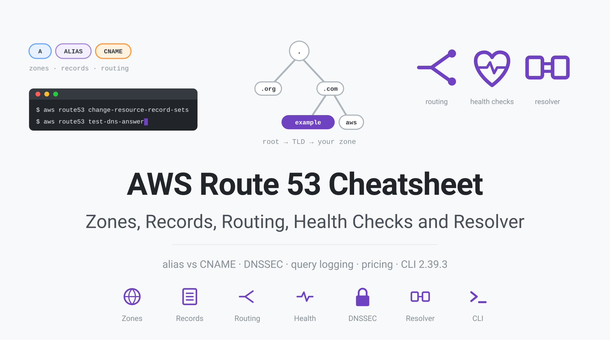</a> <a href="aws-route53-cheatsheet/index.md">AWS Route 53 Cheatsheet</a></td>
</tr>
<tr>
<td width="33%" valign="top"><a href="aws-ec2-placement-groups-guide/index.md">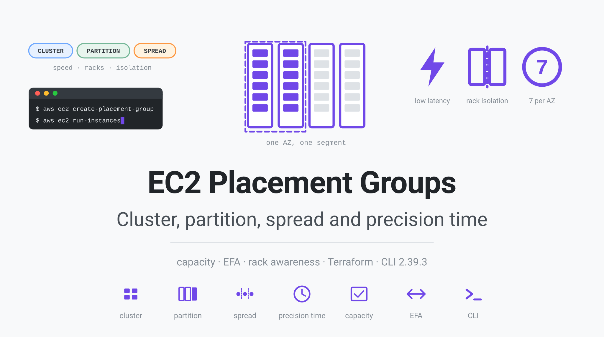</a> <a href="aws-ec2-placement-groups-guide/index.md">EC2 Placement Groups: Cluster, Partition, Spread and Precision Time</a></td>
<td width="33%" valign="top"><a href="aws-ec2-connection-methods-compared/index.md">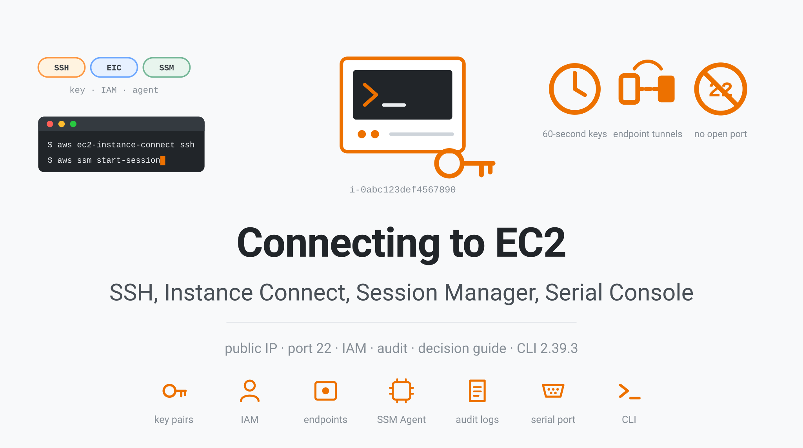</a> <a href="aws-ec2-connection-methods-compared/index.md">Connecting to EC2: SSH vs EC2 Instance Connect vs Instance Connect Endpoint vs Session Manager vs Serial Console</a></td>
<td width="33%" valign="top"><a href="aws-certificate-manager-guide/index.md">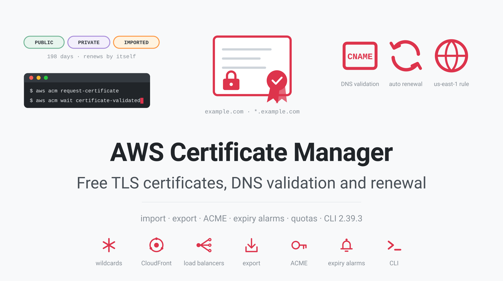</a> <a href="aws-certificate-manager-guide/index.md">AWS Certificate Manager (ACM): Free TLS Certificates for Your AWS Services</a></td>
</tr>
<tr>
<td width="33%" valign="top"><a href="aws-backup-guide/index.md">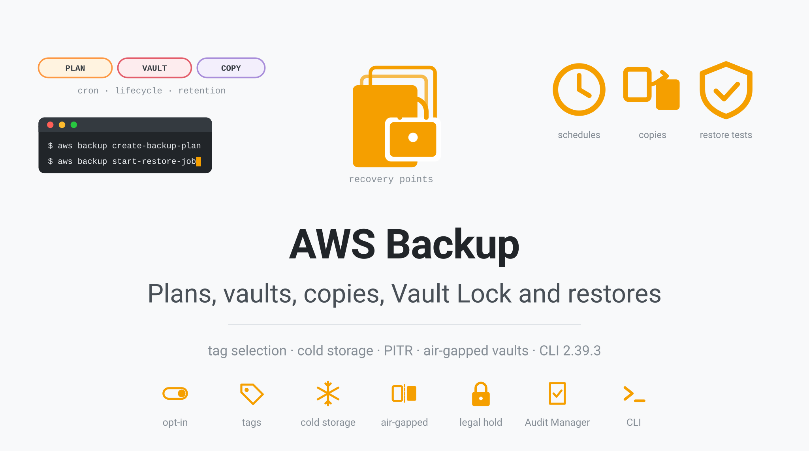</a> <a href="aws-backup-guide/index.md">AWS Backup: Plans, Vaults, Copies, Vault Lock and Restore Testing</a></td>
<td width="33%" valign="top"><a href="aws-s3-object-lock-modes-guide/index.md">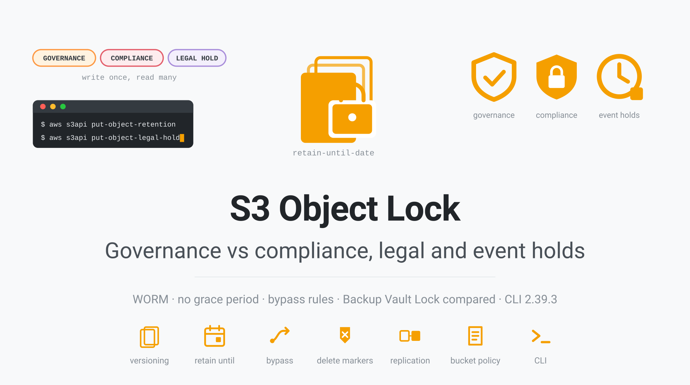</a> <a href="aws-s3-object-lock-modes-guide/index.md">S3 Object Lock: Governance vs Compliance Mode, Legal Holds and Event Holds</a></td>
<td width="33%" valign="top"><a href="aws-s3-lifecycle-policies-guide/index.md">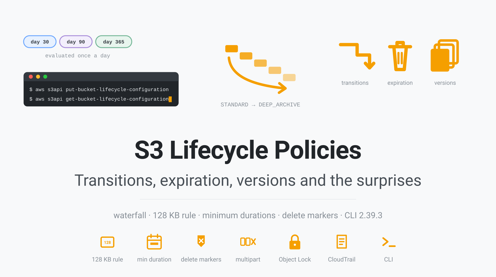</a> <a href="aws-s3-lifecycle-policies-guide/index.md">S3 Lifecycle Policies: Transitions, Expiration, Versions and the Rules That Surprise You</a></td>
</tr>
<tr>
<td width="33%" valign="top"><a href="aws-storage-gateway-cheatsheet/index.md">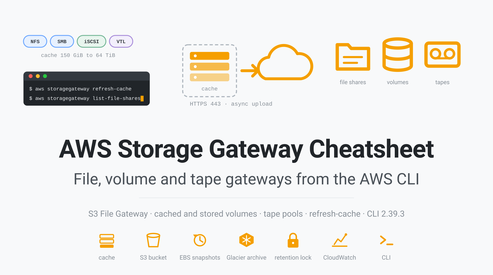</a> <a href="aws-storage-gateway-cheatsheet/index.md">AWS Storage Gateway Cheatsheet</a></td>
<td width="33%" valign="top"><a href="aws-auto-scaling-groups-guide/index.md">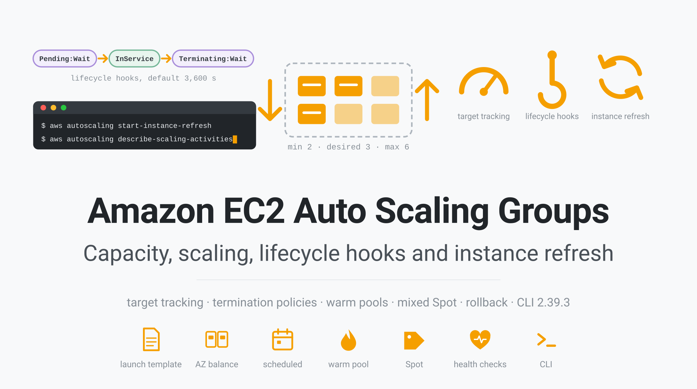</a> <a href="aws-auto-scaling-groups-guide/index.md">Amazon EC2 Auto Scaling Groups: Capacity, Scaling Policies, Lifecycle Hooks and Instance Refresh</a></td>
<td width="33%" valign="top"><a href="aws-s3-cheatsheet/index.md">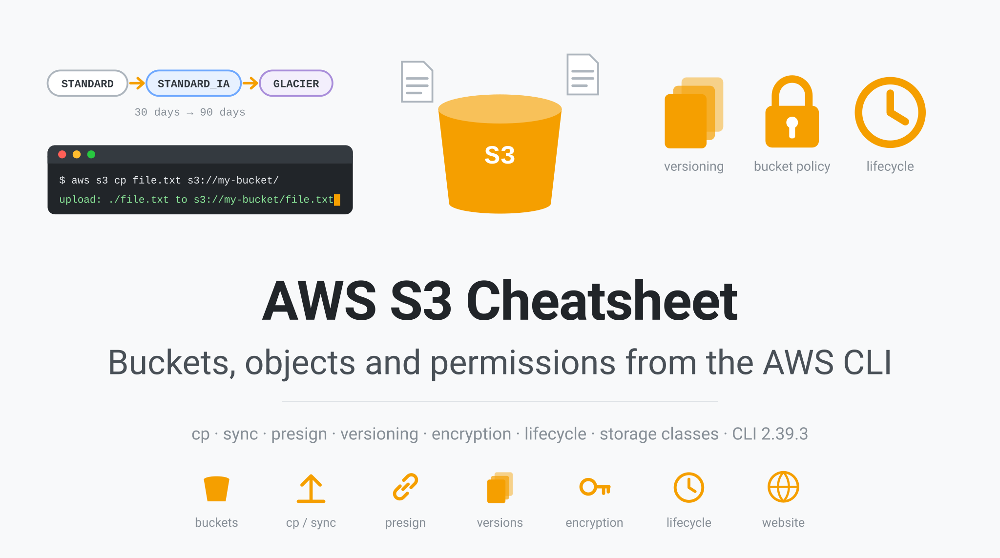</a> <a href="aws-s3-cheatsheet/index.md">AWS S3 Cheatsheet</a></td>
</tr>
<tr>
<td width="33%" valign="top"><a href="aws-s3-sync-guide/index.md">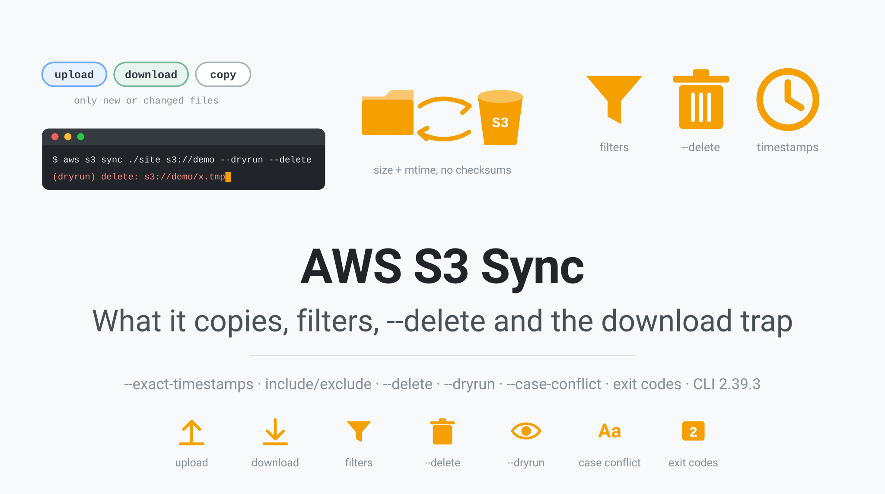</a> <a href="aws-s3-sync-guide/index.md">AWS S3 Sync: How It Decides What to Copy, Filters, Delete and the Download Trap</a></td>
<td width="33%" valign="top"><a href="aws-ebs-cheatsheet/index.md">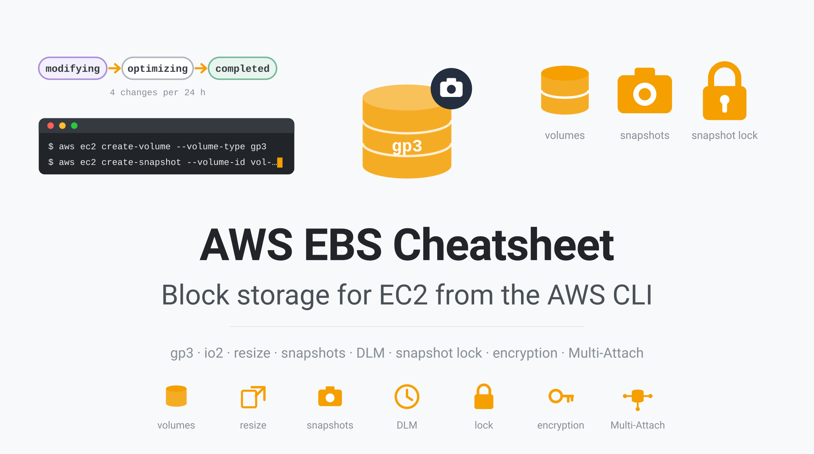</a> <a href="aws-ebs-cheatsheet/index.md">AWS EBS Cheatsheet</a></td>
<td width="33%" valign="top"><a href="aws-iam-concepts-guide/index.md">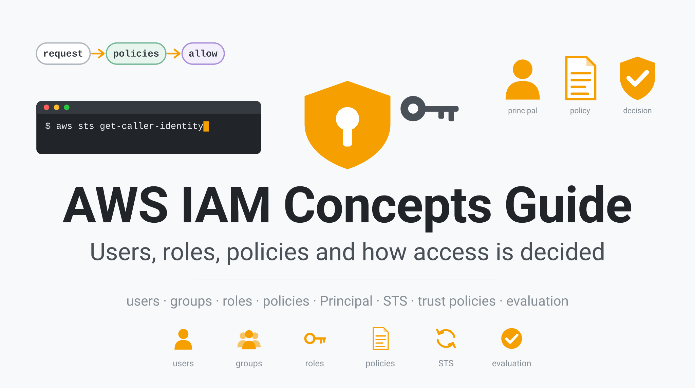</a> <a href="aws-iam-concepts-guide/index.md">AWS IAM Concepts Guide</a></td>
</tr>
<tr>
<td width="33%" valign="top"><a href="aws-lightsail/index.md">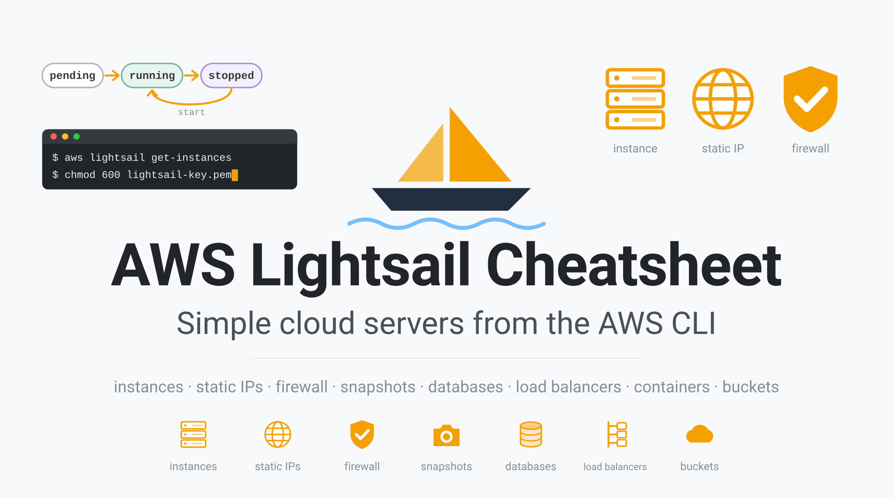</a> <a href="aws-lightsail/index.md">AWS Lightsail Cheatsheet</a></td>
</tr>
</table>

## Kubernetes

<table>
<tr>
<td width="33%" valign="top"><a href="kubernetes-crashloopbackoff-explained/index.md">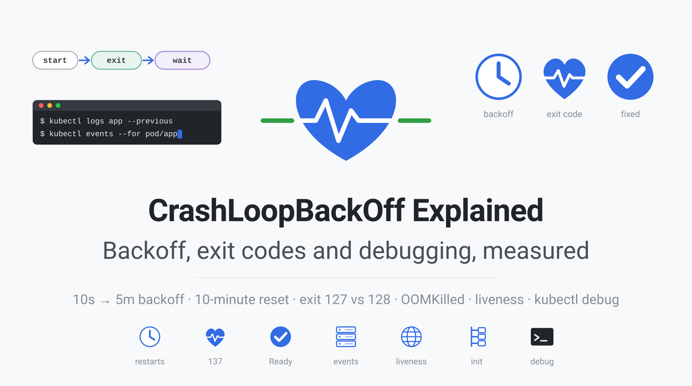</a> <a href="kubernetes-crashloopbackoff-explained/index.md">CrashLoopBackOff Explained: Backoff, Exit Codes and How to Debug It</a></td>
<td width="33%" valign="top"><a href="kubernetes-rolling-updates/index.md">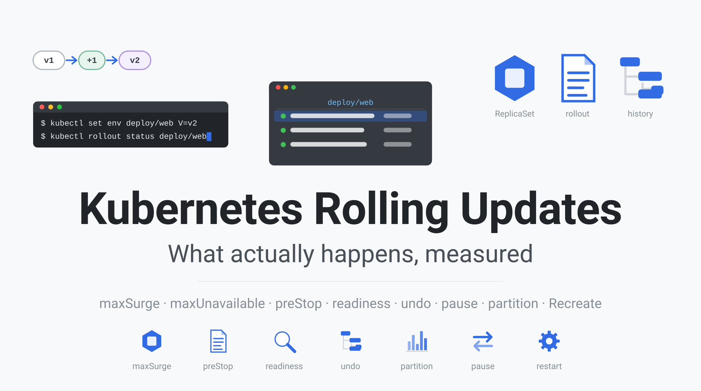</a> <a href="kubernetes-rolling-updates/index.md">Kubernetes Rolling Updates: What Actually Happens, Measured</a></td>
<td width="33%" valign="top"><a href="kubernetes-troubleshooting-techniques/index.md">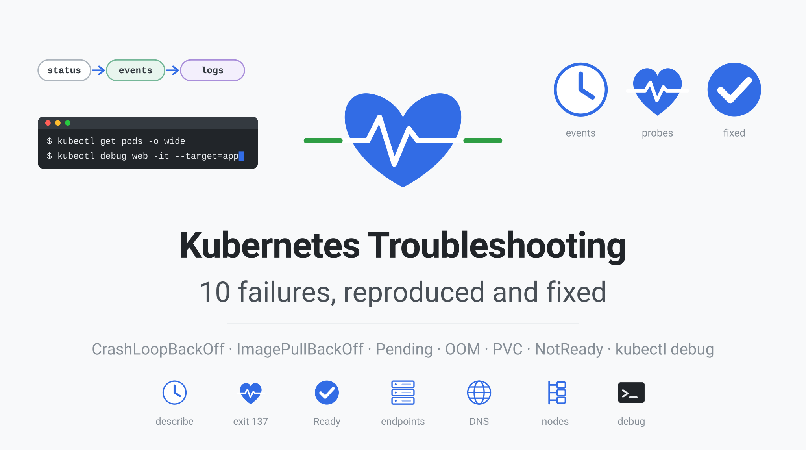</a> <a href="kubernetes-troubleshooting-techniques/index.md">Kubernetes Troubleshooting: 10 Failures, Reproduced and Fixed</a></td>
</tr>
<tr>
<td width="33%" valign="top"><a href="kubernetes-yaml-manifests-quickly/index.md">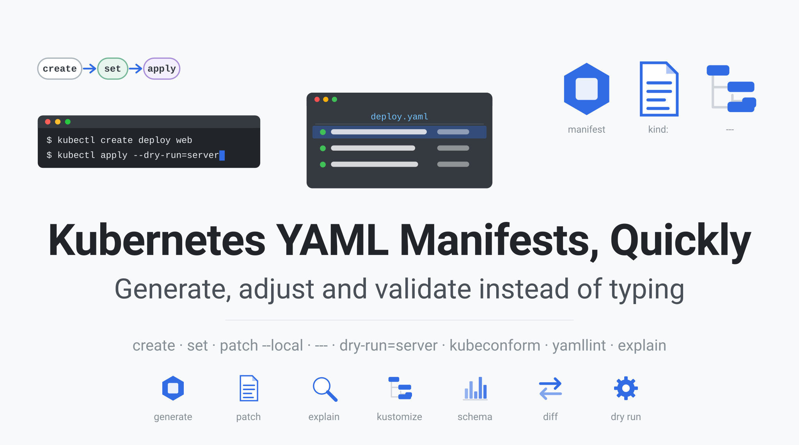</a> <a href="kubernetes-yaml-manifests-quickly/index.md">How to Create Kubernetes YAML Manifests Quickly</a></td>
<td width="33%" valign="top"><a href="argocd-cheatsheet/index.md">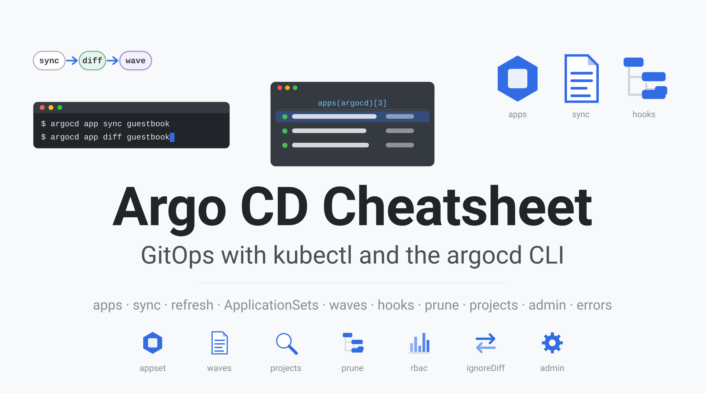</a> <a href="argocd-cheatsheet/index.md">Argo CD Cheatsheet</a></td>
<td width="33%" valign="top"><a href="kubernetes-architecture-components/index.md">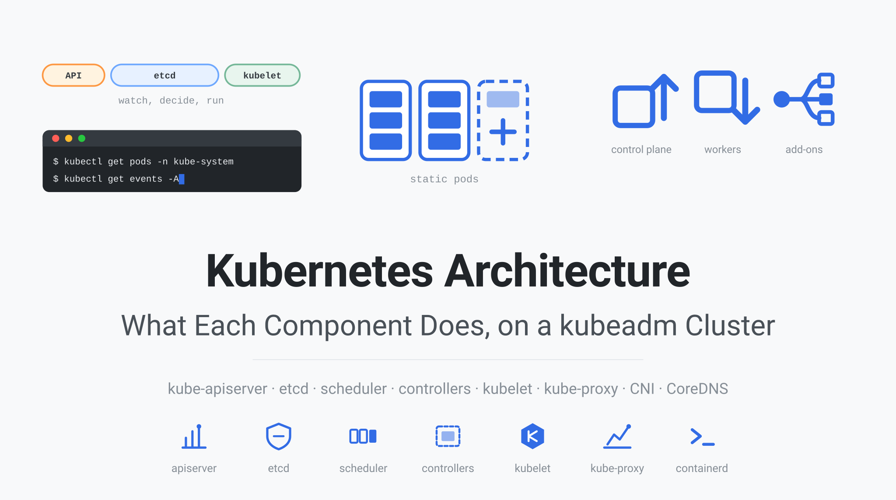</a> <a href="kubernetes-architecture-components/index.md">Kubernetes Architecture on a kubeadm Cluster: What Each Component Does</a></td>
</tr>
<tr>
<td width="33%" valign="top"><a href="kubectl-describe-vs-logs/index.md">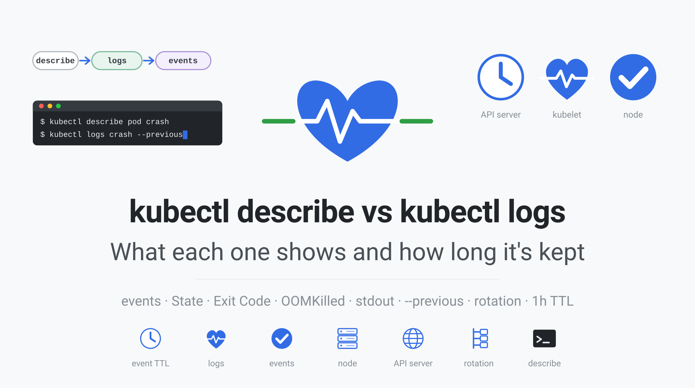</a> <a href="kubectl-describe-vs-logs/index.md">kubectl describe vs kubectl logs: What Each One Shows and How Long It&#x27;s Kept</a></td>
<td width="33%" valign="top"><a href="helm-argocd-kustomize-flux-compared/index.md">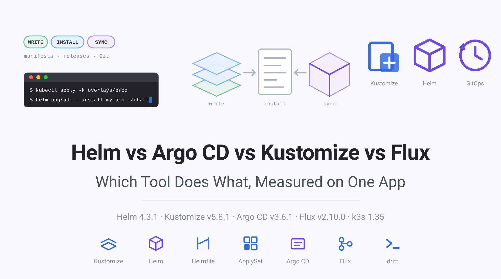</a> <a href="helm-argocd-kustomize-flux-compared/index.md">Helm vs Argo CD vs Kustomize vs Flux: Which Tool Does What</a></td>
<td width="33%" valign="top"><a href="argocd-rollback-out-of-sync/index.md">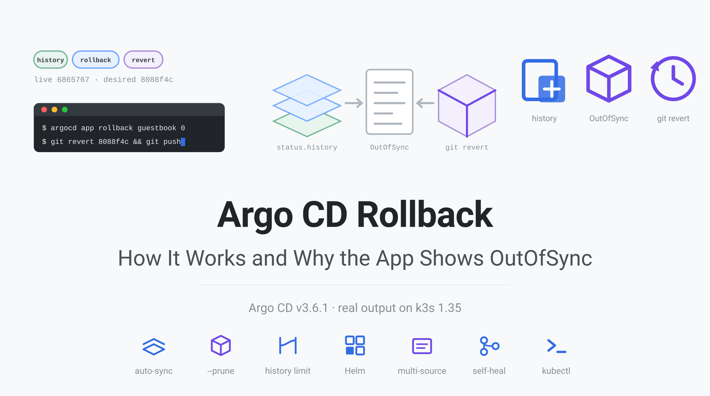</a> <a href="argocd-rollback-out-of-sync/index.md">Argo CD Rollback: How It Works and Why the App Shows OutOfSync</a></td>
</tr>
<tr>
<td width="33%" valign="top"><a href="kubernetes-cpu-memory-requests-limits/index.md">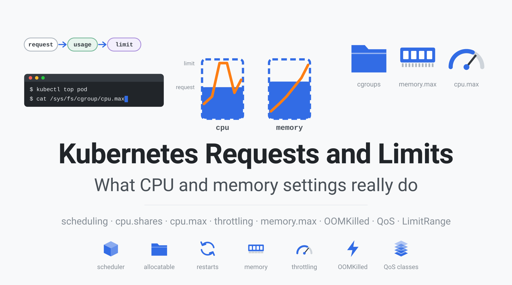</a> <a href="kubernetes-cpu-memory-requests-limits/index.md">Kubernetes CPU and Memory Requests and Limits: What Each Value Really Does</a></td>
<td width="33%" valign="top"><a href="kustomize-vs-helm/index.md">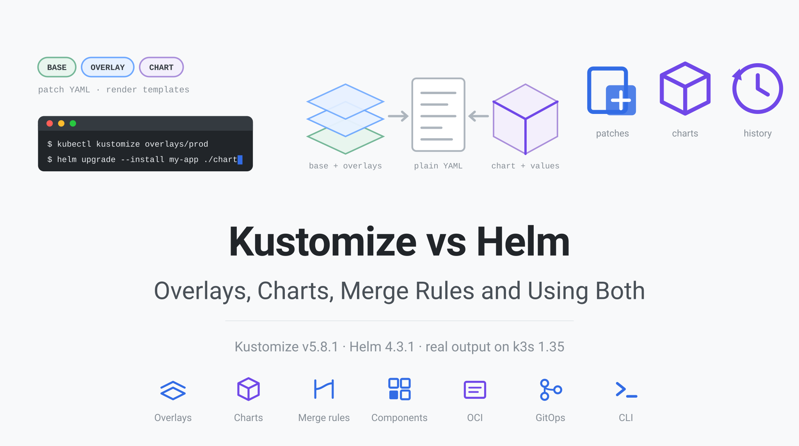</a> <a href="kustomize-vs-helm/index.md">Kustomize vs Helm: Overlays, Charts, Merge Rules and Using Both</a></td>
<td width="33%" valign="top"><a href="kubernetes-cluster-autoscaler-guide/index.md">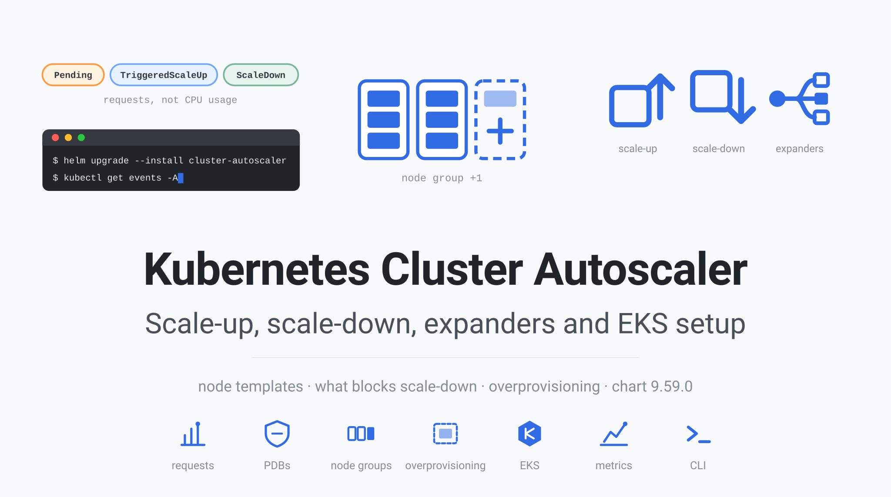</a> <a href="kubernetes-cluster-autoscaler-guide/index.md">Kubernetes Cluster Autoscaler: Scale-Up, Scale-Down, Expanders and EKS Setup</a></td>
</tr>
<tr>
<td width="33%" valign="top"><a href="helm-4-whats-new/index.md">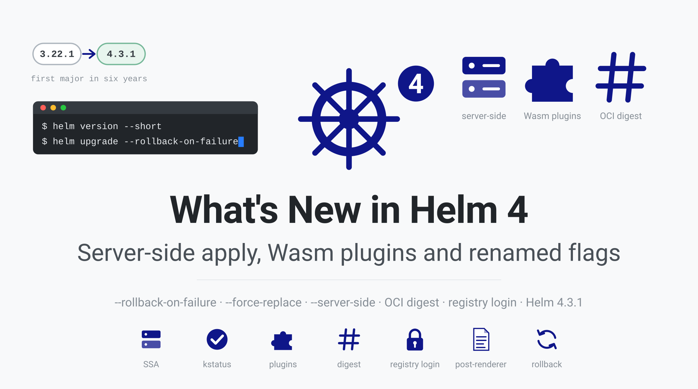</a> <a href="helm-4-whats-new/index.md">What&#x27;s New in Helm 4</a></td>
<td width="33%" valign="top"><a href="kubernetes-emptydir-volumes/index.md">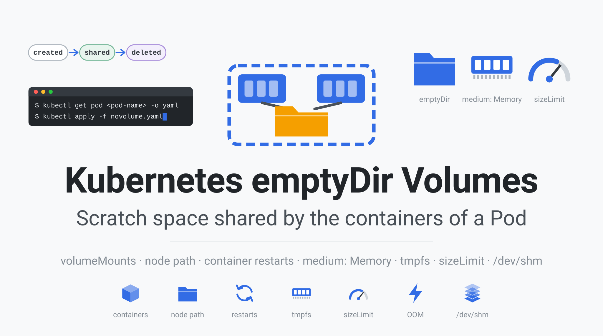</a> <a href="kubernetes-emptydir-volumes/index.md">Kubernetes emptyDir Volumes</a></td>
<td width="33%" valign="top"><a href="k9s-cheatsheet/index.md">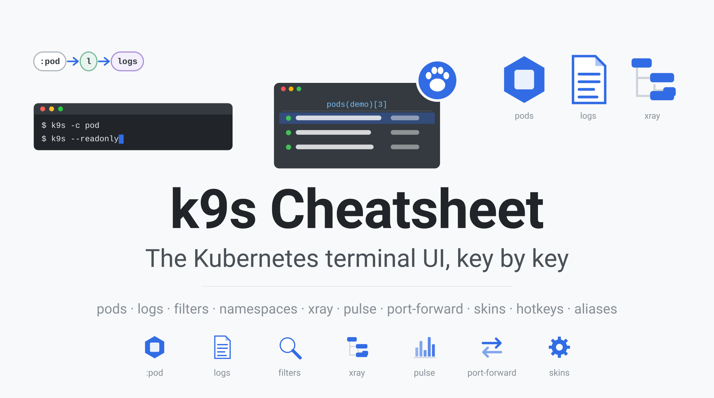</a> <a href="k9s-cheatsheet/index.md">k9s Cheatsheet</a></td>
</tr>
<tr>
<td width="33%" valign="top"><a href="helm-compare-chart-versions/index.md">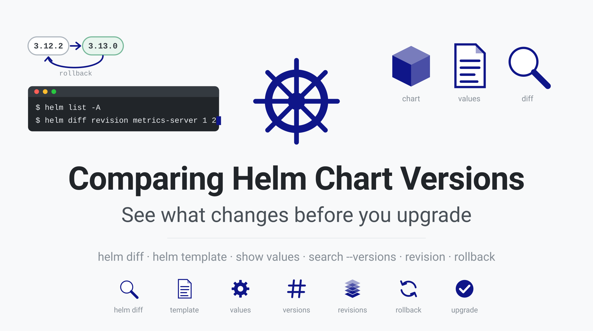</a> <a href="helm-compare-chart-versions/index.md">Comparing Helm Chart Versions Before an Upgrade</a></td>
<td width="33%" valign="top"><a href="kubernetes-health-checks-probes/index.md">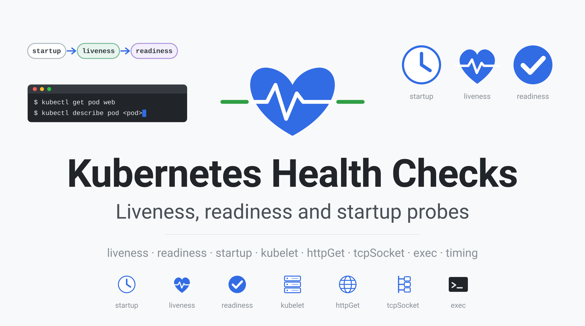</a> <a href="kubernetes-health-checks-probes/index.md">Kubernetes Health Checks: Liveness, Readiness, and Startup Probes</a></td>
<td width="33%" valign="top"><a href="helm/index.md">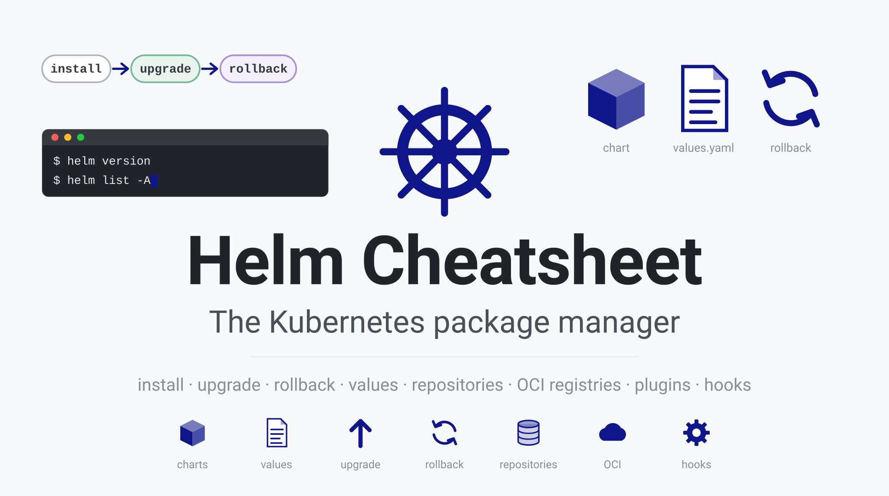</a> <a href="helm/index.md">Helm Cheatsheet</a></td>
</tr>
<tr>
<td width="33%" valign="top"><a href="kubernetes-pod-lifecycle-management/index.md">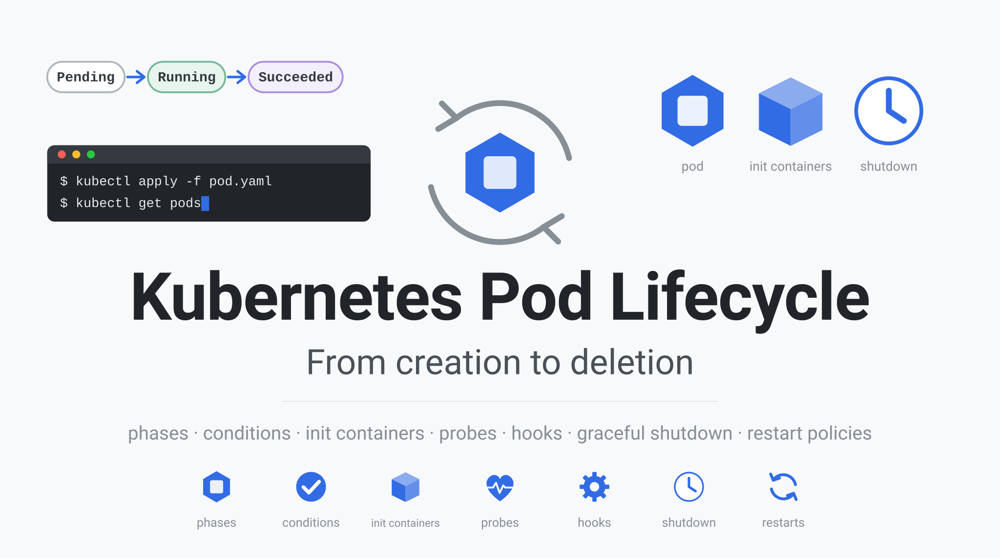</a> <a href="kubernetes-pod-lifecycle-management/index.md">Kubernetes Pod Lifecycle Management</a></td>
</tr>
</table>

## Terraform

<table>
<tr>
<td width="33%" valign="top"><a href="terraform-find-arn-and-id/index.md">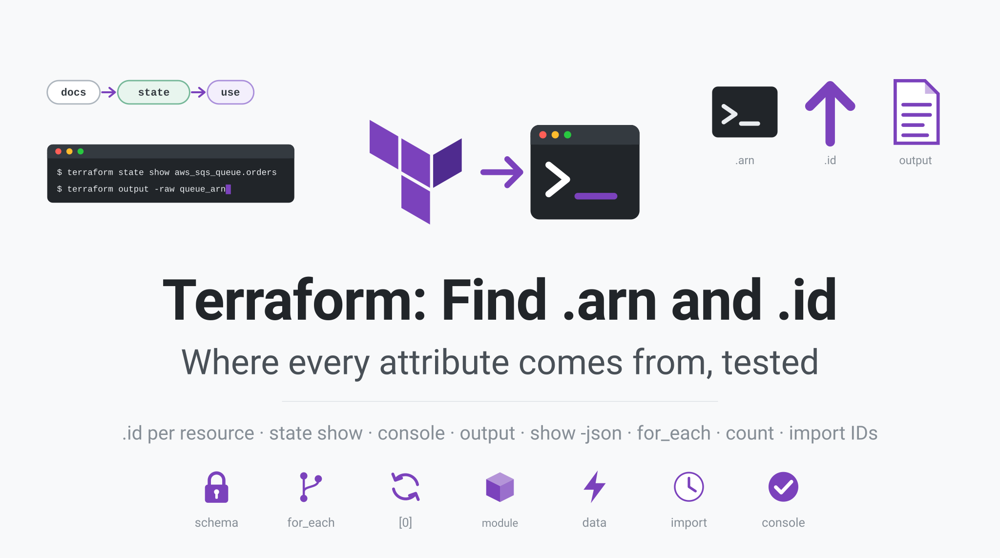</a> <a href="terraform-find-arn-and-id/index.md">Terraform: How to Find a Resource&#x27;s .arn and .id</a></td>
<td width="33%" valign="top"><a href="terraform-variables-guide/index.md">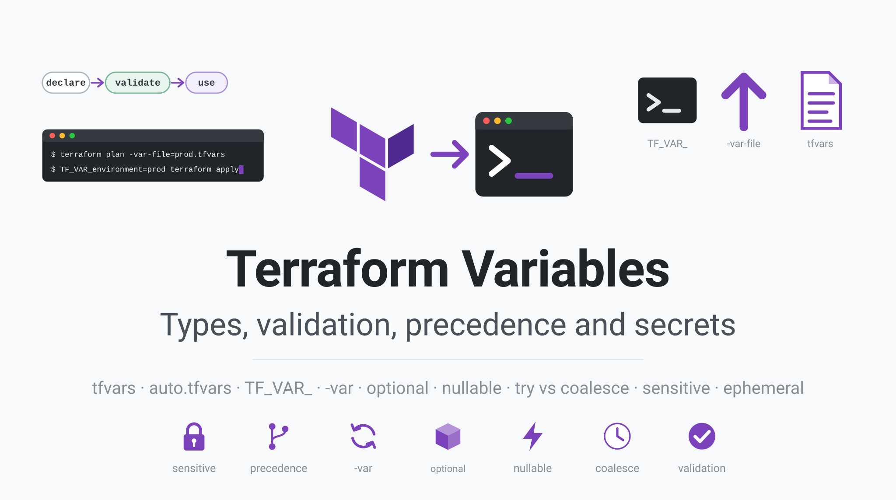</a> <a href="terraform-variables-guide/index.md">Terraform Variables: Declaration, Validation, Precedence and Sensitive Values</a></td>
<td width="33%" valign="top"><a href="terraform-provisioners-guide/index.md">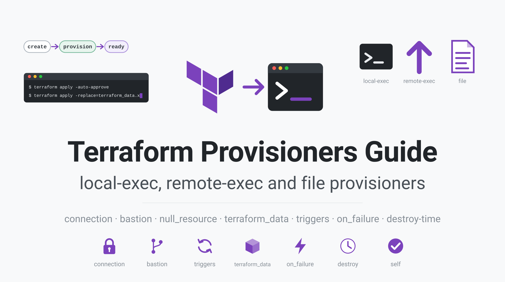</a> <a href="terraform-provisioners-guide/index.md">Terraform Provisioners Guide</a></td>
</tr>
<tr>
<td width="33%" valign="top"><a href="terraform-whats-new/index.md">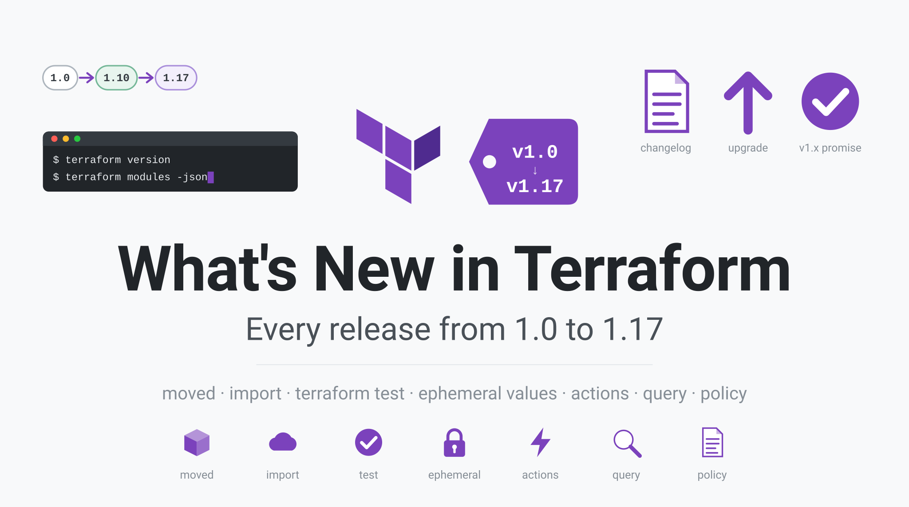</a> <a href="terraform-whats-new/index.md">What&#x27;s New in Terraform: Every Release Since 1.0</a></td>
<td width="33%" valign="top"><a href="terraform-dynamodb-table-deprecated-use-lockfile/index.md">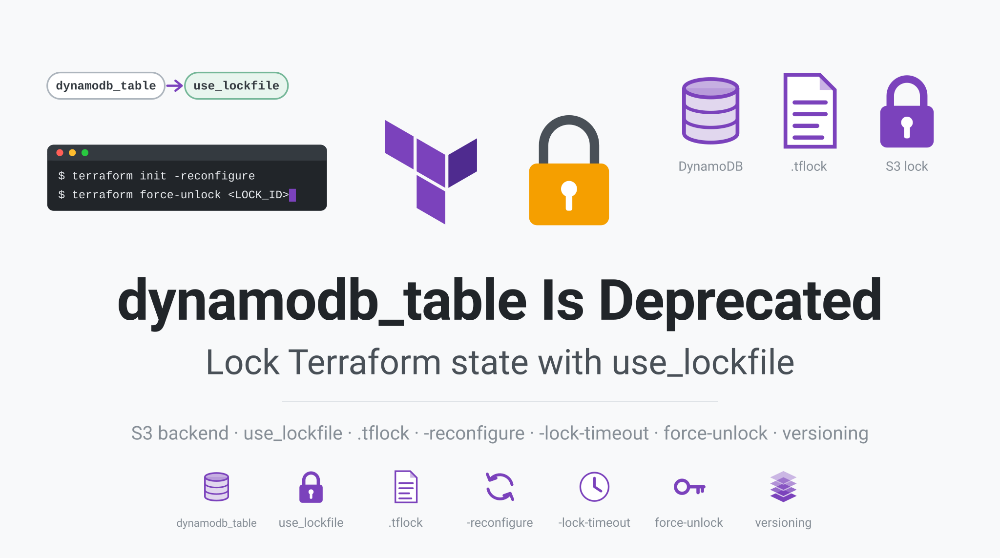</a> <a href="terraform-dynamodb-table-deprecated-use-lockfile/index.md">Terraform S3 Backend: dynamodb_table Is Deprecated, Use use_lockfile</a></td>
<td width="33%" valign="top"><a href="terraform-cheatsheet/index.md">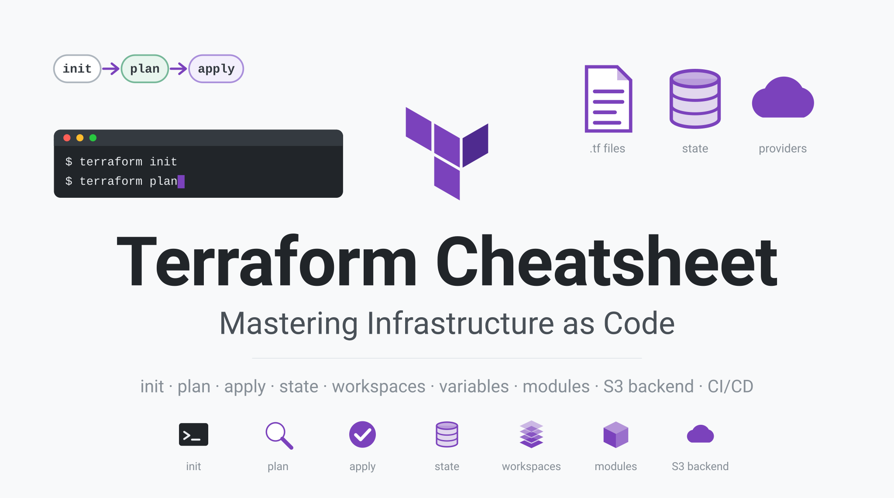</a> <a href="terraform-cheatsheet/index.md">Terraform Cheatsheet</a></td>
</tr>
<tr>
<td width="33%" valign="top"><a href="terraform-migrate-state-off-terraform-cloud/index.md">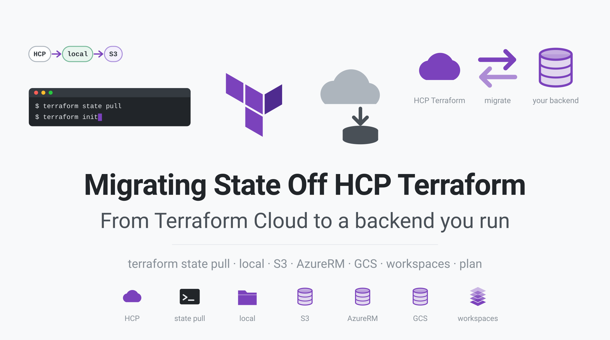</a> <a href="terraform-migrate-state-off-terraform-cloud/index.md">Migrating State Off HCP Terraform (Terraform Cloud)</a></td>
<td width="33%" valign="top"><a href="terraform-init-upgrade-and-constraints/index.md">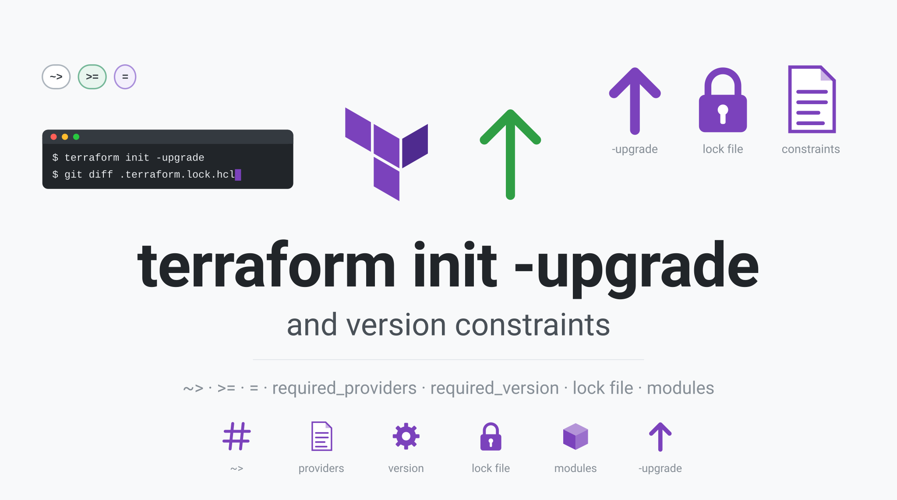</a> <a href="terraform-init-upgrade-and-constraints/index.md">terraform init -upgrade and Version Constraints</a></td>
<td width="33%" valign="top"><a href="terraform-get-update-vs-init-upgrade/index.md">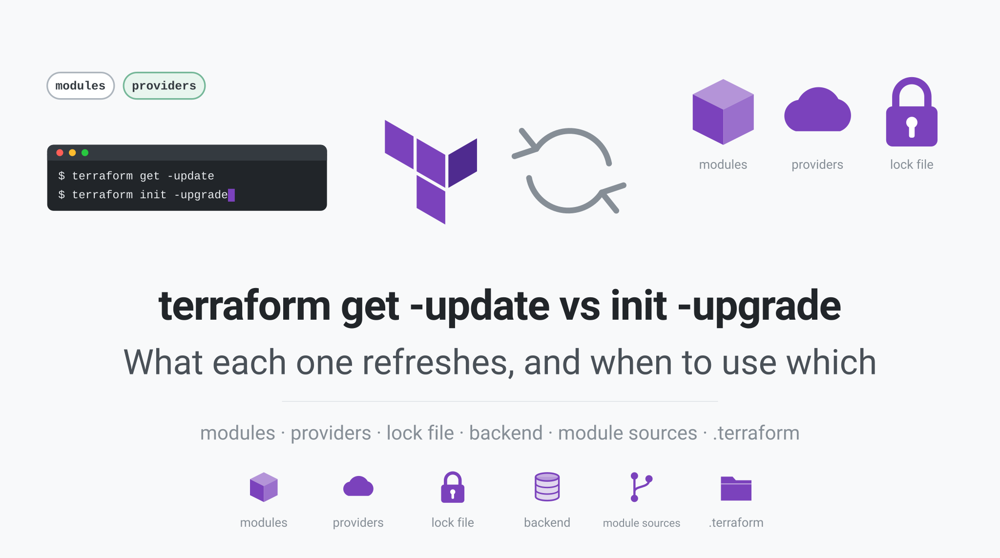</a> <a href="terraform-get-update-vs-init-upgrade/index.md">terraform get -update vs terraform init -upgrade</a></td>
</tr>
<tr>
<td width="33%" valign="top"><a href="terraform-tfstate-vs-terraform-directory-state/index.md">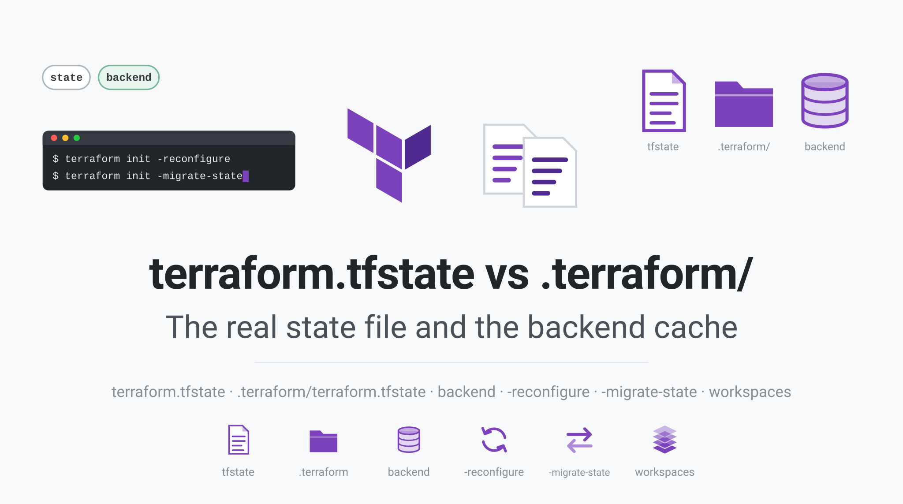</a> <a href="terraform-tfstate-vs-terraform-directory-state/index.md">terraform.tfstate vs .terraform/terraform.tfstate</a></td>
<td width="33%" valign="top"><a href="terraform-lock-file-checksums/index.md">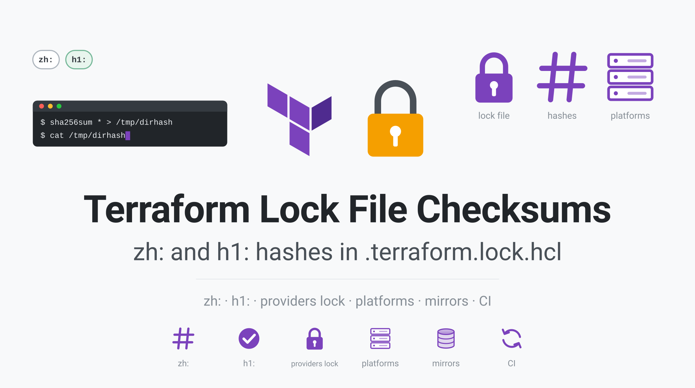</a> <a href="terraform-lock-file-checksums/index.md">Terraform Lock File Checksums: zh and h1 Hashes</a></td>
</tr>
</table>

## Docker

<table>
<tr>
<td width="33%" valign="top"><a href="docker-overlay2-storage/index.md">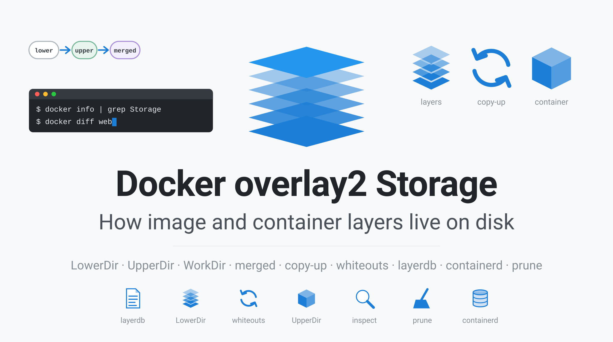</a> <a href="docker-overlay2-storage/index.md">Docker overlay2 Storage: How Image and Container Layers Live on Disk</a></td>
<td width="33%" valign="top"> <a href="container-registry-list-tags/index.md">Listing Image Tags in Docker Hub and Other Container Registries</a></td>
<td width="33%" valign="top"> <a href="docker-compose-2x-vs-5x-guide/index.md">Docker Compose 2.x vs 5.x</a></td>
</tr>
<tr>
<td width="33%" valign="top"> <a href="docker-restart-policies/index.md">Docker Restart Policies</a></td>
<td width="33%" valign="top"> <a href="docker-compose-variables-env/index.md">Defining Variables in Docker Compose: Interpolation, environment, env_file and .env</a></td>
<td width="33%" valign="top"> <a href="docker-cheatsheet/index.md">Docker Cheatsheet</a></td>
</tr>
<tr>
<td width="33%" valign="top"> <a href="docker-image-layers/index.md">How Docker Images Are Built: Layers, Cache and the Container on Top</a></td>
<td width="33%" valign="top"> <a href="docker-pull-technical-details-guide/index.md">How docker pull Works: Technical Details</a></td>
<td width="33%" valign="top"> <a href="docker-compose/index.md">Docker Compose Cheatsheet</a></td>
</tr>
</table>

## Ansible

<table>
<tr>
<td width="33%" valign="top"> <a href="ansible-adhoc-cheatsheet/index.md">Ansible Ad-Hoc Commands Cheatsheet</a></td>
<td width="33%" valign="top"> <a href="ansible-cheatsheet/index.md">Ansible Cheatsheet</a></td>
<td width="33%" valign="top"> <a href="ansible-inventory-guide/index.md">Ansible Inventory Guide</a></td>
</tr>
<tr>
<td width="33%" valign="top"> <a href="ansible-python-interpreter/index.md">Ansible and the Target&#x27;s Python: Versions by OS</a></td>
</tr>
</table>

## Linux & Bash

<table>
<tr>
<td width="33%" valign="top"> <a href="bash-escaping-special-characters/index.md">Escaping Special Characters in Bash</a></td>
<td width="33%" valign="top"> <a href="fzf-ssh-host-picker/index.md">fssh: Pick an SSH Host from ~/.ssh/config with fzf</a></td>
<td width="33%" valign="top"> <a href="cloud-init-bootcmd-vs-runcmd/index.md">cloud-init: bootcmd vs runcmd</a></td>
</tr>
<tr>
<td width="33%" valign="top"> <a href="bash-aliases-functions/index.md">Bash Aliases and Functions</a></td>
<td width="33%" valign="top"> <a href="cron-cheatsheet/index.md">Cron Cheatsheet</a></td>
<td width="33%" valign="top"> <a href="proxmenux-monitor/index.md">ProxMenux Monitor: A Web Dashboard for Proxmox VE</a></td>
</tr>
<tr>
<td width="33%" valign="top"> <a href="apt-vs-apt-get/index.md">apt vs apt-get: Differences and When to Use Each</a></td>
<td width="33%" valign="top"> <a href="user-administration/index.md">Linux User Administration Cheatsheet</a></td>
<td width="33%" valign="top"> <a href="iotop-cheatsheet/index.md">iotop Cheatsheet</a></td>
</tr>
<tr>
<td width="33%" valign="top"> <a href="linux-proc-meminfo-explained/index.md">Understanding /proc/meminfo</a></td>
<td width="33%" valign="top"> <a href="linux-swap-shm-segments/index.md">Linux Swap Usage: When Processes Aren&#x27;t the Culprit</a></td>
<td width="33%" valign="top"> <a href="linux-memory-rss-vsz/index.md">Linux Memory: RSS, VSZ, and Why RSS Alone Is Misleading</a></td>
</tr>
<tr>
<td width="33%" valign="top"> <a href="ps/index.md">Linux Processes and Signals Cheatsheet</a></td>
<td width="33%" valign="top"> <a href="mediawiki-installation-ubuntu/index.md">Installing MediaWiki on Ubuntu</a></td>
<td width="33%" valign="top"> <a href="kvm/index.md">KVM / virsh Cheatsheet</a></td>
</tr>
</table>

## Terminal & macOS

<table>
<tr>
<td width="33%" valign="top"> <a href="switch-screenshots-mac/index.md">Copying Nintendo Switch Screenshots to a Mac over USB</a></td>
<td width="33%" valign="top"> <a href="ghostty-cheatsheet/index.md">Ghostty Cheatsheet</a></td>
<td width="33%" valign="top"> <a href="alfred-5/index.md">Alfred 5 for DevOps: Launcher, Powerpack and Workflows</a></td>
</tr>
<tr>
<td width="33%" valign="top"> <a href="macos-terminal-emulators-compared/index.md">iTerm2 vs kitty vs Alacritty vs Ghostty vs Otty vs cmux</a></td>
<td width="33%" valign="top"> <a href="fzf/index.md">fzf Cheatsheet</a></td>
<td width="33%" valign="top"> <a href="tmux/index.md">tmux Cheatsheet</a></td>
</tr>
</table>
