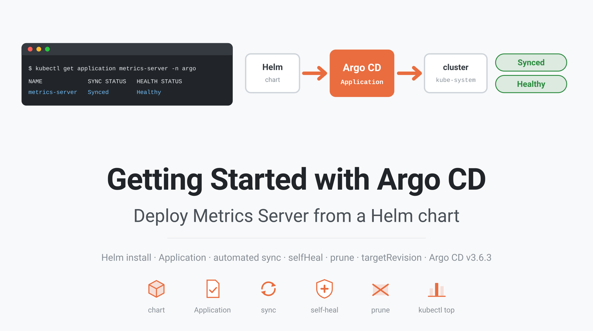

# Getting Started with Argo CD: Deploy Metrics Server from a Helm Chart



Argo CD keeps a Kubernetes cluster in the state you describe and puts it back when something drifts. This tutorial installs Argo CD with Helm and deploys a first application with it: the Kubernetes Metrics Server, from its Helm chart. Metrics Server is a good first app: it's small, most clusters need it (`kubectl top`, Horizontal Pod Autoscaling), and you can see at once whether it works.

Everything below was run on a two-node kind cluster with Kubernetes 1.37.0, Argo CD chart `argo/argo-cd` 10.20.0 (Argo CD v3.6.3), Helm 4.3.2 and kubectl 1.37.2. The Metrics Server chart goes from 3.12.2 to 3.13.0; the newest at the time of testing was 3.14.0 (Metrics Server v0.9.0).

## What You'll Learn

- How to install Argo CD with Helm and log in to its UI
- What an Argo CD `Application` manifest contains
- How to deploy a Helm chart through Argo CD
- What automated sync, self-heal and prune actually do
- How to upgrade the chart, and what to check when something is stuck

## How It Fits Together

[![Argo CD's flow for this tutorial: the Application object metrics-server in namespace argo names a Helm chart (repo, chart, version, parameters) and a destination. The repo-server downloads the chart from the Helm repository and renders it with the parameters; the application controller compares the result with what is live in kube-system and applies the difference (sync). Automated sync, self-heal and prune keep the live state matching. argocd-server serves the UI and API, reached with kubectl port-forward.](how-argocd-works.svg)](how-argocd-works.svg "Open the diagram full size")

## Prerequisites

- A Kubernetes cluster (kind, minikube, k3s, EKS, GKE, ...)
- `kubectl` connected to it
- `helm` 3 or 4

## Why Metrics Server?

Metrics Server collects CPU and memory usage from each node's kubelet and serves it through the Kubernetes API (`metrics.k8s.io`). That's what `kubectl top nodes`, `kubectl top pods` and the Horizontal Pod Autoscaler use. kind ships without it: before this tutorial, `kubectl top` doesn't work there.

## Step 1: Install Argo CD

```bash
helm repo add argo https://argoproj.github.io/argo-helm
helm repo update argo
```

```bash
helm install argo argo/argo-cd --version 10.20.0 -n argo --create-namespace
```

Wait for **all** Argo CD deployments. Waiting only for `argo-argocd-server` isn't enough: when it was ready, the repo-server, which downloads charts, still wasn't:

```
$ kubectl wait --for=condition=available --timeout=300s deployment/argo-argocd-server -n argo
deployment.apps/argo-argocd-server condition met

$ kubectl get deploy -n argo
NAME                                    READY   UP-TO-DATE   AVAILABLE   AGE
argo-argocd-applicationset-controller   1/1     1            1           12s
argo-argocd-dex-server                  1/1     1            1           12s
argo-argocd-notifications-controller    1/1     1            1           12s
argo-argocd-redis                       1/1     1            1           12s
argo-argocd-repo-server                 0/1     1            0           12s
argo-argocd-server                      1/1     1            1           12s
```

```bash
kubectl wait --for=condition=available --timeout=300s deployment --all -n argo
```

The application controller runs as a StatefulSet (`argo-argocd-application-controller`), so it isn't in that list. The names all start with `argo-argocd-` because the Helm release is called `argo`.

### Access the Argo CD UI

The initial `admin` password is in a Secret:

```bash
kubectl -n argo get secret argocd-initial-admin-secret \
  -o jsonpath="{.data.password}" | base64 -d
```

Forward the UI to your machine:

```
$ kubectl port-forward service/argo-argocd-server -n argo 8080:443
Forwarding from 127.0.0.1:8080 -> 8080
Forwarding from [::1]:8080 -> 8080
```

(The Service's port 443 points at port 8080 in the pod; that's the second number.) Open <https://localhost:8080>, accept the self-signed certificate, and log in as `admin` with that password. In the test the UI answered `200`, a login with the password through the API (`POST /api/v1/session`) returned a session token, and `/api/version` reported `Argo CD v3.6.3`.

Change the password after the first login, then delete `argocd-initial-admin-secret`: Argo CD only uses it to show you the first password.

## Step 2: The Application Manifest

Argo CD deploys what an `Application` object describes. This one deploys the Metrics Server chart:

```yaml
apiVersion: argoproj.io/v1alpha1
kind: Application
metadata:
  name: metrics-server
  namespace: argo
spec:
  project: default
  source:
    repoURL: https://kubernetes-sigs.github.io/metrics-server/
    targetRevision: 3.12.2
    helm:
      parameters:
        - name: args[0]
          value: '--kubelet-insecure-tls'
    chart: metrics-server
  destination:
    server: https://kubernetes.default.svc
    namespace: kube-system
  syncPolicy:
    automated:
      prune: true
      selfHeal: true
    syncOptions:
      - CreateNamespace=true
```

### Metadata

- `name`: the application's name in Argo CD.
- `namespace`: Applications go in the namespace Argo CD is installed in (`argo` here). Argo CD only watches its own namespace unless it's configured otherwise.

### Source

- `repoURL`: the **Helm repository** the chart comes from. It isn't a Git repository: for a chart, `repoURL` plus `chart` work like `helm repo add` plus the chart name.
- `chart`: the chart's name in that repository.
- `targetRevision`: the chart version.
- `helm.parameters`: values for the chart, like `helm install --set`. `args[0]` is the chart's `args` list, which the chart appends after its default arguments.

### Destination

- `server`: the cluster to deploy to. `https://kubernetes.default.svc` is the cluster Argo CD runs in.
- `namespace`: where the chart's resources go.

### Sync Policy

- `automated`: sync on its own when the desired state changes, instead of waiting for someone to press Sync.
- `selfHeal`: also sync when the **live** state drifts, for example after a manual `kubectl` change.
- `prune`: delete resources that are no longer part of the desired state.
- `syncOptions: CreateNamespace=true`: create the destination namespace if it's missing (`kube-system` always exists, so it does nothing here).

### Why `--kubelet-insecure-tls`?

Metrics Server connects to every kubelet over HTTPS and checks its certificate. On kind (and other local clusters) the kubelets use self-signed certificates without the node's IP address in them. Without the flag, the new Metrics Server pod logs:

```
E1127 09:26:53.332100       1 scraper.go:149] "Failed to scrape node" err="Get \"https://172.18.0.3:10250/metrics/resource\": tls: failed to verify certificate: x509: cannot validate certificate for 172.18.0.3 because it doesn't contain any IP SANs" node="argo
```

and never becomes ready (see [Stuck in Progressing](#application-stays-synced-progressing)). Managed clusters such as EKS and GKE have proper kubelet certificates and don't need the flag; in production, fix the certificates instead of skipping the check.

## Step 3: Deploy Metrics Server

Save the manifest as `metrics-server-app.yaml` and apply it:

```
$ kubectl apply -f metrics-server-app.yaml -n argo
application.argoproj.io/metrics-server created
```

Argo CD downloads the chart, renders it with the parameter, applies the result to `kube-system`, and keeps watching it. Sync and health, every 5 seconds:

```
11:24:54
11:24:59 Synced Progressing
11:25:04 Synced Progressing
11:25:09 Synced Progressing
11:25:14 Synced Progressing
11:25:19 Synced Healthy
```

**Synced** means the live resources match the chart; **Healthy** means they're also working (here: the Deployment's pod is ready). It took 25 seconds.

## Step 4: Verify the Deployment

### The Application

```
$ kubectl get application metrics-server -n argo
NAME             SYNC STATUS   HEALTH STATUS
metrics-server   Synced        Healthy

$ kubectl get application metrics-server -n argo -o wide
NAME             SYNC STATUS   HEALTH STATUS   REVISION   PROJECT
metrics-server   Synced        Healthy         3.12.2     default
```

### The Pod

```
$ kubectl get pods -n kube-system | grep -E "NAME|metrics-server"
NAME                                         READY   STATUS    RESTARTS   AGE
metrics-server-7d847ddbf9-wlt6f              1/1     Running   0          30s
```

The chart ran image `registry.k8s.io/metrics-server/metrics-server:v0.7.2` with the parameter added after the chart's defaults:

```
["--secure-port=10250","--cert-dir=/tmp","--kubelet-preferred-address-types=InternalIP,ExternalIP,Hostname","--kubelet-use-node-status-port","--metric-resolution=15s","--kubelet-insecure-tls"]
```

### The Metrics API

```
$ kubectl top nodes
NAME                 CPU(cores)   CPU(%)   MEMORY(bytes)   MEMORY(%)
argo-control-plane   213m         5%       944Mi           15%
argo-worker          171m         4%       644Mi           10%
```

It worked on the first try, 30 seconds after the pod started. `kubectl top pods -n argo` works too and shows what Argo CD itself uses:

```
NAME                                                     CPU(cores)   MEMORY(bytes)
argo-argocd-applicationset-controller-868b4765ff-2btk6   1m           28Mi
argo-argocd-dex-server-644c5cdc47-sk6kp                  1m           111Mi
argo-argocd-redis-5cc474695d-wmxw7                       3m           5Mi
argo-argocd-repo-server-5b47fbc97f-vhzkk                 2m           27Mi
```

## Step 5: The Argo CD UI

Log in to the UI (port-forward as in Step 1). The **Applications** page shows one card per application:

[](argocd-resource-tree.png "Open the screenshot full size")

The card repeats the Application manifest: the Helm repository, chart and version (`3.12.2`), and the destination (`in-cluster` is Argo CD's name for `https://kubernetes.default.svc`). **Status** is the same pair as `kubectl get application`: `Healthy` and `Synced`. This screenshot is from Argo CD v3.2.5; v3.6.3, used for the rest of this article, has the same page.

Click the card to open the application. In v3.6.3, after the [upgrade](#upgrading-the-chart) below, it showed:

- **App health / Sync status:** `Healthy`, and `Synced` to `3.13.0`; **Last sync:** `Sync OK`.
- **Resource tree:** everything the chart created (Service, ServiceAccount, the `v1beta1.metrics.k8s.io` APIService, Deployment, ClusterRoles, ClusterRoleBindings, RoleBinding), and to the right of the Deployment its ReplicaSets, one per rollout. The Application node has a `1 parameter override(s)` badge: the `--kubelet-insecure-tls` parameter.
- **History and Rollback**, **Diff**, and each resource's events and pod logs are a click away.

## What Self-Heal and Prune Do

### Self-Heal

Someone scales the Deployment by hand:

```
$ kubectl scale deploy metrics-server -n kube-system --replicas=3
deployment.apps/metrics-server scaled
11:25:37 replicas=3 sync=OutOfSync
11:25:39 replicas=1 sync=Synced
```

Two seconds later Argo CD had put it back to the chart's 1 replica, with these events on the Application:

```
ResourceUpdated      Updated health status: Healthy -> Progressing (Caused by apps/Deployment:kube-system/metrics-server)
OperationCompleted   Partial sync operation to 3.12.2 succeeded
ResourceUpdated      Updated sync status: OutOfSync -> Synced
ResourceUpdated      Updated health status: Progressing -> Healthy
```

Manual changes to managed resources don't last while `selfHeal` is on. Change the Application (or the files it points to) instead.

### Prune

Adding two parameters to the Application turns on the chart's PodDisruptionBudget:

```yaml
        - name: podDisruptionBudget.enabled
          value: 'true'
        - name: podDisruptionBudget.minAvailable
          value: '1'
```

```
== with PDB parameter:
NAME             MIN AVAILABLE   MAX UNAVAILABLE   ALLOWED DISRUPTIONS   AGE
metrics-server   1               N/A               0                     12s
== parameter removed again:
No resources found in kube-system namespace.
```

Removing the parameters removed the PDB. Without `prune: true`, it would stay in the cluster and the app would show `OutOfSync`.

## Upgrading the Chart

Change `targetRevision` and apply the manifest again:

```yaml
  source:
    targetRevision: 3.13.0  # Changed from 3.12.2
```

```
$ kubectl apply -f metrics-server-app.yaml -n argo
application.argoproj.io/metrics-server configured
11:26:16 Synced Healthy 3.12.2
11:26:19 Synced Progressing 3.13.0
...
11:26:44 Synced Healthy 3.13.0
```

Argo CD downloaded chart 3.13.0 and the Deployment did a rolling update to `registry.k8s.io/metrics-server/metrics-server:v0.8.0`; the old ReplicaSet was scaled to 0:

```
NAME                        DESIRED   CURRENT   READY   AGE
metrics-server-6cbdc6469d   1         1         1       27s
metrics-server-7d847ddbf9   0         0         0       109s
```

Each sync is in the Application's history, which **History and Rollback** in the UI shows:

```
$ kubectl get application metrics-server -n argo -o jsonpath='{range .status.history[*]}{.id} {.revision} {.deployedAt}{"\n"}{end}'
0 3.12.2 2026-11-27T09:24:55Z
1 3.12.2 2026-11-27T09:25:46Z
2 3.12.2 2026-11-27T09:25:58Z
3 3.13.0 2026-11-27T09:26:17Z
```

(Entries 1 and 2 are the prune test.)

## Troubleshooting

### Application Stays `Synced Progressing`

Removing `--kubelet-insecure-tls` on kind:

```
NAME             SYNC STATUS   HEALTH STATUS
metrics-server   Synced        Progressing

NAME                              READY   STATUS    RESTARTS   AGE
metrics-server-578d78f945-7vdkb   0/1     Running   0          75s
metrics-server-6cbdc6469d-8gdvr   1/1     Running   0          110s
```

The new pod never got ready (the `x509 ... doesn't contain any IP SANs` error above), so the rolling update stopped halfway: the **old pod kept running**, and `kubectl top nodes` still worked. Nothing looks broken except the health. `Synced` only says the cluster matches the chart; `Progressing` that has lasted minutes means a rollout that isn't finishing. Look at the new pod:

```bash
kubectl describe pod -n kube-system -l app.kubernetes.io/name=metrics-server
```

```bash
kubectl logs -n kube-system -l app.kubernetes.io/name=metrics-server
```

Putting the parameter back finished the rollout within seconds.

### Application Shows `OutOfSync`

With `automated` and `selfHeal`, an `OutOfSync` that doesn't go away on its own means the sync is failing: the reason is in the UI or in `.status.operationState.message`. Without automated sync, `OutOfSync` is normal until someone syncs. Press **Sync** in the UI, or start a sync with kubectl. With automated sync turned off and the Deployment scaled to 2 by hand:

```
$ kubectl get application metrics-server -n argo
NAME             SYNC STATUS   HEALTH STATUS
metrics-server   OutOfSync     Progressing

$ kubectl patch application metrics-server -n argo \
    --type merge -p '{"operation":{"initiatedBy":{"username":"admin"},"sync":{}}}'
application.argoproj.io/metrics-server patched
11:28:32 OutOfSync Progressing Running replicas=2
11:28:34 Synced Healthy Succeeded replicas=1
```

```
$ kubectl get application metrics-server -n argo -o jsonpath='{.status.operationState.message} (initiated by {.status.operationState.operation.initiatedBy.username})'
successfully synced (all tasks run) (initiated by admin)
```

### Metrics Not Available

`kubectl top` answered 30 seconds after the pod started. If it says `Metrics API not available` for longer, check the pod's logs as above: the usual cause is the kubelet certificate error.

## Best Practices

### Pin the Chart Version

A semver range in `targetRevision` is allowed, and Argo CD resolves it every time it checks the repository. `'*'` means "the newest chart". Set on the running app, it upgraded straight away:

```
11:28:41 Synced Healthy 3.13.0
11:28:44 Synced Progressing 3.14.0
...
11:29:06 Synced Healthy 3.14.0
```

to image `registry.k8s.io/metrics-server/metrics-server:v0.9.0`. With automated sync, every new chart release is deployed as soon as it's published. Pin an exact version (`3.13.0`) and change it on purpose.

### Keep the Application in Git

So far the Application itself was applied with `kubectl`, and the chart came from a Helm repository: nothing is in Git yet. To make it GitOps, commit `metrics-server-app.yaml` (and later your own manifests or values files) to a repository and let Argo CD apply it, for example with an "app of apps" that points to the folder holding your Applications. Then every change goes through a commit and a review, and Git history is your audit trail.

### Use Projects

`project: default` allows any source and any destination. As you add applications, create Projects that limit which repositories, clusters and namespaces each team can deploy to:

```yaml
spec:
  project: monitoring  # instead of 'default'
```

### Remove the Initial Admin Secret

After you've changed the `admin` password (or set up SSO), delete `argocd-initial-admin-secret`.

## Next Steps

1. **Deploy more applications:** Prometheus, Grafana, or your own manifests from a Git repository.
2. **App of apps:** one parent Application that creates the others from a folder in Git.
3. **Several environments:** one folder (or values file) per environment rather than one branch per environment.
4. **CI integration:** let CI change the version in Git and Argo CD deploy it.
5. **ApplicationSets:** generate Applications for many clusters or directories from one template.

## See Also

- [Argo CD documentation](https://argo-cd.readthedocs.io/en/stable/)
- [Argo CD Helm chart](https://github.com/argoproj/argo-helm/tree/main/charts/argo-cd)
- [Metrics Server](https://github.com/kubernetes-sigs/metrics-server)
- [Argo CD Cheatsheet](../argocd-cheatsheet/index.md)
- [Argo CD Rollback: How It Works and Why the App Shows OutOfSync](../argocd-rollback-out-of-sync/index.md)
- [Helm vs Argo CD vs Kustomize vs Flux: Which Tool Does What](../helm-argocd-kustomize-flux-compared/index.md)
- [Kubernetes Vertical Pod Autoscaler (VPA)](../kubernetes-vpa-guide/index.md)
