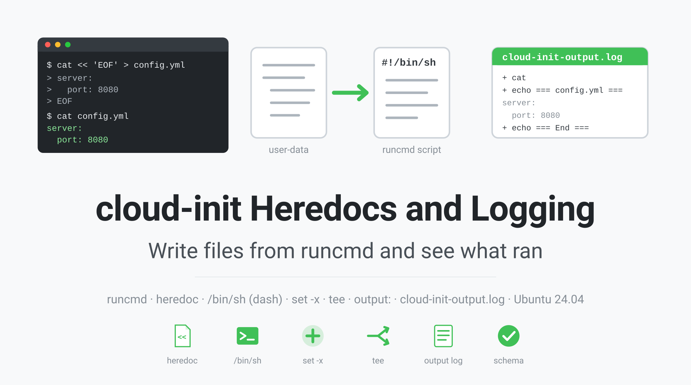
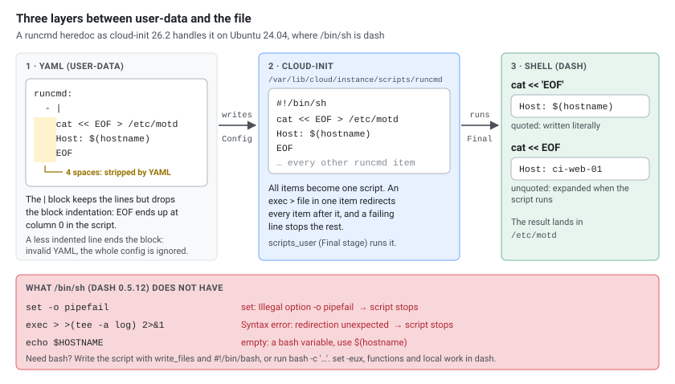
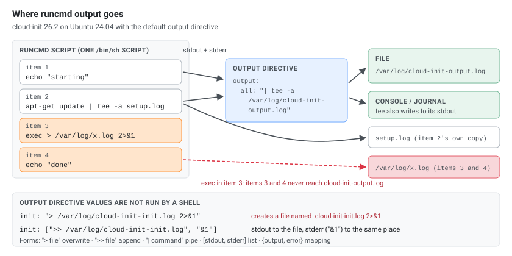

# cloud-init Heredocs and Logging



Patterns for writing files with heredocs in cloud-init user-data, capturing script output in log files, and debugging what cloud-init ran. Every example below was booted with cloud-init 26.2 on Ubuntu 24.04.5 (NoCloud datasource), where `/bin/sh` is `dash` 0.5.12. For when `bootcmd` and `runcmd` run, see [cloud-init: bootcmd vs runcmd](../cloud-init-bootcmd-vs-runcmd/index.md).

## How runcmd Runs Your Heredoc

A heredoc in `runcmd` passes through three layers before a file appears on disk, and each one has its own rules:

[](heredoc-layers.svg "Open the diagram full size")

1. **YAML.** The `|` block scalar keeps the lines as they are and strips the indentation of the block, so the heredoc lines, including the closing `EOF`, start at column 0 in the script.
2. **cloud-init.** The `runcmd` module (Config stage) writes **all** items into one script, `/var/lib/cloud/instance/scripts/runcmd`, and the `scripts_user` module (Final stage) runs it. The script starts with `#!/bin/sh`.
3. **The shell.** On Ubuntu `/bin/sh` is `dash`, not bash. A quoted delimiter (`'EOF'`) keeps `$VAR` and `$(cmd)` literal; an unquoted one expands them when the script runs.

This is the script cloud-init built from the first example below:

```
#!/bin/sh
cat << 'EOF' > /etc/myapp/config.yml
server:
  host: 0.0.0.0
  port: 8080
database:
  host: localhost
  name: myapp
EOF
```

Because it is `dash`, bash-only syntax fails, and a failure ends the whole script:

| In runcmd | Result under `/bin/sh` (dash 0.5.12) |
|---|---|
| `set -o pipefail` | `set: Illegal option -o pipefail`, script stops |
| `exec > >(tee -a /var/log/x.log) 2>&1` | `Syntax error: redirection unexpected`, script stops |
| `$HOSTNAME` | Empty: it's a bash variable, `dash` doesn't set it. Use `$(hostname)` |
| `local rc=$?` inside a function | Works (`dash` supports `local`) |

When a script needs bash, write it with `write_files` and a `#!/bin/bash` line, or call `bash` explicitly. Both are shown below.

## Heredocs in runcmd

### Basic Heredoc to Create a File

```yaml
#cloud-config
runcmd:
  - |
    mkdir -p /etc/myapp
    cat << 'EOF' > /etc/myapp/config.yml
    server:
      host: 0.0.0.0
      port: 8080
    database:
      host: localhost
      name: myapp
    EOF
```

Create the directory first. Without `mkdir -p` the first boot ended with `cloud-init status` reporting `error` and this in `/var/log/cloud-init-output.log`:

```
/var/lib/cloud/instance/scripts/runcmd: 2: cannot create /etc/myapp/config.yml: Directory nonexistent
```

### Heredoc with Variable Expansion

```yaml
#cloud-config
runcmd:
  - |
    HOSTNAME=$(hostname)
    INSTANCE_ID=$(cloud-init query instance-id)
    cat << EOF > /etc/motd
    ==========================================
    Hostname: ${HOSTNAME}
    Instance: ${INSTANCE_ID}
    Built:    $(date)
    ==========================================
    EOF
```

The unquoted `EOF` expands the variables and `$(date)` when the script runs: `/etc/motd` got the instance's hostname, its instance ID from the datasource and the boot time. Setting `HOSTNAME` yourself is what makes it work under `dash`.

### Heredoc Without Variable Expansion (Quoted EOF)

```yaml
#cloud-config
runcmd:
  - |
    cat << 'EOF' > /usr/local/bin/health-check.sh
    #!/bin/bash
    STATUS=$(curl -s -o /dev/null -w "%{http_code}" http://localhost:8080/health)
    if [ "$STATUS" != "200" ]; then
        echo "UNHEALTHY: HTTP $STATUS" | logger -t health-check
        exit 1
    fi
    EOF
    chmod +x /usr/local/bin/health-check.sh
```

With `'EOF'` the script landed on disk exactly as written: `$(curl ...)` and `$STATUS` stay for the health check to evaluate later.

### Appending with Heredoc

```yaml
#cloud-config
runcmd:
  - |
    cat << 'EOF' >> /etc/sysctl.d/99-custom.conf
    net.core.somaxconn = 65535
    net.ipv4.tcp_max_syn_backlog = 65535
    vm.swappiness = 10
    EOF
    sysctl --system
```

`sysctl net.core.somaxconn vm.swappiness` returned `65535` and `10` afterwards. `>>` appends on **every** run: after a second instance boot and one manual re-run, each line was in the file three times. For a file you own completely, write it with `>` instead (see [Appending Duplicates on Re-Run](#appending-duplicates-on-re-run)).

## Logging Patterns

### Redirect All Output to a Log File

```yaml
#cloud-config
runcmd:
  - |
    exec > /var/log/cloud-init-custom.log 2>&1
    set -x
    echo "=== Starting custom setup at $(date) ==="
    apt-get update
    apt-get install -y nginx
    systemctl enable nginx
    echo "=== Completed at $(date) ==="
```

Everything, including the `set -x` trace, went to the file; `cloud-init-output.log` got nothing from `runcmd`. The trace shows the command substitution too:

```
+ date
+ echo === Starting custom setup at Wed Nov 25 15:00:59 EET 2026 ===
=== Starting custom setup at Wed Nov 25 15:00:59 EET 2026 ===
+ apt-get update
```

> **Note:** `exec >` changes the output of the whole script, and all `runcmd` items are one script. In a test with three items, an `exec > /var/log/item2.log 2>&1` in the second item sent the third item's output to `item2.log` as well; only the first item reached `cloud-init-output.log`. Put the `exec` in the last item, or in a `write_files` script, if other items should still log to the console.

### Log Individual Commands

```yaml
#cloud-config
runcmd:
  - echo "Starting package install" | tee -a /var/log/setup.log
  - apt-get update >> /var/log/setup.log 2>&1
  - apt-get install -y nginx >> /var/log/setup.log 2>&1
  - echo "Package install done" | tee -a /var/log/setup.log
```

Only the two `tee` lines reached `cloud-init-output.log`; the apt output went to the file only.

### Structured Logging Function

```yaml
#cloud-config
runcmd:
  - |
    LOG_FILE="/var/log/cloud-init-custom.log"

    log() {
        echo "[$(date '+%Y-%m-%d %H:%M:%S')] $*" | tee -a "$LOG_FILE"
    }

    log "Starting instance configuration"
    log "Installing packages..."
    apt-get update -qq >> "$LOG_FILE" 2>&1
    apt-get install -y nginx certbot >> "$LOG_FILE" 2>&1
    log "Packages installed"

    log "Configuring nginx..."
    systemctl enable --now nginx >> "$LOG_FILE" 2>&1
    log "Configuration complete"
```

The five `log` lines appear both in the file and in `cloud-init-output.log`. Shell functions work in `dash`.

### Logging with Exit Status

```yaml
#cloud-config
runcmd:
  - |
    LOG="/var/log/cloud-init-custom.log"

    run_cmd() {
        echo "[$(date '+%H:%M:%S')] Running: $*" >> "$LOG"
        "$@" >> "$LOG" 2>&1
        local rc=$?
        if [ $rc -ne 0 ]; then
            echo "[$(date '+%H:%M:%S')] FAILED (exit $rc): $*" >> "$LOG"
        else
            echo "[$(date '+%H:%M:%S')] OK: $*" >> "$LOG"
        fi
        return $rc
    }

    run_cmd apt-get update
    run_cmd apt-get install -y docker.io
    run_cmd systemctl enable docker
    run_cmd systemctl start docker
```

The log from the test boot:

```
[15:01:16] Running: apt-get update
[15:01:17] OK: apt-get update
[15:01:17] Running: apt-get install -y docker.io
[15:01:23] OK: apt-get install -y docker.io
[15:01:23] Running: systemctl enable docker
[15:01:23] OK: systemctl enable docker
[15:01:23] Running: systemctl start docker
[15:01:23] OK: systemctl start docker
```

`run_cmd` returns the exit code but nothing stops on it: without `set -e` a failed step is logged and the script carries on.

## Cloud-Init Output Directive

The `output` directive controls where cloud-init sends the stdout and stderr of its stages, including everything `runcmd` prints. The default on Ubuntu is `all: "| tee -a /var/log/cloud-init-output.log"`.

[](output-flow.svg "Open the diagram full size")

A value is not run by a shell. It takes three forms: `"> file"` (overwrite), `">> file"` (append) or `"| command"` (pipe), as a string for both streams, a `[stdout, stderr]` list where `"&1"` means "the same as stdout", or an `output:`/`error:` mapping:

```yaml
#cloud-config
output:
  init: [">> /var/log/cloud-init-init.log", "&1"]
  config: [">> /var/log/cloud-init-config.log", "&1"]
  final:
    output: "| tee -a /var/log/cloud-init-final.log"
    error: ">> /var/log/cloud-init-final-errors.log"
```

Don't write shell redirections such as `2>&1` into a value: `init: "> /var/log/cloud-init-init.log 2>&1"` created files literally named `cloud-init-init.log 2>&1` and `cloud-init-config.log 2>&1`:

```
-rw-r--r--   1 root      root               116 Nov 25 15:02 cloud-init-config.log 2>&1
-rw-r--r--   1 root      root                 0 Nov 25 15:02 cloud-init-init.log 2>&1
```

What else the test showed:

- **The init log stays (almost) empty.** The Network stage reads user-data partway through, so everything before that is already in `cloud-init-output.log`, followed by `Stdout, stderr changing to (>> /var/log/cloud-init-init.log, &1)`. Only output after that point (from `bootcmd`, for example) reaches the new file.
- **`| tee` on the error stream duplicates it.** With `error: "| tee -a /var/log/cloud-init-final-errors.log"`, a line printed to stderr ended up in the errors file **and** in `cloud-init-final.log`, because `tee` also writes to its own stdout. Use `>>` for the error stream.

## Default Log Locations

| File | Contents |
|------|----------|
| `/var/log/cloud-init.log` | Detailed cloud-init execution log (debug) |
| `/var/log/cloud-init-output.log` | stdout/stderr of the stages, including `runcmd` and `bootcmd` |
| `/var/lib/cloud/instance/scripts/runcmd` | The script cloud-init built from your `runcmd` items |
| `/run/cloud-init/` | Runtime data (current boot) |
| `/var/lib/cloud/instance/` | Instance-specific data and semaphores |
| `/var/lib/cloud/data/` | Persistent metadata |

## write_files with Heredoc-Style Content

`write_files` writes content as is: nothing expands, and a heredoc inside the content is only run later, by whoever runs the file. Scripts written this way choose their own shell, so `#!/bin/bash` and `set -euo pipefail` are fine here.

```yaml
#cloud-config
write_files:
  # Script with bash heredoc inside it
  - path: /usr/local/bin/setup-db.sh
    permissions: '0755'
    content: |
      #!/bin/bash
      set -euo pipefail
      exec > /var/log/db-setup.log 2>&1

      echo "Creating database..."
      mysql -u root << 'SQL'
      CREATE DATABASE IF NOT EXISTS myapp;
      CREATE USER IF NOT EXISTS 'appuser'@'localhost' IDENTIFIED BY 'secret';
      GRANT ALL ON myapp.* TO 'appuser'@'localhost';
      FLUSH PRIVILEGES;
      SQL

      echo "Database setup complete"

  # Systemd unit file
  - path: /etc/systemd/system/myapp.service
    content: |
      [Unit]
      Description=My Application
      After=network.target

      [Service]
      Type=simple
      ExecStart=/usr/local/bin/myapp
      Restart=always
      StandardOutput=append:/var/log/myapp.log
      StandardError=append:/var/log/myapp-error.log

      [Install]
      WantedBy=multi-user.target

  # Logrotate config
  - path: /etc/logrotate.d/cloud-init-custom
    content: |
      /var/log/cloud-init-custom.log {
          daily
          rotate 7
          compress
          missingok
          notifempty
      }
```

All three files were written with the indentation stripped (`setup-db.sh` with mode `0755`, the other two `0644`). `write_files` only writes `setup-db.sh`; run it from `runcmd` or by hand.

## Script with Full Logging Template

A file in `/var/lib/cloud/scripts/per-instance/` runs once per instance in the Final stage, and `write_files` (Network stage) has written it by then, so it runs on the same boot. With `#!/bin/bash`, process substitution works:

```yaml
#cloud-config
write_files:
  - path: /var/lib/cloud/scripts/per-instance/setup.sh
    permissions: '0755'
    content: |
      #!/bin/bash
      set -euo pipefail

      LOG="/var/log/instance-setup.log"
      exec > >(tee -a "$LOG") 2>&1

      echo "=========================================="
      echo "Instance Setup Started: $(date)"
      echo "Hostname: $(hostname)"
      echo "Instance ID: $(cloud-init query instance-id)"
      echo "=========================================="

      # Install packages
      echo "[STEP 1] Installing packages..."
      apt-get update -qq
      apt-get install -y nginx certbot python3-certbot-nginx

      # Configure
      echo "[STEP 2] Configuring nginx..."
      cat << 'NGINX' > /etc/nginx/sites-available/default
      server {
          listen 80 default_server;
          server_name _;
          root /var/www/html;
          index index.html index.nginx-debian.html;
      }
      NGINX
      systemctl restart nginx

      # Verify
      echo "[STEP 3] Verifying..."
      curl -s -o /dev/null -w "%{http_code}" http://localhost/ | grep -q 200 && \
          echo "OK: nginx responding" || echo "FAIL: nginx not responding"

      echo "=========================================="
      echo "Instance Setup Complete: $(date)"
      echo "=========================================="
```

Keep `index.nginx-debian.html` in the `index` line, or put your own `index.html` in `/var/www/html`: Ubuntu's nginx package ships only `index.nginx-debian.html`. With `index index.html;` alone, nginx answered `HTTP 403` and the script logged `FAIL: nginx not responding`.

## Debugging Cloud-Init

### View Logs

```bash
# Main cloud-init log
sudo cat /var/log/cloud-init.log

# Script output
sudo cat /var/log/cloud-init-output.log

# Tail in real-time during boot
sudo tail -f /var/log/cloud-init-output.log

# Filter for errors
sudo grep -i "error\|fail\|traceback" /var/log/cloud-init.log

# The script cloud-init built from runcmd
sudo cat /var/lib/cloud/instance/scripts/runcmd
```

### Check Status

```bash
# Overall status
cloud-init status
cloud-init status --long

# Wait for cloud-init to finish
cloud-init status --wait
```

`status --long` lists `errors` and `recoverable_errors`; check both: user-data that isn't valid YAML shows up only under `recoverable_errors`, with `status: done` (see [Indentation in YAML](#indentation-in-yaml)).

### Validate User Data

```bash
# Check user data syntax before deploying
cloud-init schema --config-file userdata.yaml

# Check what the running instance received
sudo cloud-init schema --system

# View rendered user data on a running instance
sudo cloud-init query userdata

# View what cloud-init received
sudo cat /var/lib/cloud/instance/user-data.txt
```

### Re-Run for Testing

```bash
# Rebuild the runcmd script from the current user-data (runs nothing)
sudo cloud-init single --name runcmd --frequency always

# Run the runcmd script again
sudo cloud-init single --name scripts_user --frequency always

# Clean and re-run everything (testing only)
sudo cloud-init clean --reboot
```

`single --name runcmd` only writes `/var/lib/cloud/instance/scripts/runcmd`: in the test, the appending example added nothing. `single --name scripts_user` executes the script and added its three lines again.

## Heredoc Content Invisible in Logs

### The Problem

`set -x` only traces the command itself, not heredoc content. When you run:

```bash
set -x
cat << 'EOF' > /etc/config.yml
database:
  host: localhost
  port: 5432
EOF
```

The log only shows:

```
+ cat
```

You don't see the actual content being written, making debugging difficult.

### Strategy 1: Echo Before/After (Minimal)

```bash
echo "Writing configuration to /etc/myapp/config.yml"
cat << 'EOF' > /etc/myapp/config.yml
database:
  host: localhost
  port: 5432
EOF
echo "Configuration written successfully"
```

### Strategy 2: Write Then Display (Recommended)

```bash
cat << 'EOF' > /etc/myapp/config.yml
database:
  host: localhost
  port: 5432
  name: myapp
EOF
echo "=== /etc/myapp/config.yml ==="
cat /etc/myapp/config.yml
echo "=== End ==="
```

This shows the exact file content in the logs, verifies the write succeeded, and reveals any variable interpolation issues.

### Strategy 3: Using tee (Simultaneous Write + Display)

```bash
cat << 'EOF' | tee /etc/systemd/system/myapp.service
[Unit]
Description=My Service
After=network.target

[Service]
Type=simple
ExecStart=/usr/bin/myapp

[Install]
WantedBy=multi-user.target
EOF
```

Content is displayed as it's written — visible in `/var/log/cloud-init-output.log`.

### Strategy 4: Capture into Variable First

```bash
CONFIG_CONTENT=$(cat << 'EOF'
database:
  host: localhost
  port: 5432
EOF
)
echo "Writing content:"
echo "$CONFIG_CONTENT"
echo "$CONFIG_CONTENT" > /etc/myapp/config.yml
```

### Strategy Comparison

| Strategy | Content Visible | Verifies Write | Complexity | Best For |
|----------|:--------------:|:--------------:|:----------:|----------|
| Echo Before/After | No | No | Simple | Quick operations |
| Write Then Display | Yes | Yes | Simple | Cloud-init debugging |
| tee | Yes | Implicit | Simple | Interactive scripts |
| Capture into Variable | Yes | No | Medium | Small configs |

All four run under `dash`. Create `/etc/myapp` first, as in the first example.

### Recommended Pattern for Cloud-Init

```yaml
#cloud-config
write_files:
  - path: /etc/myapp/app.env
    content: |
      DB_HOST=db.internal
runcmd:
  - |
    set -eux
    . /etc/myapp/app.env
    cat << EOF > /etc/myapp/config.yml
    database:
      host: ${DB_HOST}
      port: 5432
    EOF
    echo "=== /etc/myapp/config.yml ==="
    cat /etc/myapp/config.yml
    echo "=== End ==="
```

- `set -eux`, not `set -euo pipefail`: `dash` has no `pipefail`, and `runcmd` stopped right there with `set: Illegal option -o pipefail`.
- `cat << EOF` without quotes, so `${DB_HOST}` expands. With `'EOF'` the file gets the literal text `${DB_HOST}`.
- `write_files` runs before `runcmd`, so the value can come from a file it wrote (or from instance metadata through `cloud-init query`). With `set -u`, an unset variable stops the script instead of writing an empty value.

In `/var/log/cloud-init-output.log`, the trace shows `+ cat` for the heredoc and the `cat` afterwards shows the expanded result:

```
+ . /etc/myapp/app.env
+ DB_HOST=db.internal
+ cat
+ echo === /etc/myapp/config.yml ===
=== /etc/myapp/config.yml ===
+ cat /etc/myapp/config.yml
database:
  host: db.internal
  port: 5432
+ echo === End ===
=== End ===
```

## Common Pitfalls

### Indentation in YAML

```yaml
#cloud-config
runcmd:
  # WRONG — heredoc content must be part of the | block
  - |
    cat << 'EOF' > /tmp/test.txt
  content here    # This is OUTSIDE the block because of indentation
    EOF

  # CORRECT — maintain consistent indentation
  - |
    cat << 'EOF' > /tmp/test.txt
    content here
    EOF
```

A less indented line ends the block, and the rest is no longer valid YAML. `cloud-init schema --config-file userdata.yaml` reports it:

```
Error: Cloud config schema errors: format-l6.c3: File userdata.yaml is not valid YAML. while scanning a simple key
  in "<unicode string>", line 6, column 3:
      content here    # This is OUTSID ...
      ^
could not find expected ':'
```

At boot it's worse than a failed command: cloud-init ignored the **whole** cloud-config, nothing in `runcmd` ran, and `cloud-init status` still said `done`. The only trace is a recoverable error in `status --long`: `Failed loading yaml blob. Invalid format at line 6 column 3`.

### Quoting EOF vs Unquoted

```yaml
#cloud-config
runcmd:
  # Quoted 'EOF' — NO variable expansion (writes the literal $(hostname))
  - |
    cat << 'EOF' > /tmp/no-expand.txt
    Host is $(hostname)
    EOF

  # Unquoted EOF — expanded when the script runs
  - |
    cat << EOF > /tmp/expanded.txt
    Host is $(hostname)
    EOF
```

Use `$(hostname)`, not `$HOSTNAME`: with `$HOSTNAME`, the unquoted version wrote `Host is ` and nothing else, because `dash` doesn't set that variable.

### Special Characters in YAML

```yaml
#cloud-config
runcmd:
  # Colons in content need the | block scalar
  - |
    echo "key: value" > /tmp/test.yaml

  # WRONG — YAML interprets the colon
  # - echo "key: value" > /tmp/test.yaml
```

`: ` (colon and space) turns the plain line into a mapping, `{'echo "key': 'value" > /tmp/test.yaml'}`. `cloud-init schema` rejects it (`is not of type 'string'`), and at boot the whole `runcmd` module failed, so **none** of the items ran, not even the one before it. The test user-data:

```yaml
#cloud-config
runcmd:
  - touch /tmp/first-item-ran
  - echo "key: value" > /tmp/test.yaml
  - touch /tmp/third-item-ran
```

No file was created, `cloud-init status` said `error`, and `status --long` showed:

```
- ('runcmd', TypeError('Failed to shellify [\'touch /tmp/first-item-ran\', {\'echo "key\': \'value" > /tmp/test.yaml\'}, \'touch /tmp/third-item-ran\'] into file /var/lib/cloud/instances/i-colon/scripts/runcmd'))
```

### tee vs Redirect

```yaml
#cloud-config
runcmd:
  # tee writes to file AND stdout (visible in cloud-init-output.log)
  - echo "Setup starting" | tee /var/log/setup.log

  # Redirect only writes to file (silent in cloud-init-output.log)
  - echo "Setup starting" > /var/log/setup.log

  # tee -a appends instead of overwriting
  - echo "Step complete" | tee -a /var/log/setup.log
```

### Appending Duplicates on Re-Run

`runcmd` runs once per instance, but a new instance ID (an image built from this instance, a cloned VM) or a manual `cloud-init single --name scripts_user` runs it again, and every `>>` appends again. For a file you own, write it whole with `>` (a drop-in such as `/etc/sysctl.d/99-custom.conf` is perfect for that); append to a shared file only behind a check:

```bash
grep -qxF 'vm.swappiness = 10' /etc/sysctl.conf || echo 'vm.swappiness = 10' >> /etc/sysctl.conf
```

### exec Redirects the Rest of runcmd

An `exec > file 2>&1` in one item applies to every later item too, because they share one script (see [Redirect All Output to a Log File](#redirect-all-output-to-a-log-file)).

## Quick Reference

| Goal | Pattern |
|------|---------|
| Create file from heredoc | `mkdir -p /dir && cat << 'EOF' > /dir/file` ... `EOF` |
| Expand variables in heredoc | `cat << EOF > /path/file` (unquoted); `$(hostname)`, not `$HOSTNAME` |
| Shell `runcmd` runs in | `/bin/sh` (`dash` on Ubuntu): no `pipefail`, no `>(...)` |
| Stop on errors in runcmd | `set -eux` |
| Log all output | `exec > /var/log/file.log 2>&1` (applies to all later `runcmd` items) |
| Log + show on console | `exec > >(tee -a /var/log/file.log) 2>&1` in a `#!/bin/bash` script, or `cmd 2>&1 \| tee -a /var/log/file.log` per command |
| Timestamped logging | Function with `date` + `tee` |
| Redirect cloud-init output | `output:` directive: `">> file"`, `"\| cmd"`, `[stdout, stderr]` with `"&1"` |
| View script output | `/var/log/cloud-init-output.log` |
| See the generated script | `/var/lib/cloud/instance/scripts/runcmd` |
| View cloud-init debug | `/var/log/cloud-init.log` |
| Validate config | `cloud-init schema --config-file file.yaml` |
| Re-run the runcmd commands | `cloud-init single --name scripts_user --frequency always` |
