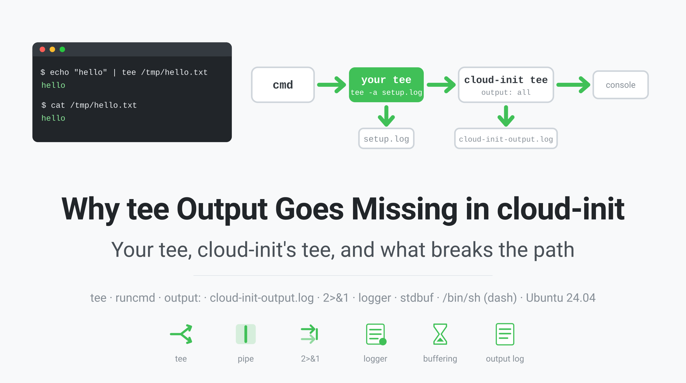

# Why tee Output Goes Missing in cloud-init



`tee` inside cloud-init scripts (`runcmd`, `bootcmd`, user-data shell scripts) usually works: the output lands in your file **and** in `/var/log/cloud-init-output.log`. When it doesn't, the cause is almost never `tee` itself but something around it: a redirect, the list form of `runcmd`, bash-only syntax under `/bin/sh`, or the `output` directive. Every example below was booted with cloud-init 26.2 on Ubuntu 24.04.5 (NoCloud datasource), where `/bin/sh` is `dash` 0.5.12. Related: [cloud-init Heredocs and Logging](../cloud-init-heredoc-logging-guide/index.md) and [cloud-init: bootcmd vs runcmd](../cloud-init-bootcmd-vs-runcmd/index.md).

## The Usual Starting Point

```yaml
#cloud-config
runcmd:
  - echo "hello" | tee /tmp/hello.txt
  - apt-get install -y nginx 2>&1 | tee -a /var/log/my-setup.log
```

This one works. In the test boot `/tmp/hello.txt` contained `hello` and `hello` was in `cloud-init-output.log`; the nginx install wrote 58 lines to `/var/log/my-setup.log`, and the same lines were in `cloud-init-output.log`. If your output is missing, one of the causes below is in play.

## Why tee Usually Works

### cloud-init Already Pipes Through tee

cloud-init's **default output configuration**, in `/etc/cloud/cloud.cfg.d/05_logging.cfg`, sends the stdout and stderr of every stage through `tee`:

```yaml
output: {all: '| tee -a /var/log/cloud-init-output.log'}
```

Your `tee` sits inside that stream. It writes one copy to your file and passes the other copy on through its stdout, which is cloud-init's stdout, which goes through cloud-init's own `tee` into `cloud-init-output.log` and the console:

[](nested-tee.svg "Open the diagram full size")

### How runcmd Runs Your Line

cloud-init doesn't run `runcmd` items one by one. The `runcmd` module writes **all** of them into one script, `/var/lib/cloud/instance/scripts/runcmd`, and the `scripts_user` module runs it with `/bin/sh` in the Final stage. A string item becomes a line of that script as written; a list item becomes a line with every element quoted. That decides two of the causes below.

## What Actually Makes Output Disappear

Each pattern below was run in its own boot; this is where its output ended up:

[](where-it-lands.svg "Open the diagram full size")

1. **List-form runcmd.** The `|` is quoted, so it's printed, not run.
2. **A redirect before the pipe.** `> file` takes stdout before the pipe gets it; `tee` receives nothing.
3. **Something else takes stdout.** `exec > file`, `>> file`, or `| logger` at the end of the pipe: the output goes there and not to cloud-init.
4. **The `output` directive.** `>` instead of `>>` or `| tee -a`, a value cloud-init doesn't recognise, or a `final` stage sent elsewhere.
5. **Bash-only syntax.** `exec > >(tee ...)` is a syntax error under `dash`, and the whole `runcmd` script stops.
6. **A directory that doesn't exist.** `tee` prints an error, writes no file, and cloud-init still reports `done`.

Buffering is not on that list: it only delays output, it doesn't lose it (see [Scenario 3](#scenario-3-buffering-delays-output)).

## Common Scenarios and Fixes

### Scenario 1: tee in List-Form runcmd (Pipe Not Interpreted)

```yaml
#cloud-config
# BROKEN — every element is quoted, so | is just an argument to echo
runcmd:
  - [echo, "setup complete", "|", "tee", "/tmp/status.txt"]
```

cloud-init quoted each element into the script:

```
#!/bin/sh
'echo' 'setup complete' '|' 'tee' '/tmp/status.txt'
```

`cloud-init-output.log` got the line `setup complete | tee /tmp/status.txt`, and `/tmp/status.txt` was never created. Use the string form, so the shell sees the pipe:

```yaml
#cloud-config
# WORKS — the string is a line of the /bin/sh script
runcmd:
  - echo "setup complete" | tee /tmp/status.txt
```

### Scenario 2: Output Missing from cloud-init-output.log

```yaml
#cloud-config
runcmd:
  - apt-get update 2>&1 | tee /var/log/apt-setup.log
```

This works: the output goes to `/var/log/apt-setup.log` (your `tee`) and to `/var/log/cloud-init-output.log` (cloud-init's `tee`). If it's missing from `cloud-init-output.log`, check the redirects in the line itself, then the `output` setting, which can come from the image **or** from user-data:

```bash
# The image's setting
grep -rn "^output" /etc/cloud/cloud.cfg.d/

# An output: key in your user-data
sudo grep -n -A4 "^output" /var/lib/cloud/instance/cloud-config.txt
```

The `grep` over `cloud.cfg.d` only shows the default (`05_logging.cfg:71`); an `output:` from user-data shows up only in `cloud-config.txt` (or `cloud-init query userdata`).

A redirect before the pipe empties it:

```yaml
#cloud-config
runcmd:
  # BROKEN — > takes stdout, the pipe gets nothing
  - echo "redirect-marker" > /tmp/redir.txt 2>&1 | tee /tmp/redir-tee.txt
```

`/tmp/redir.txt` got the text, `/tmp/redir-tee.txt` was created with 0 bytes, and nothing reached `cloud-init-output.log`.

If the `output` directive uses `>` instead of `| tee -a` or `>>`, each stage overwrites the file and only the last stage's output survives. With `output: {all: "> /var/log/cloud-init-output.log"}` the file had 3 lines after boot: the Final stage's start line, the `runcmd` output and the finish line; the `bootcmd` output was gone.

### Scenario 3: Buffering Delays Output

A C program that writes into a pipe switches from line to block buffering, so its lines arrive together when the buffer fills or the program exits. In the test, three lines written one second apart came out of `grep` in the same second, and one per second with `stdbuf -oL`:

```
--- grep, block buffered when writing to a pipe
1795614530 line 1
1795614530 line 2
1795614530 line 3
--- stdbuf -oL grep
1795614530 line 1
1795614531 line 2
1795614532 line 3
```

Nothing is lost either way: the final log has every line. Use these when you watch the log live (`tail -f`) and need the lines as they happen:

```yaml
#cloud-config
runcmd:
  # Force line-buffered output (C programs using stdio)
  - stdbuf -oL some-c-tool 2>&1 | tee -a /var/log/setup.log

  # Or run the command under a pseudo-terminal
  - script -qc "some-tool --verbose" /dev/null | tee -a /var/log/setup.log
```

`unbuffer` does the same but isn't installed by default: it failed with `unbuffer: not found` (exit 127) until the `expect` package was installed. `apt-get` doesn't need any of this: piped through `tee`, it wrote its 40 lines over 3 seconds as it went. `stdbuf` has no effect on programs that manage their own buffers (Python, Perl, Java); use their own switches (`python3 -u`, `$| = 1`).

### Scenario 4: You Want Output in Both a Custom File and cloud-init-output.log

Plain `2>&1 | tee -a file` already does that, because cloud-init captures whatever `tee` passes on:

```yaml
#cloud-config
runcmd:
  # Option A: tee to your file, cloud-init captures the copy on stdout
  - apt-get install -y nginx 2>&1 | tee -a /var/log/setup.log

  # Option B: the same pipeline in an explicit bash (useful for bash-only syntax)
  - bash -c 'apt-get install -y nginx 2>&1 | tee -a /var/log/setup.log'
```

### Scenario 5: Using tee with sudo Inside runcmd

`runcmd` already runs as root, so `tee` doesn't need `sudo`:

```yaml
#cloud-config
# UNNECESSARY — runcmd runs as root
runcmd:
  - echo "setting" | sudo tee /etc/some/config

# SIMPLER — just use tee directly
runcmd:
  - echo "setting" | tee /etc/some/config
```

Both wrote the file (once `/etc/some` existed). The second `runcmd:` key replaces the first one in YAML, so use only one of them.

## The output Directive Explained

`output` controls where cloud-init sends each stage's stdout and stderr. A value is not run by a shell, and must start with `| ` (pipe), `> ` (overwrite) or `>> ` (append). It is a string for both streams, a `[stdout, stderr]` list, or an `output:`/`error:` mapping:

```yaml
#cloud-config
output:
  init:
    output: "> /var/log/cloud-init.out"
    error: "> /var/log/cloud-init.err"
  config: "| tee -a /var/log/cloud-config.log"
  final:
    - ">> /var/log/cloud-final.out"
    - ">> /var/log/cloud-final.err"
```

What the test showed:

- **Only one `output:` key.** YAML keeps the last of two `output:` keys and drops the first, and `cloud-init schema` still says `Valid schema`.
- **The prefix is required.** `config: "tee -a /var/log/cloud-config.log"` (no `|`) was ignored without a warning: no `Redirecting` line in `/var/log/cloud-init.log` and no file.
- **`final` is where `runcmd` goes.** With the `final` list above, the `runcmd` output went to `cloud-final.out` and `cloud-final.err` and **not** to `cloud-init-output.log`. cloud-init's own start and finish lines are written to stderr, so they land in the `.err` file.
- **Stages you don't name keep `all`.** User-data that set only `config: ">> /var/log/only-config.log"` sent the Config stage there, and `runcmd` output still reached `cloud-init-output.log` through the default `all`.
- **`init` starts late.** The Network stage reads user-data partway through, so the early part of a boot is already in the old target; `cloud-init.out` and `.err` stayed empty in a boot without `bootcmd` output.

The stages map to:

| Stage | What runs there |
|-------|----------------|
| `init` | Network stage — bootcmd, write_files, mounts, users, ssh |
| `config` | Config stage — locale, ntp, runcmd (writes the script) |
| `final` | Final stage — packages, scripts_user (runs the runcmd script) |

Your `runcmd` commands execute in the **final** stage. More on the value forms, including a `2>&1` that ends up in the file name, in [cloud-init Heredocs and Logging](../cloud-init-heredoc-logging-guide/index.md#cloud-init-output-directive).

## When tee Is Actually Useful in cloud-init

```yaml
#cloud-config
runcmd:
  # 1. Write to a custom log file AND let cloud-init capture it
  - bash -c 'my-installer.sh 2>&1 | tee -a /var/log/my-app-install.log'

  # 2. Write to a file that needs to exist for another process
  - mkdir -p /run/myapp
  - echo "READY" | tee /run/myapp/init-complete

  # 3. Append to a config file
  - echo "10.0.0.5 db.internal" | tee -a /etc/hosts

  # 4. Write to multiple files simultaneously
  - mkdir -p /etc/myapp /var/run/myapp
  - echo "node_id=abc123" | tee /etc/myapp/id /var/run/myapp/id
```

Create the directories first. Without the `mkdir -p` lines, `tee` printed `tee: /run/myapp/init-complete: No such file or directory`, created none of the three files, and `cloud-init status` still reported `done`: the script's exit code is its last command's, and a failed `tee` in the middle doesn't change it.

## When to Skip tee Entirely

For simple logging you don't need `tee`: cloud-init already captures everything.

```yaml
#cloud-config
runcmd:
  # These all appear in /var/log/cloud-init-output.log automatically
  - echo "Starting setup..."
  - apt-get update
  - apt-get install -y nginx
  - systemctl enable --now nginx
  - echo "Setup complete"
```

If you want a separate log file and don't need the output in `cloud-init-output.log`, use plain redirection:

```yaml
#cloud-config
runcmd:
  - apt-get install -y nginx >> /var/log/setup.log 2>&1
```

This output will **not** appear in `cloud-init-output.log`, because stdout and stderr no longer go to cloud-init.

## Debugging Missing Output

```bash
# 1. The output setting: the image's default, and any output: from user-data
grep -rn "^output" /etc/cloud/cloud.cfg.d/
sudo grep -n -A4 "^output" /var/lib/cloud/instance/cloud-config.txt

# 2. Check that cloud-init-output.log exists and has content
ls -la /var/log/cloud-init-output.log
wc -l /var/log/cloud-init-output.log

# 3. Only the Final stage at the top? A stage used > (overwrite) instead of >> (append)
head -5 /var/log/cloud-init-output.log

# 4. The script cloud-init built: quoted list items, redirects before pipes, bash-only syntax
sudo cat /var/lib/cloud/instance/scripts/runcmd

# 5. Errors and warnings from the run
cloud-init status --long
```

To see the output again, re-run the script **with the same shell** cloud-init uses: `sudo sh -x /var/lib/cloud/instance/scripts/runcmd`. `bash -x` hides `dash` problems (process substitution works there), and either way every command runs again, installs and appends included.

## Solutions

### Option 1: Send stderr to tee Too

`tee` only sees stdout. Without `2>&1` your file gets no error messages, though they still reach `cloud-init-output.log` through cloud-init's capture:

```bash
command 2>&1 | tee -a /var/log/your-log.log
```

With `ls /nonexistent-path | tee -a /var/log/o1.log`, `o1.log` stayed empty and the error line was in `cloud-init-output.log`; with `2>&1` it was in both.

### Option 2: Pipe to logger for the Journal

```bash
command 2>&1 | tee -a /var/log/your-log.log | logger -t cloud-init
```

The line reached `/var/log/your-log.log` and the journal (`journalctl -t cloud-init`), but **not** `cloud-init-output.log`: `logger` consumes `tee`'s stdout.

### Option 3: Redirect a Whole Block

In `runcmd` (`/bin/sh`), group the commands and pipe the group:

```bash
{
  command-one
  command-two
} 2>&1 | tee -a /var/log/your-log.log
```

`exec > >(tee -a /var/log/your-log.log)` does the same in **bash** only: use it in a `write_files` script that starts with `#!/bin/bash`, never directly in `runcmd`.

### Option 4: Don't tee Into cloud-init's Own Log

```bash
# DUPLICATES every line
command 2>&1 | tee -a /var/log/cloud-init-output.log
```

The line is written once by your `tee` and once more by cloud-init's: in the test it was in `cloud-init-output.log` twice. Plain `command` already lands there.

## Best Practice: Group and Pipe in runcmd

```yaml
#cloud-config
runcmd:
  - |
    {
      echo "Starting initialization..."
      # Your commands here
      echo "Initialization complete"
    } 2>&1 | tee -a /var/log/my-init.log
```

Everything in the group goes to `/var/log/my-init.log` and, through cloud-init's `tee`, to `cloud-init-output.log`.

> **Warning:** the common `exec > >(tee -a /var/log/my-init.log)` version fails in `runcmd`. `/bin/sh` is `dash`, which has no process substitution: the boot stopped at line 2 with `Syntax error: redirection unexpected`, `cloud-init status` reported `error`, and none of the commands ran.

## Complete Example

```yaml
#cloud-config
runcmd:
  - |
    {
      echo "=== Starting Custom Initialization ==="
      date

      # Install packages
      apt-get update
      apt-get install -y docker.io

      # Configure services
      systemctl enable docker
      systemctl start docker

      echo "=== Initialization Complete ==="
      date
    } 2>&1 | tee -a /var/log/custom-init.log
```

In the test boot, the same structure wrote 106 lines to its log file, the closing line was also in `cloud-init-output.log`, and `docker` was `active` afterwards.

## Common Patterns

### Pattern 1: Simple Command Logging

```bash
echo "Installing Docker..." 2>&1 | tee -a /var/log/setup.log
apt-get install -y docker.io 2>&1 | tee -a /var/log/setup.log
```

### Pattern 2: Function with Logging

```bash
log_and_run() {
    echo "Running: $*" 2>&1 | tee -a /var/log/setup.log
    "$@" 2>&1 | tee -a /var/log/setup.log
}

log_and_run apt-get update
log_and_run apt-get install -y docker.io
```

Works in `runcmd` as is (`dash` supports functions): `setup.log` got the `Running: apt-get update` and `Running: apt-get install -y docker.io` lines followed by each command's output.

### Pattern 3: Entire Script Block

```yaml
#cloud-config
runcmd:
  - |
    {
      echo "Starting setup at $(date)"
      apt-get update
      apt-get install -y docker.io
      echo "Setup complete at $(date)"
    } 2>&1 | tee -a /var/log/setup.log
```

## Summary

When `tee` output goes missing, the cause is almost always one of these:

1. **List-form runcmd** — the `|` is quoted, not run. Use the string form.
2. **Redirect before the pipe** — `> file` takes stdout, `tee` gets nothing.
3. **Something else takes stdout** — `exec >`, `>> file` or `| logger`: the output leaves `cloud-init-output.log`.
4. **The output directive** — `>` instead of `>>`, a value without `|`, `>` or `>>` (ignored), or a `final` stage sent elsewhere.
5. **Bash-only syntax** — `exec > >(tee ...)` stops the whole `runcmd` script under `dash`. Group and pipe instead.
6. **A missing directory** — `tee` writes nothing and the boot still reports `done`.

Buffering only delays lines; it doesn't lose them. And `tee -a /var/log/cloud-init-output.log` doesn't help: it doubles every line.

When in doubt: use string-form commands, skip `tee` for simple logging (cloud-init captures it), and add `tee` only when you need a custom file alongside cloud-init's log.
