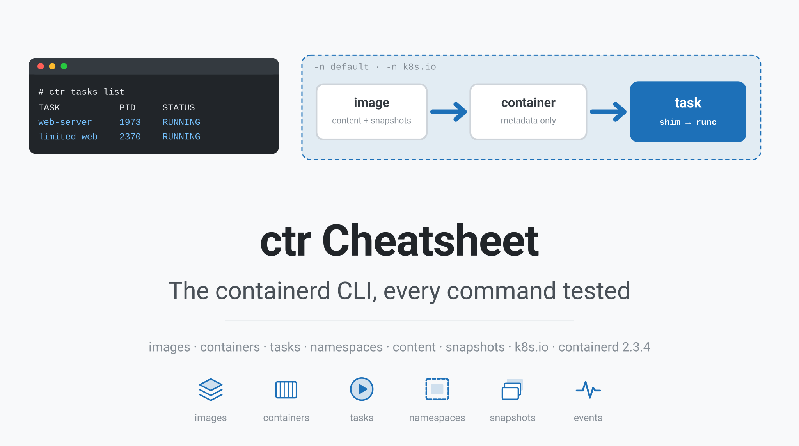

# ctr Cheatsheet (containerd CLI)



`ctr` is the low-level command-line client for containerd, the container runtime under Kubernetes on EKS, GKE, kind and most self-managed clusters. It talks to containerd's own gRPC API, unlike `crictl`, which uses the Kubernetes CRI API. `ctr` is a debugging tool: it has no `logs` command, no image builds, and doesn't accept short image names.

Everything below was run as root on a kind node with containerd and ctr v2.3.4 and runc 1.4.3 (Kubernetes 1.37.0).

## How containerd Is Organised

[![containerd's objects, all inside a namespace (default for ctr, k8s.io for Kubernetes): an image is a name pointing at blobs in the content store (index, manifest, config, layers); the layers are unpacked into committed snapshots; a container is only metadata (ID, image, runtime, OCI spec, labels) plus an active snapshot as its writable root filesystem; a task is the running process, started by the containerd shim with runc. ctr talks to all of these over containerd's gRPC socket, crictl and the kubelet go through the CRI plugin.](containerd-objects.svg)](containerd-objects.svg "Open the diagram full size")

- **Image:** a name (`docker.io/library/nginx:latest`) pointing at blobs in the **content store**.
- **Snapshot:** an unpacked image layer, or a container's writable layer, on the overlayfs snapshotter.
- **Container:** only metadata (image, runtime, OCI spec, labels). Nothing runs yet.
- **Task:** the running process of a container. `ctr run` creates the container and starts the task in one step.
- **Namespace:** everything above lives in one. ctr uses `default`; Kubernetes uses `k8s.io`.

## Basic Structure

```sh
ctr [global options] command [command options] [arguments...]
```

Short command names work too: `ctr i` (images), `ctr c` (containers), `ctr t` (tasks), `ctr ns` (namespaces).

## Global Options

| Flag | Environment variable | Description |
|------|----------------------|-------------|
| `--address`, `-a` | `CONTAINERD_ADDRESS` | containerd's gRPC socket (default: `/run/containerd/containerd.sock`) |
| `--namespace`, `-n` | `CONTAINERD_NAMESPACE` | Namespace (default: `default`) |
| `--timeout` | | Total timeout for the command |
| `--connect-timeout` | | Timeout for connecting to containerd |
| `--debug` | | Debug output |

`export CONTAINERD_NAMESPACE=k8s.io` saves typing `-n k8s.io` on a Kubernetes node.

```
$ ctr version
Client:
  Version:  v2.3.4
  Revision: db8809540e1a7a9da5d518876894933ff55692ab
  Go version: go1.26.7

Server:
  Version:  v2.3.4
  Revision: db8809540e1a7a9da5d518876894933ff55692ab
  UUID: a4966bc5-8f17-434e-aec5-fe30c4fb2beb
```

## Images

### Full Names Only

ctr doesn't expand short names the way Docker does. Always write `docker.io/library/nginx:latest`:

```
$ ctr images pull nginx:latest
ctr: failed to resolve image: parse "dummy://nginx:latest": invalid port ":latest" after host

$ ctr images remove nginx:latest ubuntu:20.04
time="2026-11-27T09:37:18Z" level=warning msg="nginx:latest: image not found"
time="2026-11-27T09:37:18Z" level=warning msg="ubuntu:20.04: image not found"
```

### Pull

```sh
# Pull (for the node's own platform)
ctr images pull docker.io/library/nginx:latest

# Pull another platform
ctr images pull --platform linux/amd64 docker.io/library/nginx:latest

# Pull every platform in the index (needed before export --all-platforms)
ctr images pull --all-platforms docker.io/library/alpine:3.23
```

```
Completed pull from OCI Registry (docker.io/library/nginx:latest)	elapsed: 5.4 s	total:  59.4 M	(11.0 MiB/s)
```

### List and Check

```
$ ctr images list
REF                            TYPE                                    DIGEST                                                                  SIZE     PLATFORMS                                                                                              LABELS
docker.io/library/alpine:3.23  application/vnd.oci.image.index.v1+json sha256:469c9ea410b9215eaee7976ba6c0639039b444be8e5d638f7abbada189971eb2 4.0 MiB  linux/386,linux/amd64,linux/arm/v6,linux/arm/v7,linux/arm64/v8,linux/ppc64le,linux/riscv64,linux/s390x -
docker.io/library/nginx:latest application/vnd.oci.image.index.v1+json sha256:6a3df739b6312289e87d70947d900669c1b3087474ece5814b9c01bbf2e6dde3 59.4 MiB linux/386,linux/amd64,linux/arm/v5,linux/arm/v7,linux/arm64/v8,linux/ppc64le,linux/riscv64,linux/s390x -

$ ctr images list -q
docker.io/library/alpine:3.23
docker.io/library/nginx:latest
```

The digest is always a column; there is no `--digests` flag (`flag provided but not defined: -digests`).

`ctr images check` shows whether all content is present and the image is unpacked (ready to run):

```
$ ctr images check
REF                            TYPE                                    DIGEST                                                                  STATUS         SIZE              UNPACKED
docker.io/library/alpine:3.23  application/vnd.oci.image.index.v1+json sha256:469c9ea410b9215eaee7976ba6c0639039b444be8e5d638f7abbada189971eb2 complete (2/2) 4.0 MiB/4.0 MiB   false
docker.io/library/nginx:latest application/vnd.oci.image.index.v1+json sha256:6a3df739b6312289e87d70947d900669c1b3087474ece5814b9c01bbf2e6dde3 complete (8/8) 59.3 MiB/59.3 MiB true
```

### Tag and Remove

```
$ ctr images tag docker.io/library/nginx:latest my-registry/nginx:v1.0
my-registry/nginx:v1.0

$ ctr images remove my-registry/nginx:v1.0
my-registry/nginx:v1.0

$ ctr images rm docker.io/library/nginx:latest
docker.io/library/nginx:latest
```

### Export and Import

```sh
ctr images export nginx.tar docker.io/library/nginx:latest
ctr images import nginx.tar
```

The export was 62 MB, and the import took 0.3 s. `--all-platforms` only works if every platform was pulled first; after a normal pull it fails and still leaves a broken 1.5 KB file:

```
$ ctr images export --all-platforms nginx-all.tar docker.io/library/nginx:latest
ctr: failed to get reader: content digest sha256:00d07fcd62c985ecf18999476c950c61b6c7b9430b2c7828a617c4fa02776b7a: not found
```

### Look Inside an Image Without Running It

```
$ ctr images mount docker.io/library/alpine:3.23 /mnt/img
sha256:4154419d13c4db5f2e910214abf684812a6cc507f3e8d77e793da4ce07adedfd
/mnt/img

$ cat /mnt/img/etc/alpine-release
3.23.8

$ ctr images unmount /mnt/img

$ ctr images usage --snapshotter overlayfs docker.io/library/alpine:3.23
KEY                                                                     SIZE    INODES
sha256:4154419d13c4db5f2e910214abf684812a6cc507f3e8d77e793da4ce07adedfd 8.9 MiB 515
```

## Containers

A container is only metadata. Creating one starts nothing.

```
$ ctr containers create docker.io/library/nginx:latest nginx-container
$ ctr containers create --runtime io.containerd.runc.v2 docker.io/library/nginx:latest my-container

$ ctr containers list
CONTAINER          IMAGE                             RUNTIME
my-container       docker.io/library/nginx:latest    io.containerd.runc.v2
nginx-container    docker.io/library/nginx:latest    io.containerd.runc.v2

$ ctr containers list -q
my-container
nginx-container
```

### Info and Labels

```
$ ctr containers info nginx-container
{
    "ID": "nginx-container",
    "Labels": {
        "io.containerd.image.config.stop-signal": "SIGQUIT",
        "maintainer": "NGINX Docker Maintainers <docker-maint@nginx.com>"
    },
    "Image": "docker.io/library/nginx:latest",
    "Runtime": {
        "Name": "io.containerd.runc.v2",
...
```

The output also has the full OCI `Spec`. `ctr containers label` **sets** labels; called without labels it doesn't list them, it fails. Read labels from `info`:

```
$ ctr containers label nginx-container team=platform
maintainer=NGINX Docker Maintainers <docker-maint@nginx.com>,team=platform,io.containerd.image.config.stop-signal=SIGQUIT

$ ctr containers label nginx-container
ctr: container.Snapshotter field is immutable: invalid argument
```

### Delete

```sh
ctr containers delete my-container
```

There's no `--force` (`flag provided but not defined: -force`). A container with a running task can't be deleted:

```
ctr: cannot delete a non stopped container: {running 0 0001-01-01 00:00:00 +0000 UTC}
```

## Tasks (Running Containers)

### Run: Create and Start in One Step

```sh
# Run in the foreground, remove when it exits
ctr run --rm docker.io/library/ubuntu:22.04 temp-container cat /etc/os-release

# Interactive shell
ctr run --rm -t docker.io/library/ubuntu:22.04 temp-container bash

# Detached
ctr run -d docker.io/library/nginx:latest web-server

# Environment variables
ctr run --rm --env VAR1=value1 --env VAR2=value2 docker.io/library/ubuntu:22.04 my-container sh -c 'echo $VAR1 $VAR2'

# Host network
ctr run --rm --net-host docker.io/library/nginx:latest web-host

# Memory limit, in bytes
ctr run -d --memory-limit 536870912 docker.io/library/ubuntu:22.04 limited-web sleep 300
```

```
value1 value2
```

**Networking:** without flags, `ctr run` gives the container **no network**, only `lo`. That's the default, and there's no `--net-none` flag (`flag provided but not defined: -net-none`). `--net-host` shares the node's interfaces (the test listed `lo`, `eth0` and the node's `veth` interfaces), and `--cni` attaches the container to a CNI network.

**Memory limit:** it isn't visible from inside the container, but it is in the task's cgroup on the node:

```
$ cat /proc/<pid>/cgroup
0::/default/limited-web
$ cat /sys/fs/cgroup/default/limited-web/memory.max
536870912
```

### Start a Task for an Existing Container

`ctr tasks start` runs in the **foreground**, attached to the container's output, until the process ends. Add `-d` to detach:

```sh
ctr tasks start -d nginx-container
```

There's no `-t` on `tasks start` (`flag provided but not defined: -t`): a TTY is set when the container is created, with `ctr containers create -t`. If a foreground `ctr tasks start` is stopped, the task ends with it.

### List, Inspect, Exec

```
$ ctr tasks list
TASK               PID     STATUS
web-server         1973    RUNNING
limited-web        2370    RUNNING
nginx-container    2602    RUNNING

$ ctr tasks ps nginx-container
PID     INFO
2602    -
2639    -
2640    -

$ ctr tasks exec --exec-id my-session nginx-container nginx -v
nginx version: nginx/1.31.10
```

`--exec-id` is required and must be unique per running exec. Add `-t` for an interactive shell: `ctr tasks exec -t --exec-id shell nginx-container sh`.

```
$ ctr tasks metrics limited-web
ID             TIMESTAMP
limited-web    seconds:1795772265  nanos:851612643

METRIC                VALUE
pids.current          1
pids.limit            18446744073709551615
cpu.usage_usec        3633
...
```

### Pause, Resume, Kill, Delete

```sh
ctr tasks pause nginx-container     # STATUS: PAUSED
ctr tasks resume nginx-container    # STATUS: RUNNING
ctr tasks kill nginx-container      # STATUS: STOPPED
ctr tasks kill --signal SIGKILL nginx-container
ctr tasks delete nginx-container
```

- `kill` without `--signal` sends the image's stop signal (`SIGQUIT` for nginx, from the `io.containerd.image.config.stop-signal` label above). `-a` signals every process in the container.
- A running task can't be deleted: `task must be stopped before deletion: running: failed precondition`.
- `ctr tasks delete -f` kills and deletes in one step (`task limited-web exit with non-zero exit code 137`).

### Attach

```sh
ctr tasks attach ticker
```

`attach` streams the task's output and **forwards signals to the task**. `Ctrl-C` or a `SIGTERM` doesn't detach you, it goes to the container's process. The test container ran `sh` as PID 1, which ignores `SIGTERM`, so `timeout 3 ctr tasks attach ticker` kept streaming; the attach had to be killed from another shell.

## Namespaces

```
$ ctr namespaces list
NAME    LABELS
default
k8s.io

$ ctr namespaces create my-namespace
$ ctr -n my-namespace images pull docker.io/library/alpine:3.23

$ ctr namespaces remove my-namespace
ctr: unable to delete my-namespace: namespace "my-namespace" must be empty, but it still has images, blobs, snapshots on "overlayfs" snapshotter: failed precondition
```

Remove the images first. Their blobs and snapshots are freed by containerd's garbage collector a moment later; right after `images rm` the namespace still had `blobs, snapshots`, and 5 seconds later `ctr namespaces remove my-namespace` worked.

## Content Store

```
$ ctr content list
DIGEST									SIZE	AGE		LABELS
sha256:016a4b0dc063fab5ee35211e3329dd1c39fe769b594bc455905ad7083afe4520	9.096kB	About a minute	containerd.io/distribution.source.docker.io=library/nginx
sha256:05ed9b607a9c505cc6e103630f4367699f2b18cbda0d573b76aaa3385edee4ab	241B	About a minute	containerd.io/distribution.source.docker.io=library/alpine

$ ctr content get sha256:016a4b0dc063fab5ee35211e3329dd1c39fe769b594bc455905ad7083afe4520
{"architecture":"riscv64","config":{"ExposedPorts":{"80/tcp":{}},"Env":["PATH=/usr/local/sbin:/usr/local/bin:/usr/sbin:/usr/bin:/sbin:/bin","NGINX_VERSION=1.31.9", ...
```

```sh
ctr content fetch docker.io/library/busybox:1.37   # download all content
ctr content rm sha256:<digest>                      # permanently delete a blob
```

There's no `ctr content info` (`No help topic for 'info'`); `content get` prints the blob itself. `content fetch` downloads without unpacking, but it does create an image record: `docker.io/library/busybox:1.37` appeared in `ctr images list` afterwards.

## Snapshots

```
$ ctr snapshots list
KEY                                                                     PARENT                                                                  KIND
sha256:1b069e7c868777e7af4a71edd4a62913d19ba3f6f5403789e2fd24403591b50d sha256:26e23f55fcf29a05a14a0468713cc8b2fb272a86c28ab16ceabaa624bdf04b69 Committed
sha256:1f75ccad0a0d377a87a5f8c58b8a254a5dcfb680fe54cc9cce526208b85968ea                                                                         Committed

$ ctr snapshots prepare my-snapshot sha256:1b069e7c868777e7af4a71edd4a62913d19ba3f6f5403789e2fd24403591b50d
$ ctr snapshots usage my-snapshot
KEY         SIZE    INODES
my-snapshot 4.0 KiB 1

$ ctr snapshots remove my-snapshot
```

`Committed` snapshots are read-only image layers; `Active` ones (like `my-snapshot`, or a container's root filesystem) are writable. `ctr snapshots info <key>` shows the parent chain and labels.

## Plugins, Events and Server Info

```
$ ctr plugins list | grep -i runtime
io.containerd.runtime.v2                  task                     linux/arm64/v8    ok
io.containerd.cri.v1                      runtime                  linux/arm64/v8    ok

$ ctr plugins list | awk '$NF!="ok"'
TYPE                                      ID                       PLATFORMS         STATUS
io.containerd.snapshotter.v1              blockfile                linux/arm64/v8    skip
io.containerd.snapshotter.v1              erofs                    linux/arm64/v8    skip
io.containerd.server.v1                   metrics                  -                 skip
```

`ctr events` streams everything containerd does. One `ctr run --rm ... true`:

```
2026-11-27 09:42:29.383044827 +0000 UTC default /snapshot/prepare {"key":"evt","parent":"sha256:4154419d13c4...
2026-11-27 09:42:29.387512341 +0000 UTC default /containers/create {"id":"evt","image":"docker.io/library/alpine:3.23",...
2026-11-27 09:42:29.40856419 +0000 UTC default /tasks/create {"container_id":"evt","bundle":"/run/containerd/io.containerd.runtime.v2.task/default/evt",...
2026-11-27 09:42:29.412089186 +0000 UTC default /tasks/start {"container_id":"evt","pid":2530}
2026-11-27 09:42:29.4181907 +0000 UTC default /tasks/delete {"container_id":"evt","pid":2530,"exited_at":{...}}
```

Other read-only commands: `ctr info` (server UUID and PID), `ctr leases list`, and `ctr oci spec` (the default OCI spec, `"ociVersion": "1.3.0"`).

## Complete Container Lifecycle

```sh
ctr images pull docker.io/library/nginx:latest                   # 1. image
ctr containers create docker.io/library/nginx:latest web-server  # 2. container (metadata)
ctr tasks start -d web-server                                    # 3. task (process), detached
ctr tasks list                                                   # 4. RUNNING
ctr tasks exec -t --exec-id debug web-server sh                  # 5. shell inside
ctr tasks kill web-server                                        # 6. STOPPED
ctr tasks delete web-server                                      # 7. remove the task
ctr containers delete web-server                                 # 8. remove the container
ctr images remove docker.io/library/nginx:latest                 # 9. optional
```

## Kubernetes Nodes (`k8s.io` Namespace)

```
$ ctr -n k8s.io containers list
CONTAINER                                                           IMAGE                                                          RUNTIME
280c96b00ef93c9c3d46f77d9f20aaea0b09535d6dd54a99ac14f63a68fb4c88    registry.k8s.io/kube-proxy-arm64:v1.37.0                       io.containerd.runc.v2
2cb9bf237554e6e7e6e207139fcca499c95bfd67b6892c543fd83c1b5e130282    registry.k8s.io/pause:3.10                                     io.containerd.runc.v2
...
```

Containers are listed by ID and image, so `ctr -n k8s.io containers list | grep <pod-name>` finds nothing. Filter on the label the kubelet sets instead; the result includes the pod's `pause` sandbox:

```
$ ctr -n k8s.io containers list 'labels."io.kubernetes.pod.name"==web'
CONTAINER                                                           IMAGE                                  RUNTIME
477094ae7c1dfb3ed94074fad91e17c97fb6430e1907b0f083c1a0726f8b3770    docker.io/library/nginx:1.29-alpine    io.containerd.runc.v2
8b00ba73bf923b07ed434096954db2db79065281d2d4bb24d5bedd8d68fdba8a    registry.k8s.io/pause:3.10             io.containerd.runc.v2

$ ctr -n k8s.io containers info 477094ae7c1d... | grep io.kubernetes
        "io.kubernetes.container.name": "web",
        "io.kubernetes.pod.name": "web",
        "io.kubernetes.pod.namespace": "default",
```

`crictl` shows the same with pod names, which is usually easier:

```
$ crictl ps --name web
CONTAINER           IMAGE               CREATED                  STATE               NAME                ATTEMPT             POD ID              POD                 NAMESPACE
477094ae7c1df       7f7dcd27f920b       Less than a second ago   Running             web                 0                   8b00ba73bf923       web                 default
```

### Mounts and Disk

The container's root filesystem is an overlay mount named after its ID:

```
$ grep 477094ae7c1d /proc/mounts
overlay /run/containerd/io.containerd.runtime.v2.task/k8s.io/477094ae7c1dfb3ed94074fad91e17c97fb6430e1907b0f083c1a0726f8b3770/rootfs overlay rw,relatime,lowerdir=...

$ df -h | grep overlay
overlay          20G  2.6G   16G  15% /
overlay          20G  2.6G   16G  15% /run/containerd/io.containerd.runtime.v2.task/k8s.io/ee541dfb20063fad40456fc8a415c6bb85bd01e14f0478f5731b21f426d298e9/rootfs
```

`ctr -n k8s.io snapshots usage` and `ctr -n k8s.io content list` show what images take on disk.

### Don't Manage Pods with ctr

Kubernetes owns everything in `k8s.io`. Stopping a pod's container from below doesn't stop the pod: after `crictl stop` on the `web` container, the kubelet started a new one within seconds (`RESTARTS 1`). Use ctr there to look, and `kubectl` to change things.

## ctr vs crictl vs docker

| | `ctr` | `crictl` | `docker` |
|---|---|---|---|
| Talks to | containerd's gRPC API | the CRI API (containerd's CRI plugin, CRI-O) | the Docker daemon |
| Namespaces | Yes (`-n k8s.io`) | Always Kubernetes' (`k8s.io` on containerd) | No |
| Pod names | No (container IDs, labels) | Yes (`crictl pods`, `ps --name`) | No |
| Images | pull, tag, import, export, mount | pull, list, remove, inspect | Full, including build |
| Containers | create, run, exec, kill, pause, delete | runp, create, start, stop, rm, exec, logs | Full |
| Logs | No | `crictl logs` | `docker logs` |
| On EKS nodes | Yes (comes with containerd) | Yes | No (dockershim was removed in Kubernetes 1.24) |
| Best for | Low-level containerd debugging, image ops | Debugging pods on a node | Development, building images |

## Quick Reference

```sh
# Images (full names only)
ctr images pull docker.io/library/<image>:<tag>
ctr images list
ctr images check
ctr images remove <ref>
ctr images tag <source> <target>
ctr images export <file.tar> <ref>
ctr images import <file.tar>
ctr images mount <ref> <dir> && ctr images unmount <dir>

# Containers (metadata)
ctr containers create <image> <name>
ctr containers list
ctr containers info <name>
ctr containers delete <name>

# Tasks (processes)
ctr run --rm -t <image> <name> <command>
ctr run -d <image> <name>
ctr tasks start -d <container>
ctr tasks list
ctr tasks exec -t --exec-id <id> <container> <cmd>
ctr tasks kill [--signal SIGKILL] <container>
ctr tasks delete [-f] <container>

# Kubernetes nodes
export CONTAINERD_NAMESPACE=k8s.io
ctr containers list 'labels."io.kubernetes.pod.name"==<pod>'
```

## Important Notes

- **Full image names:** `docker.io/library/nginx:latest`, never `nginx:latest`.
- **Order:** `tasks kill` → `tasks delete` → `containers delete`, or `tasks delete -f` to skip the kill.
- **`tasks start` is foreground** unless you add `-d`.
- **No network by default:** `ctr run` gives the container only `lo`; use `--net-host` or `--cni`.
- **`attach` forwards signals:** `Ctrl-C` goes to the container, it doesn't detach.
- **`k8s.io` is Kubernetes'**: look with ctr, change with `kubectl`. The kubelet recreates what you stop.
- **Root:** ctr needs root, or access to the containerd socket.

## See Also

- [containerd getting started](https://github.com/containerd/containerd/blob/main/docs/getting-started.md)
- [crictl user guide](https://github.com/kubernetes-sigs/cri-tools/blob/master/docs/crictl.md)
- [Docker overlay2 Storage: How Image and Container Layers Live on Disk](../docker-overlay2-storage/index.md)
- [How docker pull Works: Technical Details](../docker-pull-technical-details-guide/index.md)
- [k9s Cheatsheet](../k9s-cheatsheet/index.md)
- [Linux Processes and Signals Cheatsheet](../ps/index.md)
