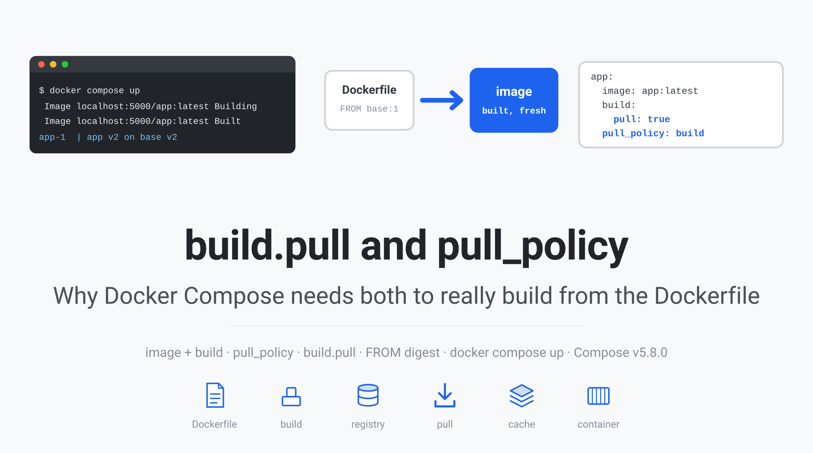

# Why Docker Compose Needs build.pull and pull_policy Set to build



A service that has both `image:` and `build:` looks like it is built from its Dockerfile. In practice, Docker Compose often doesn't build it at all: it reuses an old local image, or pulls whatever is in the registry under that name. When it does build, it uses the copy of the base image already on the machine. Two settings fix this, and you need both:

```yaml
services:
  app:
    image: localhost:5000/app:latest
    build:
      context: .
      dockerfile: Dockerfile
      pull: true            # always check the registry for a newer FROM image
    pull_policy: build      # always build this service, never pull it
```

Everything below was tested with Docker Compose v5.8.0, Docker CLI 29.10.1, buildx v0.39.1 (BuildKit v0.30.0) and Docker Engine 29.5.2 (containerd image store), with a local `registry:3` on `localhost:5000`.

## What Each Setting Does

[](two-decisions.svg "Open the diagram full size")

They answer two different questions:

| Setting | Question it answers | Default | With the setting |
|---------|---------------------|---------|------------------|
| `pull_policy` (service) | Does `docker compose up` **build** the service, or use an image? | `missing`: use the local image; if there is none, pull the `image:` name; build only if that pull fails | `build`: build on every `up`, skip it in `docker compose pull` |
| `build.pull` | When it builds, which **base image** (`FROM`) does it use? | `false`: the copy already on the machine | `true`: ask the registry for the tag's current digest |

`pull_policy: build` alone gets your code changes in but keeps building on an old base image. `build.pull: true` alone refreshes the base, but only on the rare occasions Compose actually builds.

## The Test Setup

The app is two files on top of a base image from the local registry:

```dockerfile
# Dockerfile
FROM localhost:5000/base:1
COPY app.sh /app.sh
CMD ["sh", "/app.sh"]
```

```sh
# app.sh
echo "app v1 on $(cat /base-version)"
```

`localhost:5000/base:1` is a one-line image that writes its version into `/base-version`. It was pushed as `base v1`, then a `base v2` was pushed **under the same tag**, the way `python:3.12-slim` or `alpine:3.23` gets a security update, while the machine kept its local v1:

```
local base:1:    base v1
registry base:1: base v2
```

```
local:    sha256:8caf0f26c0fcd8f5f3b940fb470d3945878c23060d11076daf5e716874bbb5d8
registry: "sha256:52ae3cbc92e50fd96d8a47bd47160b73960d046df9dfd28b93268561d26b395b"
```

The starting `compose.yaml` has neither setting:

```yaml
services:
  app:
    image: localhost:5000/app:latest
    build:
      context: .
      dockerfile: Dockerfile
```

## Problem 1: The Build Uses the Old Base Image

After the first build (`app v1 on base v1`), the registry got base v2. Building again with the plain file:

```
$ docker compose build
#3 [internal] load metadata for localhost:5000/base:1
#6 [1/2] FROM localhost:5000/base:1@sha256:8caf0f26c0fcd8f5f3b940fb470d3945878c23060d11076daf5e716874bbb5d8
#6 resolve localhost:5000/base:1@sha256:8caf0f26c0fcd8f5f3b940fb470d3945878c23060d11076daf5e716874bbb5d8 done
#7 [2/2] COPY app.sh /app.sh

$ docker compose run --rm app
app v1 on base v1
```

BuildKit found `base:1` on the machine and used it (`8caf…`, the local digest). It never asked the registry. With `build.pull: true` added under `build:`:

```
$ docker compose build
#3 [internal] load metadata for localhost:5000/base:1
#6 [1/2] FROM localhost:5000/base:1@sha256:52ae3cbc92e50fd96d8a47bd47160b73960d046df9dfd28b93268561d26b395b
#6 resolve localhost:5000/base:1@sha256:52ae3cbc92e50fd96d8a47bd47160b73960d046df9dfd28b93268561d26b395b done
#7 [2/2] COPY app.sh /app.sh

$ docker compose run --rm app
app v1 on base v2
```

Now it resolved `52ae…`, the registry's digest. The local tag is not updated by this: afterwards `docker run --pull never localhost:5000/base:1` still printed `base v1`, so a build without `pull` would go back to the old base.

The command-line equivalent is `docker compose build --pull`.

## Problem 2: `docker compose up` Doesn't Rebuild

`app.sh` was changed to print `app v2`. With the plain file, `up` ran the image built earlier:

```
$ docker compose up
 Container demo-app-1 Creating
 Container demo-app-1 Created
Attaching to app-1
 Container demo-app-1 Starting
app-1  | app v1 on base v2
 Container demo-app-1 Started
app-1 exited with code 0
```

With the default `pull_policy` (`missing`), an image that exists locally is used as it is. The code change is ignored until someone runs `docker compose build` or `up --build`. With `pull_policy: build` added to the service:

```
$ docker compose up
 Image localhost:5000/app:latest Building
 Image localhost:5000/app:latest Built
 Container demo-app-1 Creating
 Container demo-app-1 Created
 Container demo-app-1 Starting
app-1  | app v2 on base v1
 Container demo-app-1 Started
app-1 exited with code 0
```

The code is current, but the base went back to `v1`: without `build.pull` the build used the local base again. With both settings:

```
$ docker compose up
 Image localhost:5000/app:latest Building
 Image localhost:5000/app:latest Built
app-1  | app v2 on base v2
```

`docker compose up --build` gives the same rebuild for one run, still on the local base: it printed `app v2 on base v1`.

## Problem 3: Compose Pulls the Image Instead of Building It

`image:` is both the name the build is tagged with **and** a name Compose can pull. If an image with that name is in the registry (an old CI push, a colleague's test, an unrelated image with the same name) and not on the machine, the default policy pulls it and never looks at the Dockerfile. An old image was pushed as `localhost:5000/app:latest` and the local copy removed:

```
$ docker compose up
 Image localhost:5000/app:latest Pulling
 68600b42eeb9 Download complete 0B
 Image localhost:5000/app:latest Pulled
 Container demo-app-1 Creating
 Container demo-app-1 Created
Attaching to app-1
 Container demo-app-1 Starting
app-1  | app from the registry (old push)
 Container demo-app-1 Started
app-1 exited with code 0
```

That's a fresh clone or a new CI runner running code from somewhere else. With both settings, the same command built from the Dockerfile:

```
$ docker compose up
 Image localhost:5000/app:latest Building
 Image localhost:5000/app:latest Built
app-1  | app v2 on base v2
```

`docker compose pull` does the same thing on purpose. With the plain file it replaced the local build with the registry image; with `pull_policy: build` the service is skipped:

```
$ docker compose pull                 # plain file
 Image localhost:5000/app:latest Pulling
 68600b42eeb9 Download complete 0B
 Image localhost:5000/app:latest Pulled

$ docker compose pull                 # with pull_policy: build
 Image localhost:5000/app:latest Skipped
```

### Why the Default Seems to Work

When the name exists nowhere, the default policy tries to pull, fails, and **falls back** to building:

```
$ docker compose up                   # image: localhost:5000/nothere:latest
 Image localhost:5000/nothere:latest Pulling
 Image localhost:5000/nothere:latest failed to resolve reference "localhost:5000/nothere:latest": localhost:5000/nothere:latest: not found
 Image localhost:5000/nothere:latest Building
#1 [internal] load local bake definitions
```

So the first `up` on a new machine builds, and everything looks fine. The problems start once an image with that name exists, locally or in the registry.

## Results Side by Side

The same project, with the registry holding base v2, an old `app` image, and the code at `app v2`:

| Setup | Command | Result |
|-------|---------|--------|
| plain | `docker compose build` + `run` | `app v1 on base v1` (before the code change) |
| `build.pull: true` | `docker compose build` + `run` | `app v1 on base v2` |
| plain, image built earlier | `docker compose up` | `app v1 on base v2`: no rebuild |
| `pull_policy: build` | `docker compose up` | `app v2 on base v1`: old base |
| plain, no local image | `docker compose up` | `app from the registry (old push)` |
| plain | `docker compose up --build` | `app v2 on base v1` |
| plain | `docker compose build --pull`, then `up` | `app v2 on base v2` |
| **both** | `docker compose up` | **`app v2 on base v2`** |

## Gotchas

- **`up --pull always` overrides `pull_policy: build`.** With both settings in the file, `docker compose up --pull always` pulled `localhost:5000/app:latest` and ran `app from the registry (old push)`. Don't use that flag for projects with built services.
- **`build.pull: true` needs the registry.** With the registry stopped, the build failed: `failed to solve: localhost:5000/base:1: failed to resolve source metadata for localhost:5000/base:1: ... connect: connection refused`. The plain file still built offline from the local base. For offline work, run `docker compose build` without it, or keep a second Compose file.
- **The layer cache still works.** `pull: true` only checks the digest. With nothing changed, the second build still showed `#7 CACHED` for `COPY app.sh`. Layers are rebuilt only when the base digest really changed.
- **Pick an `image:` name nobody pushes** if the image is only built locally, or leave `image:` out: Compose then names the image after the project and service, a name that nobody has pushed to a registry.
- **`pull_policy: build` builds on every `up`.** With the cache that takes seconds, but it does a BuildKit run each time. For a service you deploy from a registry, `pull_policy: always` (pull, never build) is the matching setting instead.

## See Also

- [Compose file reference: build.pull](https://docs.docker.com/reference/compose-file/build/#pull)
- [Compose file reference: pull_policy](https://docs.docker.com/reference/compose-file/services/#pull_policy)
- [docker compose build](https://docs.docker.com/reference/cli/docker/compose/build/)
- [docker compose up](https://docs.docker.com/reference/cli/docker/compose/up/)
- [Docker Compose Cheatsheet](../docker-compose/index.md)
- [How Docker Images Are Built: Layers, Cache and the Container on Top](../docker-image-layers/index.md)
- [How docker pull Works: Technical Details](../docker-pull-technical-details-guide/index.md)
