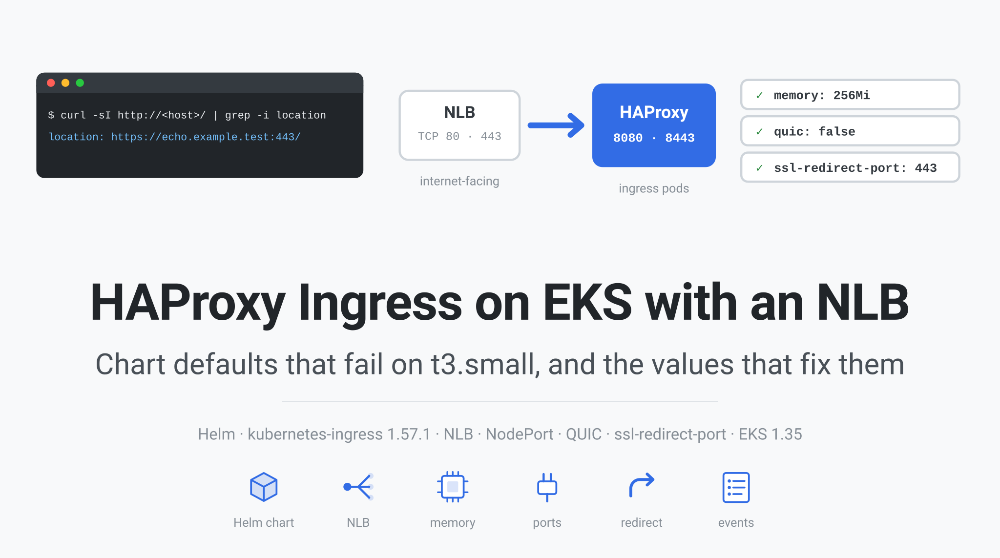

# HAProxy Ingress Controller on EKS with a Network Load Balancer



This installs the [HAProxy Kubernetes Ingress Controller](https://github.com/haproxytech/kubernetes-ingress) on an EKS cluster with Helm and exposes it through an internet-facing AWS Network Load Balancer (NLB). The chart's defaults don't work on a small EKS cluster: the pods never schedule, the NLB is never created, and HTTP is redirected to a port nobody listens on. The [values file](#the-values-file) below fixes all three, and each problem is reproduced in [Troubleshooting](#troubleshooting).

Everything was tested on EKS 1.35 (`v1.35.9-eks-91f89a9`) with three `t3.small` worker nodes (Ubuntu 24.04, kubelet 1.34.12), chart `haproxytech/kubernetes-ingress` 1.57.1 (controller 3.4.1), Helm 4.3.2 and AWS CLI 2.42.2. The problems were reproduced with a second, separate release in its own namespace and IngressClass, next to the one in use.

## How Traffic Gets In

[](traffic-path.svg "Open the diagram full size")

No AWS Load Balancer Controller is needed. A Service of type `LoadBalancer` with the `aws-load-balancer-type: nlb` annotation is enough: EKS's built-in service controller, which runs in the AWS-managed control plane, creates the NLB. It puts the NLB in the subnets tagged `kubernetes.io/role/elb=1`, and on the test cluster the NLB it created looked like this:

```
$ aws elbv2 describe-load-balancers --output text \
    --query "LoadBalancers[?DNSName=='<host>'].[LoadBalancerName,Type,Scheme,State.Code,join(',',AvailabilityZones[].SubnetId)]"
a5eaa7de4ed314482afbbc5e4637360b	network	internet-facing	provisioning	subnet-003df92d929eb2646,subnet-02be0e402d2049dfd,subnet-091059a99f495804e

$ aws elbv2 describe-listeners --load-balancer-arn <arn> --query 'Listeners[].[Port,Protocol]' --output text
80	TCP
443	TCP

$ aws elbv2 describe-target-groups --load-balancer-arn <arn> --query 'TargetGroups[].[Port,Protocol,TargetType]' --output text
31829	TCP	instance
30598	TCP	instance

$ aws ec2 describe-subnets --subnet-ids <the NLB's subnets> --output text \
    --query 'Subnets[].[SubnetId,AvailabilityZone,join(`,`,Tags[?starts_with(Key,`kubernetes.io`)].join(`=`,[Key,Value]))]'
subnet-02be0e402d2049dfd	us-east-1b	kubernetes.io/cluster/demo-cluster=owned,kubernetes.io/role/elb=1
subnet-003df92d929eb2646	us-east-1a	kubernetes.io/cluster/demo-cluster=owned,kubernetes.io/role/elb=1
subnet-091059a99f495804e	us-east-1c	kubernetes.io/role/elb=1,kubernetes.io/cluster/demo-cluster=owned
```

The targets are the Service's **NodePorts** on every node (target type `instance`), and kube-proxy forwards from there to an HAProxy pod, which listens on 8080 and 8443 inside the pod.

## Prerequisites

- An EKS cluster whose nodes are `Ready`, with public subnets tagged `kubernetes.io/role/elb=1`.
- `kubectl`, `helm` and the AWS CLI installed, and a session: `aws login --profile default` (a recent AWS CLI v2 command; it signs in with your console credentials and refreshes them automatically).

## The Values File

[Download haproxy-values.yaml](haproxy-values.yaml)

```yaml
# Values for the HAProxy Kubernetes Ingress Controller
# Chart: haproxytech/kubernetes-ingress (https://haproxytech.github.io/helm-charts)
# Tested with chart 1.57.1 (controller 3.4.1) on EKS 1.35 with t3.small nodes.
# Install steps and troubleshooting: https://corneschi.ro/haproxy-ingress-eks/

controller:
  # Two replicas so one node going away doesn't take ingress down.
  # Note: t3.small nodes fit only ~11 pods each.
  replicaCount: 2

  # The chart default requests 2Gi memory, which never fits on a t3.small
  # (2 GiB total, ~1.4 GiB allocatable). These sizes suit a small demo cluster.
  resources:
    requests:
      cpu: 100m
      memory: 256Mi
    limits:
      memory: 512Mi

  service:
    # Exposes HAProxy through an AWS Network Load Balancer.
    # The NLB is placed in the public subnets tagged kubernetes.io/role/elb=1
    # (set by Terraform or eksctl when the VPC is created).
    type: LoadBalancer
    annotations:
      service.beta.kubernetes.io/aws-load-balancer-type: "nlb"
      service.beta.kubernetes.io/aws-load-balancer-scheme: "internet-facing"
    # Ports exposed on the NLB.
    # quic: off - it adds UDP 443 next to TCP 443, and EKS's built-in load balancer
    #   controller rejects mixed TCP/UDP ("mixed protocol is not supported").
    # stat/admin: off - keep the stats page and admin/pprof port off the internet;
    #   they're still reachable inside the cluster (kubectl port-forward).
    enablePorts:
      http: true
      https: true
      quic: false
      stat: false
      admin: false

  # Global controller settings (ConfigMap).
  # ssl-redirect-port: HAProxy listens on 8443 inside the pod, so by default its
  #   HTTP->HTTPS redirect points to https://host:8443/, which the NLB doesn't
  #   expose. Redirect to the public port 443 instead (the Location header
  #   then reads https://host:443/, which browsers treat as https://host/).
  config:
    ssl-redirect-port: "443"

  # Registers the "haproxy" IngressClass and makes it the cluster default,
  # so Ingress objects without ingressClassName are handled by HAProxy.
  ingressClassResource:
    name: haproxy
    default: true
```

What each block changes compared with the chart's defaults:

| Setting | Chart default (1.57.1) | This file | Why |
|---------|------------------------|-----------|-----|
| `resources` | requests `cpu: 250m`, `memory: 2Gi`, limit `2560Mi` | requests `100m` / `256Mi`, limit `512Mi` | 2Gi never fits on a `t3.small` |
| `service.type` | `NodePort` | `LoadBalancer` + NLB annotations | creates the NLB |
| `enablePorts` | `http`, `https`, `quic`, `stat`, `admin` all `true` | only `http` and `https` | UDP for QUIC blocks the NLB; stats and admin shouldn't be public |
| `config.ssl-redirect-port` | unset (redirects to `8443`) | `"443"` | the NLB only listens on 443 |
| `ingressClassResource.default` | `false` | `true` | Ingresses without a class go to HAProxy |

## Install

Point a kubeconfig at the cluster:

```bash
aws eks update-kubeconfig --name demo-cluster --region us-east-1 --profile default
```

Add the chart repository:

```bash
helm repo add haproxytech https://haproxytech.github.io/helm-charts && helm repo update
```

Install, pinned to the tested chart version:

```bash
helm install haproxy-ingress haproxytech/kubernetes-ingress --version 1.57.1 \
  -n haproxy-controller --create-namespace -f haproxy-values.yaml
```

Watch for the NLB hostname under `EXTERNAL-IP`:

```bash
kubectl get svc -n haproxy-controller -w
```

The hostname appears within seconds of the Service being accepted, but the NLB only starts passing traffic once it is active and its targets are healthy. On the test cluster the first successful request came about 3.5 minutes after the hostname appeared. Until then `curl` gets no answer.

The running controller, with only TCP 80 and 443 on the NLB:

```
$ kubectl get svc,pods -n haproxy-controller
NAME                                         TYPE           CLUSTER-IP       EXTERNAL-IP                                                                     PORT(S)                      AGE
service/haproxy-ingress-kubernetes-ingress   LoadBalancer   172.20.248.115   ae58ce51db6324efbba598f4519b76f2-a4381599b789bf89.elb.us-east-1.amazonaws.com   80:32560/TCP,443:30293/TCP   159m

NAME                                                      READY   STATUS    RESTARTS   AGE
pod/haproxy-ingress-kubernetes-ingress-86db54bff6-5wlcx   1/1     Running   0          138m
pod/haproxy-ingress-kubernetes-ingress-86db54bff6-8xghd   1/1     Running   0          138m
```

## Test

Deploy a small app and route `/` to it:

```bash
kubectl create deployment echo --image=hashicorp/http-echo -- /http-echo -text="hello from haproxy"
```

```bash
kubectl expose deployment echo --port=80 --target-port=5678
```

```bash
kubectl create ingress echo --class=haproxy --rule="/*=echo:80"
```

```
$ curl http://<EXTERNAL-IP>/
hello from haproxy

$ curl -sI http://<EXTERNAL-IP>/
HTTP/1.1 200 OK
x-app-name: http-echo
x-app-version: 1.0.0
date: Thu, 26 Nov 2026 14:57:09 GMT
content-length: 19
content-type: text/plain; charset=utf-8
```

This Ingress has no TLS, so plain HTTP is served directly. An Ingress **with** a `tls:` section is redirected from HTTP to HTTPS; see [the 8443 redirect](#http-redirects-to-httpshost8443-and-hangs).

Remove the test app:

```bash
kubectl delete ingress,service,deployment echo
```

## Upgrade or Change Settings

Edit `haproxy-values.yaml`, then:

```bash
helm upgrade haproxy-ingress haproxytech/kubernetes-ingress --version 1.57.1 \
  -n haproxy-controller -f haproxy-values.yaml
```

Changes under `controller.config` go to a ConfigMap that the controller reloads by itself: after changing `ssl-redirect-port`, the new redirect was served by the same pod, without a restart.

## Uninstall

**Do this before tearing down the cluster or VPC** (for example `terraform destroy`). The NLB is created by Kubernetes, not by Terraform, so Terraform doesn't know it exists: if it's left behind it keeps billing and blocks deleting the VPC.

```bash
helm uninstall haproxy-ingress -n haproxy-controller
```

```bash
kubectl delete namespace haproxy-controller
```

When the test release was uninstalled, its NLB was gone from `aws elbv2 describe-load-balancers` within seconds. The chart's CRDs are installed by a Job, not as part of the release, so `helm uninstall` leaves them in place.

## Troubleshooting

To reproduce these, a second release was installed from the chart's defaults, with only the Service switched to an NLB, and the fixes applied one `helm upgrade` at a time:

```yaml
controller:
  replicaCount: 1
  ingressClass: haproxy-test
  ingressClassResource:
    name: haproxy-test
    default: false
  service:
    type: LoadBalancer
    annotations:
      service.beta.kubernetes.io/aws-load-balancer-type: "nlb"
      service.beta.kubernetes.io/aws-load-balancer-scheme: "internet-facing"
```

### Where to See Errors

The NLB is created by EKS's built-in service controller in the managed control plane, so there is no controller pod whose logs you can read. It reports to the **Service's events**; if the NLB was never created, there is nothing in the AWS console either.

The Service, with its ports and events at the bottom:

```bash
kubectl describe svc haproxy-ingress-kubernetes-ingress -n haproxy-controller
```

Only the Service's events, newest last:

```bash
kubectl get events -n haproxy-controller --field-selector involvedObject.kind=Service --sort-by=.lastTimestamp
```

All warnings in the namespace (pods and Service):

```bash
kubectl get events -n haproxy-controller --field-selector type=Warning
```

Which Helm revision is running, to confirm an upgrade was applied:

```
$ helm history haproxy-test -n haproxy-test
REVISION	UPDATED                 	STATUS    	CHART                    	APP VERSION	DESCRIPTION
1       	Thu Nov 26 16:51:20 2026	superseded	kubernetes-ingress-1.57.1	3.4.1      	Install complete
2       	Thu Nov 26 16:52:08 2026	superseded	kubernetes-ingress-1.57.1	3.4.1      	Upgrade complete
3       	Thu Nov 26 16:52:45 2026	superseded	kubernetes-ingress-1.57.1	3.4.1      	Upgrade complete
4       	Thu Nov 26 16:57:47 2026	deployed  	kubernetes-ingress-1.57.1	3.4.1      	Upgrade complete
```

Events are kept for about an hour, so a warning that was already fixed stays listed until it expires.

### Pods Stay `Pending`: `Insufficient memory`

With the chart's defaults the pod never schedules:

```
$ kubectl get deploy -n haproxy-test -o jsonpath='{.items[0].spec.template.spec.containers[0].resources}'
{"limits":{"memory":"2560Mi"},"requests":{"cpu":"250m","memory":"2Gi"}}

Warning   FailedScheduling   0/3 nodes are available: 2 Too many pods, 3 Insufficient memory. no new claims to deallocate, preemption: 0/3 nodes are available: 3 Preemption is not helpful for scheduling.
```

A `t3.small` has 2 GiB of memory, and what's left for pods is less:

```
$ kubectl get nodes -o custom-columns=NAME:.metadata.name,TYPE:.metadata.labels.node\\.kubernetes\\.io/instance-type,ALLOC_MEM:.status.allocatable.memory,PODS:.status.allocatable.pods
NAME                         TYPE       ALLOC_MEM   PODS
ip-10-0-1-51.ec2.internal    t3.small   1464280Ki   11
ip-10-0-2-147.ec2.internal   t3.small   1464284Ki   11
ip-10-0-3-239.ec2.internal   t3.small   1464284Ki   11
```

1464280Ki is about 1.4 GiB, so a 2Gi request can never fit, and adding nodes or Cluster Autoscaler won't help because every node is the same size. (`2 Too many pods` is a separate limit: two nodes already ran their maximum of 11 pods.)

Fix: `controller.resources` in the values file (requests `100m` / `256Mi`, limit `512Mi`). With only that change, the next revision's pod was `Running` within seconds. If the pods later restart with `OOMKilled`, raise the memory limit.

### `EXTERNAL-IP` Stays `<pending>`: `mixed protocol is not supported`

With the default ports, the Service asks for five ports, two of them on 443:

```
NAME                              TYPE           CLUSTER-IP      EXTERNAL-IP   PORT(S)                                                                  AGE
haproxy-test-kubernetes-ingress   LoadBalancer   172.20.195.15   <pending>     80:30598/TCP,443:31829/TCP,443:31829/UDP,1024:31064/TCP,6060:32687/TCP   72s
```

```
2026-11-26T14:52:00Z   4     EnsuringLoadBalancer     Ensuring load balancer
2026-11-26T14:52:00Z   4     SyncLoadBalancerFailed   Error syncing load balancer: failed to ensure load balancer: mixed protocol is not supported for LoadBalancer
```

`443/UDP` is QUIC (HTTP/3). EKS's built-in controller can't put TCP and UDP on one load balancer, so it never creates the NLB and keeps retrying. The defaults also publish the stats page (`1024`) and the admin/pprof port (`6060`) on the load balancer.

Fix: `controller.service.enablePorts` with `quic`, `stat` and `admin` set to `false`. After that upgrade the Service had only `80/TCP` and `443/TCP`, and the next retry, about 15 seconds later, created the NLB:

```
$ kubectl describe svc haproxy-test-kubernetes-ingress -n haproxy-test
...
LoadBalancer Ingress:     a5eaa7de4ed314482afbbc5e4637360b-d0c735ffb6e93c54.elb.us-east-1.amazonaws.com
Port:                     http  80/TCP
TargetPort:               http/TCP
NodePort:                 http  30598/TCP
Endpoints:                10.0.3.169:8080
Port:                     https  443/TCP
TargetPort:               https/TCP
NodePort:                 https  31829/TCP
Endpoints:                10.0.3.169:8443
...
Events:
  Type     Reason                  Age                 From                Message
  ----     ------                  ----                ----                -------
  Warning  SyncLoadBalancerFailed  25s (x5 over 100s)  service-controller  Error syncing load balancer: failed to ensure load balancer: mixed protocol is not supported for LoadBalancer
  Normal   EnsuringLoadBalancer    10s (x6 over 100s)  service-controller  Ensuring load balancer
  Normal   EnsuredLoadBalancer     7s                  service-controller  Ensured load balancer
```

If the error persists, check that the upgrade was applied: `helm history` shows a new revision, and the Service's ports no longer include `443/UDP`.

### `http://` Redirects to `https://<host>:8443/` and Hangs

[](redirect-8443.svg "Open the diagram full size")

This only happens for an Ingress with TLS: HAProxy redirects its HTTP requests to HTTPS. The test used a self-signed certificate for `echo.example.test`:

```bash
kubectl create secret tls echo-tls --cert=tls.crt --key=tls.key
kubectl create ingress echo-tls --class=haproxy --rule="echo.example.test/*=echo:80,tls=echo-tls"
```

HAProxy listens on 8443 inside the pod and, by default, puts that port in the redirect. The NLB only listens on 443:

```
$ curl -sI -H "Host: echo.example.test" http://<host>/
HTTP/1.1 302 Found
location: https://echo.example.test:8443/

$ curl -sk -o /dev/null --max-time 10 -w '%{http_code} %{url_effective} (%{errormsg})\n' \
    --resolve echo.example.test:8443:<NLB IP> https://echo.example.test:8443/
000 https://echo.example.test:8443/ (Connection timed out after 10003 milliseconds)
```

Fix: `controller.config.ssl-redirect-port: "443"`. Then check the redirect target:

```
$ curl -sI http://<host>/ | grep -i location
location: https://echo.example.test:443/

$ curl -skL -w '\n%{http_code} %{num_redirects} redirect(s), final %{url_effective}\n' \
    --resolve echo.example.test:80:<NLB IP> --resolve echo.example.test:443:<NLB IP> http://echo.example.test/
hello from haproxy

200 1 redirect(s), final https://echo.example.test:443/
```

The port stays in the URL as `:443`. That's the HTTPS default, so browsers and `curl` treat it as `https://echo.example.test/`.

### `Startup probe failed` or `Readiness probe failed` Right After Start

The chart points all three probes (startup, readiness, liveness) at `:1042/healthz`. In the first seconds HAProxy isn't listening yet, so one event like this is normal:

```
Readiness probe failed: Get "http://10.0.3.169:1042/healthz": dial tcp 10.0.3.169:1042: connect: connection refused
```

It only matters if the pod keeps restarting (`RESTARTS` growing in `kubectl get pods -n haproxy-controller`).

### Viewing the HAProxy Stats Page

The `stat` port is off on the NLB. Forward it to your machine:

```bash
kubectl port-forward -n haproxy-controller deploy/haproxy-ingress-kubernetes-ingress 1024:1024
```

```
Forwarding from 127.0.0.1:1024 -> 1024
Forwarding from [::1]:1024 -> 1024
```

Then open <http://localhost:1024/> in a browser: it returned HAProxy's "Statistics Report for HAProxy" page.

## Notes

- **Pod capacity:** `t3.small` nodes take 11 pods each, and system add-ons already use several. Two of the three test nodes were full, which is the `Too many pods` above. If pods stay `Pending`, add nodes or use a larger instance type.
- **Cost:** the NLB is billed per hour while it exists, plus for the traffic it carries.
- **kubectl version:** keep `kubectl` within one minor version of the cluster. With kubectl 1.37 against EKS 1.35 every command prints `version difference between client (1.37) and server (1.35) exceeds the supported minor version skew of +/-1`.

## See Also

- [HAProxy Kubernetes Ingress Controller](https://github.com/haproxytech/kubernetes-ingress)
- [haproxytech Helm charts](https://github.com/haproxytech/helm-charts)
- [Network Load Balancing on Amazon EKS](https://docs.aws.amazon.com/eks/latest/userguide/network-load-balancing.html)
- [What's New in Helm 4](../helm-4-whats-new/index.md)
- [Helm Cheatsheet](../helm/index.md)
- [Kubernetes Node Selectors: nodeSelector, Node Affinity, Taints and nodeName](../kubernetes-node-selectors/index.md)
