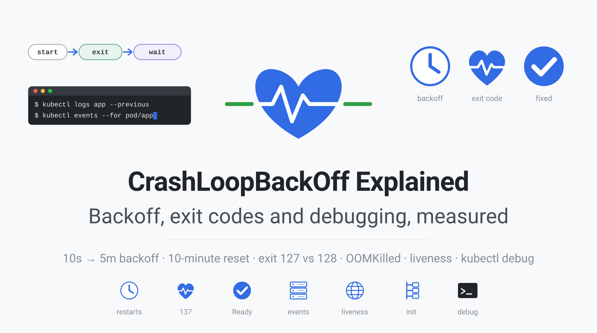
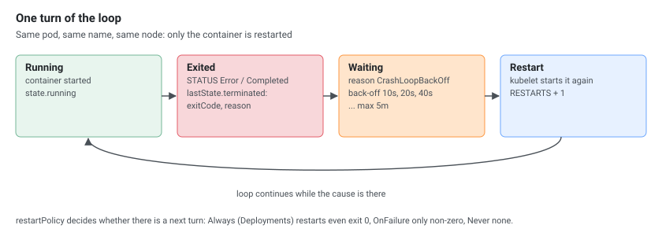
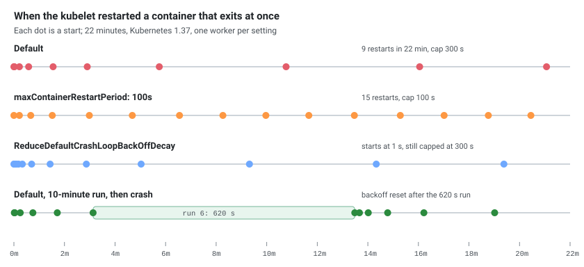
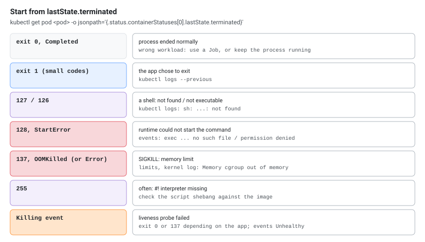
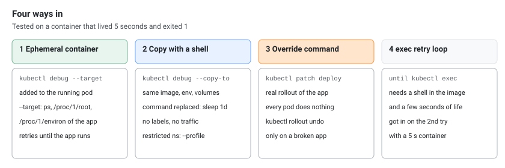

# CrashLoopBackOff Explained: Backoff, Exit Codes and How to Debug It



CrashLoopBackOff isn't an error by itself. It's the kubelet saying: this container keeps exiting, so I'll wait a little longer before starting it again. The real error is whatever made the container exit, and this article shows where to find it. Everything below was run on a kind cluster with Kubernetes 1.37, with three workers configured differently to compare the backoff settings.

## 1. What CrashLoopBackOff Is

[](crashloop-cycle.svg "Open the diagram full size")

When a container exits and the pod's `restartPolicy` says it should be restarted, the kubelet restarts it in the same pod (same name, same node, same IP), but not immediately every time: after each crash it waits a delay that doubles, from 10 seconds up to 5 minutes. While it waits, the container's state is `waiting` with reason `CrashLoopBackOff`.

```bash
kubectl get pod <pod>
kubectl get pod <pod> -o jsonpath='{.status.containerStatuses[0].state}{"\n"}'
kubectl get pod <pod> -o jsonpath='{.status.containerStatuses[0].lastState.terminated}{"\n"}'
```

The `state` field is the present (`running`, or `waiting` with `back-off 20s restarting failed container=...`); `lastState.terminated` is the run that just ended, with its `exitCode`, `reason` and timestamps. That's where the cause starts.

### What kubectl get pods Shows

A container that printed an error and exited 1 after 2 seconds, sampled every 0.7 seconds:

| Time | STATUS | RESTARTS |
|---|---|---|
| 0 s | `ContainerCreating` | 0 |
| 1 s | `Running` | 0 |
| 4 s | `Running` | 1 |
| 7 s | `Error` | 1 |
| 20 s | `Running` | 2 |
| 22 s | `Error` | 2 |
| 48 s | `Running` | 3 |
| 51 s | `Error` | 3 |

The pattern starts as **Running, Error, Running, Error**, with RESTARTS climbing; the waits between runs were 13 and 26 seconds. Once the delays grow, the pod spends most of its time waiting, and the column mostly says `CrashLoopBackOff`: sampled every 2 seconds a few minutes later, it showed `CrashLoopBackOff` in 52 of 60 samples. The `BackOff` event (`Back-off restarting failed container app in pod ...`) counts the waits. Whatever the column shows at the moment you look, the restart count and `lastState` tell the story.

### restartPolicy Decides What Gets Restarted

| restartPolicy | Exit code 0 | Exit code ≠ 0 | Used by |
|---|---|---|---|
| `Always` (default) | Restarted | Restarted | Deployments, StatefulSets, DaemonSets: they only allow `Always` |
| `OnFailure` | Not restarted (`Completed`) | Restarted, with backoff | Jobs, CronJobs, bare pods |
| `Never` | Not restarted (`Completed`) | Not restarted (`Error`) | Jobs, one-off bare pods |

So **a Deployment whose container finishes successfully loops too**: `echo done; exit 0` showed `Completed` with 3 restarts within a minute, exit code 0 every time. A Deployment needs a process that keeps running (a server, a worker loop); one-off work belongs in a Job. With `OnFailure` the same `exit 0` gave `Completed` and 0 restarts, `exit 1` gave `Error` and 2 restarts in 30 seconds; with `Never`, `exit 1` gave `Error` and 0 restarts.

## 2. The Backoff Delays

[](crashloop-backoff.svg "Open the diagram full size")

A container that exits 1 immediately, on three workers with different kubelet settings, recorded for 22 minutes. The times are when each run started, in seconds after the first:

| Kubelet setting | Runs started at (s) | Delays |
|---|---|---|
| Default | 0, 1, 13, 35, 93, 174, 345, 646, 963, 1264 | immediate, then ≈10, 20, 40, 80, 160, 300, 300 |
| `maxContainerRestartPeriod: "100s"` | 0, 13, 40, 91, 179, 281, 393, 496, 598, 700 ... | ≈10, 20, 40, 80, then every ≈100 |
| `ReduceDefaultCrashLoopBackOffDecay` gate | 0, 1, 3, 6, 11, 20, 42, 86, 172, 302, 559, 860, 1163 | 1, 2, 3, 5, 9, 22, 44, 86, 130, 257, then 300 |

With the defaults, the first restart is immediate, then the delay doubles from 10 seconds to the **5-minute cap**, reached after about 6 minutes; from then on the pod restarts every 5 minutes, about 12 times an hour, forever. The measured gaps are a few seconds longer than the nominal delay (container start, status update, and the 2-second polling of the test). After 22 minutes the default pod had 9 restarts; the 100-second one had 15.

`ReduceDefaultCrashLoopBackOffDecay` is documented as "1 second initial, 60 seconds maximum". On Kubernetes 1.37 the first part held, the delays started at 1 second, but the maximum stayed at **300 seconds**: the kubelet's own `maxContainerRestartPeriod` (5 minutes unless set) takes precedence. Set both to get a short cap.

### Changing the Backoff

The curve can be changed per node in the kubelet configuration. Both settings below were tested on their own worker:

```yaml
# /var/lib/kubelet/config.yaml (KubeletConfiguration)
crashLoopBackOff:
  maxContainerRestartPeriod: "100s"      # KubeletCrashLoopBackOffMax, beta and on by default
featureGates:
  ReduceDefaultCrashLoopBackOffDecay: true   # alpha, off by default
```

```bash
kubectl get --raw /api/v1/nodes/<node>/proxy/configz | jq '.kubeletconfig | {featureGates, crashLoopBackOff}'
```

The `configz` endpoint shows what a kubelet actually runs with: `"maxContainerRestartPeriod":"1m40s"` on the first worker, and the feature gate on the second. There's no per-pod setting. Shorter delays help a pod recover sooner after the cause is fixed, but a pod that keeps crashing then restarts more often, with more load on the node and more image pulls. On managed clusters (EKS, GKE, AKS) the kubelet configuration belongs to the node image or node pool settings.

### When the Backoff Resets

The kubelet forgets the backoff once a container has run for **10 minutes** without exiting. The test container crashed at once on its first 5 runs (the delays reached ≈85 seconds), ran for 620 seconds on the 6th, then crashed at once again. The next restart came after **1 second**, and the following delays were 11, 21, 46, 86 and 168 seconds: the curve started over. A pod that crashes every 9 minutes never resets and keeps the 5-minute delays; one that crashes every 11 minutes is restarted at once each time.

Deleting the pod also starts over: a controller creates a new pod with a restart count of 0 and no backoff.

```bash
kubectl delete pod <pod>                         # the Deployment creates a fresh one
kubectl rollout restart deployment/<name>        # all pods, as a rolling update
```

That's a way to retry immediately once the cause is fixed outside the pod (a database that's back, a Secret that now exists), not a fix.

## 3. Read the Exit Code and Reason First

[](crashloop-diagnosis.svg "Open the diagram full size")

```bash
kubectl get pod <pod> -o jsonpath='{.status.containerStatuses[0].lastState.terminated.exitCode} {.status.containerStatuses[0].lastState.terminated.reason}{"\n"}'
kubectl logs <pod> --previous
kubectl events --for pod/<pod>
```

Each row below is a pod that was run with `restartPolicy: Always` and left to loop:

| What the container did | STATUS | Reason / exit code | Where the details are |
|---|---|---|---|
| App printed an error and exited 1 | `Error`, `CrashLoopBackOff` | `Error` / 1 | `kubectl logs` |
| Exited 0 | `Completed` | `Completed` / 0 | Wrong workload type (see above) |
| `command: ["/app/start.sh"]`, file doesn't exist | `RunContainerError` | `StartError` / **128** | Event: `exec: "/app/start.sh": stat /app/start.sh: no such file or directory` |
| Script without the execute bit, run directly | `RunContainerError` | `StartError` / **128** | Event: `exec: "/scripts/start.sh": permission denied` |
| Script with `#!/bin/bash`, image without bash | `Error` | `Error` / 255 | Nothing useful in the logs |
| `sh -c /app/start.sh`, file doesn't exist | `Error` | `Error` / **127** | Logs: `sh: /app/start.sh: not found` |
| `sh -c /scripts/start.sh`, not executable | `Error` | `Error` / **126** | Logs: `Permission denied` |
| Memory limit exceeded | `OOMKilled` | `OOMKilled` / 137 | `describe pod` (limits), the node's kernel log |
| Killed by a failing liveness probe | `CrashLoopBackOff` | depends on the app (section 4) | Events: `Liveness probe failed`, `Killing` |
| Second container binding the same port | `Error` | `Error` / 1 | Logs: `httpd: bind: Address already in use` |

The common claim that a missing command gives exit code 127 holds **only when a shell runs it**. When the container's own `command` can't be started, the runtime never starts a process: the pod shows `RunContainerError`, `lastState` says `StartError` with exit code 128, and the reason is only in the events and the `message` field, not in the logs (there are none). The `#!/bin/bash` case is the most confusing one: the file exists, but its interpreter doesn't, and it exits 255.

Exit codes above 128 are `128 + signal number`: 137 is SIGKILL (9), 143 is SIGTERM (15), 139 is SIGSEGV (11). A process running as PID 1 in a container **ignores** signals it has no handler for: `kill -TERM $$` and `kill -SEGV $$` from a shell that is PID 1 did nothing, and the container exited 0 when its script ended.

### OOM Kills

```bash
kubectl get pod <pod> -o jsonpath='{.spec.containers[0].resources.limits.memory}{"\n"}'
kubectl top pod <pod> --containers
kubectl debug node/<node> -i --image=busybox:1.37 --profile=sysadmin -- chroot /host sh -c 'dmesg | grep -i "out of memory" | tail -3'
```

A container allocating memory in a loop under a 32Mi or 64Mi limit showed STATUS `OOMKilled`, reason `OOMKilled`, exit code 137, for a shell running `tail /dev/zero`, `tail` run directly and a Python process. The node's kernel log had the matching line: `Memory cgroup out of memory: Killed process 25364 (tail)`. On other clusters (k3s with the Docker runtime) the same kind of kill was reported as `Error` with exit code 137, so treat 137 under a memory limit as an OOM kill even when the reason doesn't say so, and confirm it in the kernel log.

`kubectl top` shows usage only at the moment it samples, so a container that dies within seconds may never show its peak there. The fix is a higher memory limit or less memory used, not more replicas.

## 4. Common Causes

### The App Exits on Startup

Missing environment variables, a config file that isn't mounted, a database it can't reach on the first try. The logs say it:

```bash
kubectl logs <pod> --previous      # the run that crashed
kubectl logs <pod>                 # the current run, if it's up
kubectl logs deployment/<name>     # one pod of a Deployment, without looking up its name
```

`--previous` sometimes fails with `unable to retrieve container logs`, when the runtime has already removed the crashed container; plain `kubectl logs` right after a restart usually shows the same error. Apps that crash because a dependency isn't up yet should retry with a backoff of their own, or wait in an init container:

```yaml
initContainers:
- name: wait-for-db
  image: busybox:1.37
  command: ['sh', '-c', 'until nc -z postgres 5432; do echo waiting for db; sleep 2; done']
```

### Liveness Probe Failures

```bash
kubectl events --for pod/<pod> | grep -E 'Unhealthy|Killing'
```

An nginx container with a liveness probe on a path that returns 404 was killed after every second failure: `Liveness probe failed: HTTP probe failed with statuscode: 404`, then `Container web failed liveness probe, will be restarted`, 3 restarts in 45 seconds, `CrashLoopBackOff`. The **exit code depends on the app**: nginx stops cleanly on SIGTERM, so `lastState` said `Completed`, exit code **0**; a `sleep` process (which ignores SIGTERM as PID 1) was killed after the grace period with `Error`, **137**. Don't read a 0 or a 137 alone: check the `Killing` events.

The trap is a liveness probe that checks a **dependency**. Three replicas of an app whose liveness probe called a database Service: when the database was scaled to 0, all three were restarted at the same moment (2 restarts each within 75 seconds), and the restarts did nothing for the database. Liveness should answer "is this process alive and not stuck"; put dependency checks in the readiness probe, which only takes the pod out of the Service. Slow starters need a `startupProbe`. Probe setup: [Kubernetes Health Checks](/posts/kubernetes-health-checks-probes/).

### Missing Config, Wrong Image, Wrong Port

These look similar in `kubectl get pods` but aren't crash loops:

| Status | What failed | Where to look |
|---|---|---|
| `ImagePullBackOff` / `ErrImagePull` | The image can't be pulled; the container never started | Events |
| `CreateContainerConfigError` | A ConfigMap, Secret or key is missing; never started | `describe pod`: `couldn't find key ...`, `secret "x" not found` |
| `RunContainerError` | The runtime couldn't start the command | Events (`StartError`, section 3) |
| `Completed` with restarts | Exit 0 under `restartPolicy: Always` | Section 1 |
| `CrashLoopBackOff` / `Error` | The container **started** and exited | Logs, exit code |

Two containers in one pod listening on the same port collide, because they share one network namespace: one stayed up, the other looped with `httpd: bind: Address already in use` (`READY 1/2`). An image built for another CPU architecture fails with `exec format error`, unless the node emulates that architecture: on colima an amd64-only busybox simply ran on the arm64 node under QEMU, slower but without an error.

### Init Containers and Sidecars

```bash
kubectl get pod <pod>
kubectl logs <pod> -c <init-container-name>
```

| Setup | STATUS | What happened |
|---|---|---|
| Init container exits 1, `restartPolicy: Always` | `Init:Error` / `Init:CrashLoopBackOff` | Restarted with backoff (3 restarts in 50 s); the app container never starts |
| Init container exits 1, `restartPolicy: Never` | `Init:Error` | No restart; the pod is `Failed` |
| Native sidecar (`initContainers` with `restartPolicy: Always`) crashing | `Running`, `2/2` | The sidecar restarted 3 times; the app kept running |
| The same sidecar in a pod with `restartPolicy: Never` | `Completed` after the app finished | The sidecar **still** restarted (2 times) |

A failing init container blocks the whole pod, so its logs (`-c <name>`) are the first place to look. A native sidecar follows its own `restartPolicy: Always`, whatever the pod's policy, and its crashes show up only in the sidecar's restart count.

## 5. Getting Inside a Crashing Container

[](crashloop-debug.svg "Open the diagram full size")

A crashing container is rarely running when you try `kubectl exec`. The test app slept 5 seconds, printed `Error: DATABASE_URL is not set` and exited 1.

### Method 1: Ephemeral Debug Container

```bash
kubectl debug <pod> -it --image=busybox:1.37 --target=<container> --profile=general
# inside:
ps
ls /proc/1/root/                             # the app container's filesystem
tr '\0' '\n' < /proc/1/environ               # its environment
```

`--target` is what makes the app's processes visible: `ps` listed the app's `sh -c ...` as PID 1 and its `sleep 5`, `/proc/1/root/` showed its filesystem and `/proc/1/environ` its variables, **without** `shareProcessNamespace` (the pod's field was empty). On a container that is between crashes, kubectl kept retrying with `invalid target container` warnings until the app was running, then attached. The debug container shares the pod's network too. It stays in the pod spec and can't be restarted or removed; every `kubectl debug` adds another.

### Method 2: A Copy of the Pod With a Shell

```bash
kubectl debug <pod> --copy-to=<pod>-debug --container=<container> -- sleep 1d
kubectl debug <pod> --copy-to=<pod>-debug --container=<container> --image=alpine:3.22 -- sleep 1d   # also swap the image
kubectl exec -it <pod>-debug -- sh
kubectl delete pod <pod>-debug
```

The copy keeps the image, environment and volumes, with the command replaced, so it stays up and you can start the app by hand to watch it fail. It has no labels, so no Service sends it traffic. In a namespace that enforces the `restricted` Pod Security level, the copy was **rejected** (`must not include "SYS_PTRACE" in securityContext.capabilities.add`, added by the default `general` profile) and only worked with `--profile=restricted`.

### Method 3: Override the Command

```bash
kubectl patch deployment <name> --type=json \
  -p='[{"op":"replace","path":"/spec/template/spec/containers/0/command","value":["/bin/sh","-c","sleep infinity"]}]'
kubectl exec -it deploy/<name> -- sh
kubectl rollout undo deployment/<name>
```

That's a rollout of the real Deployment: every pod is replaced by one that does nothing. Use it on a Deployment that's broken anyway, and undo it afterwards (`kubectl rollout undo` brought the old command back). Method 2 is the same idea without touching the Deployment.

### Method 4: Exec in the Short Window

```bash
for i in $(seq 1 40); do kubectl exec deploy/<name> -- sh -c 'cat /proc/1/cmdline | tr "\0" " "; echo' && break; sleep 1; done
```

With a container that lived 5 seconds, the loop got in on the second try. It only works when the image has a shell and the container lives long enough to run your command.

## 6. Diagnostic Workflow

```bash
kubectl get pod <pod> -n <ns>                                   # STATUS, RESTARTS
kubectl get pod <pod> -n <ns> -o jsonpath='{.status.containerStatuses[0].lastState.terminated}' | jq
kubectl logs <pod> -n <ns> --previous                           # the run that crashed
kubectl events -n <ns> --for pod/<pod>                          # StartError, Killing, BackOff, OOM
kubectl describe pod <pod> -n <ns>                              # limits, probes, mounts, init containers
kubectl logs <pod> -n <ns> --all-containers --prefix            # every container, init and sidecars included
kubectl get pods -n <ns> -o jsonpath='{range .items[*]}{.metadata.name}{"\t"}{range .status.containerStatuses[*]}{.name}={.restartCount} {end}{"\n"}{end}'
```

1. **Exit code and reason** first (section 3): they decide where to look.
2. **Logs** for exit 1, 127, 126 and app errors.
3. **Events** for `StartError` (128), liveness kills, OOM and back-off timings.
4. **`describe pod`** for limits, probes and the init containers' state.
5. **Get inside** (section 5) when the logs don't explain it.

## 7. Prevention

- **Run the image locally** with the same command and env first: `docker run --rm -e ... <image>`.
- **Use the right workload:** Jobs for tasks that end, Deployments for processes that keep running.
- **Liveness checks the process only**; dependencies go in readiness; slow starts get a startup probe.
- **Size memory limits from real usage** (for example the 95th percentile of the last weeks, plus headroom).
- **Start scripts with `#!/bin/sh` and `set -eu`**, and mount scripts with `defaultMode: 0755`.
- **Pin image tags** and build multi-arch images if the cluster mixes `amd64` and `arm64` nodes.
- **Reject bad specs at admission** (Kyverno, Gatekeeper, ValidatingAdmissionPolicy): pods without memory limits or probes.
- **Alert on restarts** instead of waiting for users, for example `increase(kube_pod_container_status_restarts_total[15m]) > 3` from kube-state-metrics.

## Gotchas

- **CrashLoopBackOff is the wait, not the error.** The error is in `lastState`, the logs and the events.
- **A wrong `command` gives `StartError` and exit code 128**, not 127; 127 and 126 come from a shell.
- **`#!/bin/bash` in an image without bash** exits 255 for a file that exists.
- **A Deployment loops even on exit 0.**
- **A liveness kill can look like a clean exit** (exit 0) or like an OOM kill (137); the `Killing` event tells you.
- **Liveness on a dependency** restarts every replica at once and fixes nothing.
- **`kubectl logs --previous` can fail** on fast loops; plain `kubectl logs` usually has the same message.
- **`OOMKilled` isn't always the reason shown** for an OOM kill; 137 plus the kernel log is the proof.
- **A crashing native sidecar restarts even in a `restartPolicy: Never` pod.**
- **Copies of a pod are rejected in restricted namespaces** without `--profile=restricted`.
- **The backoff can only be tuned per node**, not per pod.

## See Also

- [Kubernetes Troubleshooting: 10 Failures, Reproduced and Fixed](/posts/kubernetes-troubleshooting-techniques/)
- [kubectl describe vs kubectl logs](/posts/kubectl-describe-vs-logs/)
- [Kubernetes Health Checks: Liveness, Readiness, and Startup Probes](/posts/kubernetes-health-checks-probes/)
- [Kubernetes Pod Lifecycle Management](/posts/kubernetes-pod-lifecycle-management/)
- [Kubernetes Rolling Updates: What Actually Happens, Measured](/posts/kubernetes-rolling-updates/)
- [Kubernetes docs: Pod Lifecycle, container restarts](https://kubernetes.io/docs/concepts/workloads/pods/pod-lifecycle/#container-restarts)
