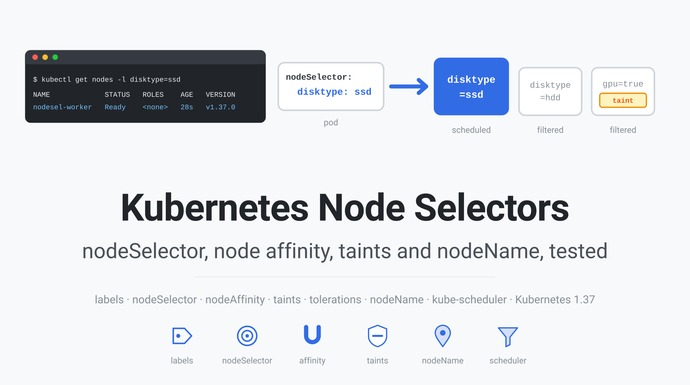
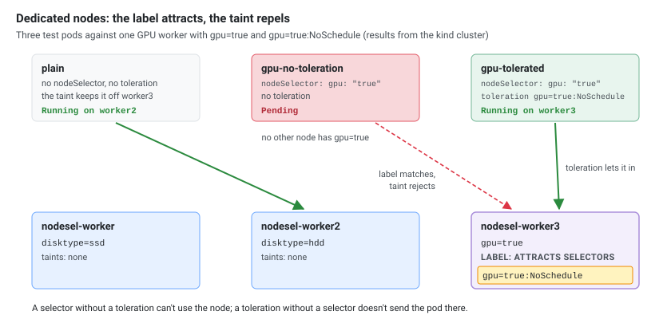

# Kubernetes Node Selectors: nodeSelector, Node Affinity, Taints and nodeName



Node selectors are the simplest way to constrain pods to specific nodes. They match against node labels: if a node has **all** the labels, the pod can be scheduled there.

Everything below was tested on a four-node kind cluster (one control plane, three workers) running Kubernetes 1.37.0, with `nginx:1.29-alpine` as the test container. kind has no cloud provider, so the zone labels were added by hand to stand in for one. The EKS, AKS, GKE, eksctl and Karpenter commands could not run there; they were checked against the AWS CLI 2.42.2 help and the providers' documentation.

## How nodeSelector Works

```yaml
apiVersion: v1
kind: Pod
metadata:
  name: my-app
spec:
  nodeSelector:
    disktype: ssd
    environment: production
  containers:
    - name: app
      image: nginx:1.29-alpine
```

The scheduler only considers nodes that have **every** listed label with exactly that value. A second pod asks for `disktype: nvme`, which no node has:

```
$ kubectl get pods -o wide
NAME       READY   STATUS    RESTARTS   AGE   IP           NODE             NOMINATED NODE   READINESS GATES
my-app     1/1     Running   0          7s    10.244.1.2   nodesel-worker   <none>           <none>
no-match   0/1     Pending   0          7s    <none>       <none>           <none>           <none>

$ kubectl describe pod no-match | sed -n '/^Events:/,$p'
Events:
  Type     Reason            Age   From               Message
  ----     ------            ----  ----               -------
  Warning  FailedScheduling  7s    default-scheduler  0/4 nodes are available: 1 node(s) had untolerated taint(s), 3 node(s) didn't match Pod's node affinity/selector. preemption: 0/4 nodes are available: 4 Preemption is not helpful for scheduling.
```

The pod stays `Pending` until a matching node appears. The message gives **one reason per node**, the first check that rejected it: the control-plane node is counted under "untolerated taint" (its `node-role.kubernetes.io/control-plane:NoSchedule` taint), not under the selector, even though it doesn't have the label either.

## The Test Cluster

The three workers got different labels, so each example has somewhere to land and somewhere it can't:

```
$ kubectl get nodes -L disktype,environment,gpu,topology.kubernetes.io/zone
NAME                    STATUS   ROLES           AGE   VERSION   DISKTYPE   ENVIRONMENT   GPU    ZONE
nodesel-control-plane   Ready    control-plane   52s   v1.37.0                                   
nodesel-worker          Ready    <none>          38s   v1.37.0   ssd        production           us-east-1a
nodesel-worker2         Ready    <none>          38s   v1.37.0   hdd        production           us-east-1b
nodesel-worker3         Ready    <none>          38s   v1.37.0                            true   us-east-1c
```

Later sections also add a `memory-gb` label (16, 32 and 64) and a `gpu=true:NoSchedule` taint on `nodesel-worker3`.

## Node Labels

### Built-in Labels

The kubelet sets a few labels on every node. Without a cloud provider, that is all a node has:

```
$ kubectl label --list node nodesel-worker
kubernetes.io/os=linux
beta.kubernetes.io/arch=arm64
beta.kubernetes.io/os=linux
kubernetes.io/arch=arm64
kubernetes.io/hostname=nodesel-worker
```

Cloud providers and node provisioners add more. These are the common ones (not present on kind):

| Label | Example value | Set by |
|-------|---------------|--------|
| `kubernetes.io/hostname` | `ip-10-0-1-42.ec2.internal` | kubelet |
| `kubernetes.io/os` | `linux` | kubelet |
| `kubernetes.io/arch` | `amd64`, `arm64` | kubelet |
| `node.kubernetes.io/instance-type` | `m5.xlarge` (EKS), `Standard_D2s_v3` (AKS) | cloud provider |
| `topology.kubernetes.io/zone` | `us-east-1a` | cloud provider |
| `topology.kubernetes.io/region` | `us-east-1` | cloud provider |
| `eks.amazonaws.com/capacityType` | `ON_DEMAND` or `SPOT` | EKS managed node groups |
| `eks.amazonaws.com/nodegroup` | `workers` | EKS managed node groups |
| `karpenter.sh/capacity-type` | `spot`, `on-demand` or `reserved` | Karpenter |

### Viewing Labels

```sh
# All labels of one node, one per line
kubectl label --list node <node-name>

# Selected labels as columns, for all nodes
kubectl get nodes -L disktype,topology.kubernetes.io/zone

# Everything on one (long) line per node
kubectl get node <node-name> --show-labels
```

`kubectl describe node <node-name> | grep -A 20 "Labels:"` also works, but the 20 lines run past the labels into annotations, the creation time and taints.

### Selecting Nodes by Label

`-l` takes the same selector syntax that Deployments and Services use:

```
$ kubectl get nodes -l disktype=ssd
NAME             STATUS   ROLES    AGE   VERSION
nodesel-worker   Ready    <none>   28s   v1.37.0

$ kubectl get nodes -l 'disktype in (ssd,nvme)'
NAME             STATUS   ROLES    AGE   VERSION
nodesel-worker   Ready    <none>   28s   v1.37.0

$ kubectl get nodes -l '!disktype'
NAME                    STATUS   ROLES           AGE   VERSION
nodesel-control-plane   Ready    control-plane   42s   v1.37.0
nodesel-worker2         Ready    <none>          28s   v1.37.0
nodesel-worker3         Ready    <none>          28s   v1.37.0
```

A comma means AND: `-l disktype=ssd,environment=production`.

## Adding Custom Labels

### Label a Node by Hand

```
$ kubectl label node nodesel-worker disktype=ssd
node/nodesel-worker labeled

$ kubectl label node nodesel-worker team=platform environment=production tier=frontend
node/nodesel-worker labeled

$ kubectl label node nodesel-worker environment=staging
error: 'environment' already has a value (production), and --overwrite is false

$ kubectl label node nodesel-worker environment=staging --overwrite
node/nodesel-worker labeled

$ kubectl label node nodesel-worker tier-
node/nodesel-worker unlabeled

$ kubectl label node nodesel-worker tier-
label "tier" not found.
node/nodesel-worker not labeled
```

Labels set this way live on the Node object only. If the node is deleted and registers again (a replaced cloud instance, a node group rollout, or `kubectl delete node`), they are gone. On `nodesel-worker3`, deleting the Node object and restarting the kubelet brought it back without its `gpu=true` and zone labels and without its taint. For nodes that come and go, set labels where the nodes are created: kubelet flags, the node group, or the Karpenter NodePool.

### Label Nodes at Boot (kubelet --node-labels)

The kubelet's `--node-labels` flag applies labels when the node **registers**. On EKS, the old `/etc/eks/bootstrap.sh --kubelet-extra-args '--node-labels=...'` belongs to Amazon Linux 2, and EKS stopped publishing AL2 AMIs on November 26, 2025. Amazon Linux 2023 nodes are configured by `nodeadm` with a `NodeConfig` in the user data:

```yaml
apiVersion: node.eks.aws/v1alpha1
kind: NodeConfig
spec:
  cluster:
    name: my-cluster
    apiServerEndpoint: https://EXAMPLE.gr7.us-east-1.eks.amazonaws.com
    certificateAuthority: <base64 CA>
    cidr: 10.100.0.0/16
  kubelet:
    flags:
      - --node-labels=team=platform,environment=prod,workload=compute
```

Two things about `--node-labels` showed up when testing it on a kind worker:

- **It only acts at registration.** Adding `--node-labels=workload=compute` and restarting the kubelet of an already registered node changed nothing. The label appeared only after the Node object was deleted and the kubelet registered it again.
- **Most `kubernetes.io` and `k8s.io` labels are refused.** With `node-role.kubernetes.io/worker=` in the list, the kubelet does not start at all, and systemd keeps restarting it:

```
failed to validate kubelet flags: unknown 'kubernetes.io' or 'k8s.io' labels specified with --node-labels: [node-role.kubernetes.io/worker]
```

Only a short allowed list passes. `--node-labels=workload=compute,node.kubernetes.io/pool=gpu,topology.kubernetes.io/zone=us-east-1c,kubelet.kubernetes.io/role=gpu` was accepted, and all four labels were on the node after it registered. An admin with `kubectl label` is not restricted: `kubectl label node nodesel-worker node-role.kubernetes.io/worker=` worked and made the ROLES column show `worker`.

### Label Nodes Through the Node Group or Node Pool

The managed services keep labels on the node group, so replaced nodes get them too:

```sh
# EKS managed node group: labels for new node groups
aws eks create-nodegroup --cluster-name <cluster> \
  --nodegroup-name gpu-pool \
  --labels gpu=true,team=ml \
  ...

# EKS: change labels on an existing node group
aws eks update-nodegroup-config --cluster-name <cluster> --nodegroup-name gpu-pool \
  --labels 'addOrUpdateLabels={team=ml-platform},removeLabels=gpu'

# AKS node pool (space-separated)
az aks nodepool add --cluster-name <cluster> -g <rg> \
  --name gpupool \
  --labels gpu=true team=ml

# GKE node pool (comma-separated)
gcloud container node-pools create gpu-pool \
  --cluster <cluster> \
  --node-labels=gpu=true,team=ml
```

AWS documents node group labels as something you can "update at any time" on the instances in the group, AKS and GKE have `az aks nodepool update --labels` and `gcloud container node-pools update --node-labels` for the same job. The AKS and GKE updates **replace** the user-set labels rather than merge, so pass the full list.

With eksctl, for managed node groups:

```sh
eksctl set labels --cluster managed-cluster --nodegroup managed-ng-1 \
  --labels role=worker,environment=prod

eksctl unset labels --cluster managed-cluster --nodegroup managed-ng-1 \
  --labels role
```

### Label Nodes with Karpenter

Labels in the NodePool template are applied to every node Karpenter creates:

```yaml
apiVersion: karpenter.sh/v1
kind: NodePool
metadata:
  name: gpu
spec:
  template:
    metadata:
      labels:
        team: ml
        gpu: "true"
        workload: training
```

## Label Values Are Strings: Quote Them

`nodeSelector` is a map of strings. An unquoted `true`, `yes`, `on` or `1` is a boolean or a number in YAML, and the API server rejects the whole pod:

```
== gpu: true
Error from server (BadRequest): error when creating "gpu.yaml": Pod in version "v1" cannot be handled as a Pod: json: cannot unmarshal bool into Go struct field PodSpec.spec.nodeSelector of type string
== gpu: "true"
pod/gpu-test created (server dry run)
== gpu: yes
Error from server (BadRequest): error when creating "gpu.yaml": Pod in version "v1" cannot be handled as a Pod: json: cannot unmarshal bool into Go struct field PodSpec.spec.nodeSelector of type string
== gpu: on
Error from server (BadRequest): error when creating "gpu.yaml": Pod in version "v1" cannot be handled as a Pod: json: cannot unmarshal bool into Go struct field PodSpec.spec.nodeSelector of type string
== gpu: 1
Error from server (BadRequest): error when creating "gpu.yaml": Pod in version "v1" cannot be handled as a Pod: json: cannot unmarshal number into Go struct field PodSpec.spec.nodeSelector of type string
== gpu: "1"
pod/gpu-test created (server dry run)
```

On the command line there is no such problem: `kubectl label node x gpu=true` always stores the string `true`. Keys and values are also case-sensitive. After `kubectl label node nodesel-worker Disktype=SSD`, `kubectl get nodes -l disktype=SSD` returned `No resources found`.

## nodeSelector Examples

```yaml
# A specific instance type
spec:
  nodeSelector:
    node.kubernetes.io/instance-type: m5.2xlarge
---
# A specific zone
spec:
  nodeSelector:
    topology.kubernetes.io/zone: us-east-1a
---
# Spot capacity: EKS managed node groups
spec:
  nodeSelector:
    eks.amazonaws.com/capacityType: SPOT
---
# Spot capacity: Karpenter
spec:
  nodeSelector:
    karpenter.sh/capacity-type: spot
---
# Linux nodes only (in clusters with Windows nodes)
spec:
  nodeSelector:
    kubernetes.io/os: linux
---
# GPU nodes (custom label)
spec:
  nodeSelector:
    gpu: "true"
  containers:
    - name: training
      image: ml-training:latest
      resources:
        limits:
          nvidia.com/gpu: 1
```

## nodeSelector in Deployments

The selector goes in the pod template, not in the Deployment spec:

```yaml
apiVersion: apps/v1
kind: Deployment
metadata:
  name: web-app
spec:
  replicas: 3
  selector:
    matchLabels:
      app: web
  template:
    metadata:
      labels:
        app: web
    spec:
      nodeSelector:
        environment: production
        disktype: ssd
      containers:
        - name: web
          image: nginx:1.29-alpine
```

All three replicas landed on the only matching node. Then the `disktype` label was removed from that node, to see what a label change does to a running Deployment:

```
$ kubectl get pods -l app=web -o wide          # after: kubectl label node nodesel-worker disktype-
NAME                      STATUS   NODE
web-app-5b84579c74-bwr4v  Running  nodesel-worker
web-app-5b84579c74-kgntg  Running  nodesel-worker
web-app-5b84579c74-zrntb  Running  nodesel-worker

$ kubectl scale deploy/web-app --replicas=4
NAME                      STATUS   NODE
web-app-5b84579c74-bwr4v  Running  nodesel-worker
web-app-5b84579c74-k5rm8  Pending  <none>
web-app-5b84579c74-kgntg  Running  nodesel-worker
web-app-5b84579c74-zrntb  Running  nodesel-worker

$ kubectl rollout restart deploy/web-app
NAME                      STATUS   NODE
web-app-5b84579c74-bwr4v  Running  nodesel-worker
web-app-5b84579c74-kgntg  Running  nodesel-worker
web-app-5b84579c74-zrntb  Running  nodesel-worker
web-app-658c8f76bd-m7bkl  Pending  <none>
web-app-658c8f76bd-t7skh  Pending  <none>
```

Running pods are not evicted (the selector is only checked at scheduling time), but every **new** pod is: the extra replica stays Pending, and the rolling update stalls with the old pods still running. Putting the label back let the rollout finish.

## nodeSelector vs Node Affinity vs Taints

| Feature | nodeSelector | Node affinity | Taints + tolerations |
|---------|:------------:|:-------------:|:--------------------:|
| Set on | Pod | Pod | Node (taint) and pod (toleration) |
| Logic | AND of exact matches | `In`, `NotIn`, `Exists`, `DoesNotExist`, `Gt`, `Lt`; terms can be ORed | Repel every pod that doesn't tolerate the taint |
| Soft preference | No | Yes (`preferredDuringScheduling...`) | Yes (`PreferNoSchedule`) |
| Keep pods away from nodes | No | Yes (`NotIn`, `DoesNotExist`) | Yes |
| Keep *other* pods off a node | No | No | Yes |
| Use case | "Run here" | "Prefer here" or "not there" | "Keep everything else out" |

- **nodeSelector**: simple hard rules, "this workload must run on SSD nodes".
- **Node affinity**: anything with OR, NOT, numeric comparisons or a preference, "prefer zone a, accept zone b", "never on spot".
- **Taints and tolerations**: reserving nodes, "only ML workloads on GPU nodes". Usually combined with a selector or affinity (see [Dedicated Nodes](#dedicated-nodes-label-and-taint)).

## Node Affinity

### Required (Hard Constraint)

The same as `nodeSelector`, with operators:

```yaml
spec:
  affinity:
    nodeAffinity:
      requiredDuringSchedulingIgnoredDuringExecution:
        nodeSelectorTerms:
          - matchExpressions:
              - key: topology.kubernetes.io/zone
                operator: In
                values:
                  - us-east-1a
                  - us-east-1b
```

Expressions inside one term are ANDed. **Separate terms are ORed**: this pod may run on an `nvme` node *or* on any node with a `gpu` label:

```yaml
        nodeSelectorTerms:
          - matchExpressions:
              - key: disktype
                operator: In
                values: ["nvme"]
          - matchExpressions:
              - key: gpu
                operator: Exists
```

### Preferred (Soft Constraint)

The scheduler adds the weight of every matching preference to a node's score; if nothing matches, the pod still runs somewhere:

```yaml
spec:
  affinity:
    nodeAffinity:
      preferredDuringSchedulingIgnoredDuringExecution:
        - weight: 80
          preference:
            matchExpressions:
              - key: disktype
                operator: In
                values:
                  - ssd
        - weight: 20
          preference:
            matchExpressions:
              - key: topology.kubernetes.io/zone
                operator: In
                values:
                  - us-east-1b
```

Weights go from 1 to 100. Preferences are one input among other scores (spreading, resource balance, image locality), so a preferred node is likely, not guaranteed.

### Operators

| Operator | Meaning | Example |
|----------|---------|---------|
| `In` | Value is one of the list | `zone In [us-east-1a, us-east-1b]` |
| `NotIn` | Value is not in the list (or the label is missing) | `disktype NotIn [ssd]` |
| `Exists` | The key exists, any value | `gpu Exists` |
| `DoesNotExist` | The key does not exist | `gpu DoesNotExist` |
| `Gt` | Value, read as an integer, is greater | `memory-gb Gt 32` |
| `Lt` | Value, read as an integer, is smaller | `memory-gb Lt 32` |

The API checks the shape of each expression:

```
The Pod "aff-gt-bad" is invalid: spec.affinity.nodeAffinity.requiredDuringSchedulingIgnoredDuringExecution.nodeSelectorTerms[0].matchExpressions[0].values: Required value: must be specified single value when `operator` is 'Lt' or 'Gt'
The Pod "aff-exists-bad" is invalid: spec.affinity.nodeAffinity.requiredDuringSchedulingIgnoredDuringExecution.nodeSelectorTerms[0].matchExpressions[0].values: Forbidden: may not be specified when `operator` is 'Exists' or 'DoesNotExist'
```

### What Each Example Did

With the labels from [The Test Cluster](#the-test-cluster) and `memory-gb` set to 16, 32 and 64 on the three workers:

| Pod | Rule | Placed on |
|-----|------|-----------|
| `aff-zones` | zone `In [us-east-1a, us-east-1b]` | `nodesel-worker2` (zone b) |
| `aff-gt` | `memory-gb Gt 32` | `nodesel-worker3` (64) |
| `aff-notgpu` | `gpu DoesNotExist` and `disktype NotIn [ssd]` | `nodesel-worker2` |
| `aff-or` | `disktype In [nvme]` OR `gpu Exists` | `nodesel-worker3` |
| `aff-preferred` | prefer `ssd` (80), prefer zone b (20) | `nodesel-worker` (the ssd node) |
| `aff-pref-nomatch` | prefer `disktype In [nvme]` only | `nodesel-worker2` (ran anyway) |
| `both-conflict` | `nodeSelector: disktype=ssd` and required zone `us-east-1b` | Pending |
| `both-ok` | `nodeSelector: disktype=ssd` and preferred zones in `us-west-1` | `nodesel-worker` |

### Combining nodeSelector with Node Affinity

Both are checked, and **both must match**. `both-conflict` asked for the ssd node and for zone `us-east-1b`, which is a different node, so it stayed Pending with the same "didn't match Pod's node affinity/selector" message. Use `nodeSelector` for the hard requirement and a preferred affinity for the nice-to-have:

```yaml
spec:
  nodeSelector:
    disktype: ssd                     # hard requirement: must have SSD
  affinity:
    nodeAffinity:
      preferredDuringSchedulingIgnoredDuringExecution:
        - weight: 100
          preference:
            matchExpressions:
              - key: topology.kubernetes.io/zone
                operator: In
                values: ["us-west-1a", "us-west-1b"]   # soft: prefer these zones
```

No node is in `us-west-1`, so `both-ok` simply ran on the ssd node.

## Dedicated Nodes: Label and Taint

[](dedicated-nodes.svg "Open the diagram full size")

A label only attracts the pods that ask for it. To keep everything else **off** a node, also taint it:

```sh
kubectl label node nodesel-worker3 gpu=true       # for nodeSelector
kubectl taint node nodesel-worker3 gpu=true:NoSchedule   # to repel other pods
```

```yaml
# Runs on the GPU node: selector and toleration
spec:
  nodeSelector:
    gpu: "true"
  tolerations:
    - key: gpu
      value: "true"
      effect: NoSchedule
  containers:
    - name: app
      image: nginx:1.29-alpine
```

Three pods: one with only the selector, one with the selector and the toleration, one with neither:

```
NAME               STATUS   NODE
gpu-no-toleration  Pending  <none>
gpu-tolerated      Running  nodesel-worker3
plain              Running  nodesel-worker2

0/4 nodes are available: 2 node(s) didn't match Pod's node affinity/selector, 2 node(s) had untolerated taint(s). preemption: 0/4 nodes are available: 4 Preemption is not helpful for scheduling.
```

The selector alone is not enough: the GPU node matches the label but rejects the pod with its taint. A toleration alone is not enough either: it *allows* the GPU node but doesn't *send* the pod there.

## nodeName vs nodeSelector

[](nodename-vs-nodeselector.svg "Open the diagram full size")

`nodeName` writes the node into the pod directly, so the scheduler never looks at it. That skips the scheduler's checks, **not** the kubelet's: the kubelet still admits or rejects every pod it is given.

| Aspect | `nodeName` | `nodeSelector` |
|--------|------------|----------------|
| Scheduler | Skipped | Filters and scores nodes |
| `NoSchedule` taints | Ignored (pod runs) | Respected |
| `NoExecute` taints | Rejected by the kubelet, then deleted | Respected |
| Not enough CPU/memory | Kubelet rejects it: pod `Failed` (`OutOfmemory`, `OutOfcpu`) | Pod stays `Pending` |
| Node doesn't exist | `Pending`, then deleted by the pod garbage collector | Pod stays `Pending` |
| Rescheduling | Never | A new pod from its controller is scheduled again |
| Production use | Avoid | Fine |

Four `nodeName` pods, each testing one row:

```
$ kubectl get pods -o wide
NAME        READY  STATUS       NODE
nn-big      0/1    OutOfmemory  nodesel-worker
nn-missing  0/1    Pending      worker-99
nn-tainted  1/1    Running      nodesel-worker3

$ kubectl get pod nn-big -o jsonpath='{.status.phase} {.status.reason}: {.status.message}'
Failed OutOfmemory: Pod was rejected: Node didn't have enough resource: memory, requested: 68719476736, used: 52428800, capacity: 6198554624
```

- `nn-tainted` was sent to the GPU node with its `gpu=true:NoSchedule` taint and no toleration, and it runs.
- `nn-big` requested 64Gi on a node with about 6 GiB. The kubelet refused it immediately; nothing was started, so there was nothing to OOM.
- `nn-missing` names a node that doesn't exist. It was Pending at 50 seconds and gone at 61: the pod garbage collector deletes pods bound to nodes that don't exist.
- `nn-noexecute` was sent to a node with a `maintenance=true:NoExecute` taint. It never shows up in the list, because it was deleted within seconds:

```
$ kubectl get events --field-selector involvedObject.name=nn-noexecute
REASON                 FROM                        MESSAGE
TaintManagerEviction   taint-eviction-controller   Marking for deletion Pod default/nn-noexecute
TaintToleration        kubelet                     Predicate TaintToleration failed: node(s) had taints that the pod didn't tolerate
```

### Pinning a Pod to One Node, the Right Way

To put a pod on one particular node, select its hostname label and keep the scheduler in the loop:

```yaml
spec:
  nodeSelector:
    kubernetes.io/hostname: worker-3   # constrains the scheduler's choice
  tolerations:                         # only if the node is tainted
    - key: maintenance
      operator: Equal
      value: "true"
      effect: NoSchedule
```

If the node lacks resources or doesn't exist, the pod waits in `Pending` with an event that says why, instead of failing or disappearing. `nodeName` is for static pods, debugging, and tools that do their own scheduling.

## Where nodeSelector Fits in Scheduling

[](scheduling-cycle.svg "Open the diagram full size")

The kube-scheduler runs every pod through plugins in stages. Its metrics (`scheduler_plugin_execution_duration_seconds`) on the test cluster list them by stage, including:

| Stage | Plugins that ran |
|-------|------------------|
| Filter | `NodeAffinity`, `NodeName`, `NodeResourcesFit`, `NodeUnschedulable`, `TaintToleration` |
| Score | `ImageLocality`, `NodeAffinity`, `NodeResourcesFit`, `PodTopologySpread`, `TaintToleration` |
| Bind | `DefaultBinder` |

`nodeSelector` is handled by the **`NodeAffinity` filter**, together with required node affinity; that is why the event says "didn't match Pod's node affinity/selector". It removes nodes before scoring and never adds points, so it is a hard constraint. Preferred node affinity is scored by the same plugin in the Score stage. Older articles call these steps predicates and priorities (`MatchNodeSelector`, `PodFitsResources`, `NodePreferAvoidPods`); those names come from the scheduler policy API that was removed, and `NodePreferAvoidPods` no longer exists.

## Related Scheduling Features

### Topology Spread Constraints

Spread replicas across zones (or nodes):

```yaml
spec:
  topologySpreadConstraints:
    - maxSkew: 1
      topologyKey: topology.kubernetes.io/zone
      whenUnsatisfiable: ScheduleAnyway
      labelSelector:
        matchLabels:
          app: spread
```

Four replicas went two to `us-east-1a` and two to `us-east-1b`; the third zone's only node was the tainted GPU node. With `ScheduleAnyway` the constraint is a score, so the pods still run when it can't be met; `DoNotSchedule` makes it a filter.

### Pod Affinity and Anti-Affinity

These look at **pods** already on a node, not at node labels.

```yaml
# Pod affinity: run next to the cache
spec:
  affinity:
    podAffinity:
      requiredDuringSchedulingIgnoredDuringExecution:
        - labelSelector:
            matchLabels:
              app: cache
          topologyKey: kubernetes.io/hostname
---
# Pod anti-affinity: one replica per node
spec:
  affinity:
    podAntiAffinity:
      requiredDuringSchedulingIgnoredDuringExecution:
        - labelSelector:
            matchLabels:
              app: anti
          topologyKey: kubernetes.io/hostname
```

The `api` pod with pod affinity landed on the same node as `cache` (`nodesel-worker2`). With anti-affinity, three replicas and only two untainted workers, the third replica stayed Pending:

```
0/4 nodes are available: 2 node(s) didn't match pod anti-affinity rules, 2 node(s) had untolerated taint(s). preemption: 0/4 nodes are available: 2 No preemption victims found for incoming pod, 2 Preemption is not helpful for scheduling.
```

### Custom Schedulers

```yaml
spec:
  schedulerName: my-custom-scheduler
```

The default scheduler then ignores the pod. If no scheduler with that name is running, the pod stays Pending **with no events at all**, since nothing ever looks at it: `kubectl get events` for it returned nothing.

## Troubleshooting

### Pod Stuck in Pending

```sh
kubectl describe pod <pod-name> | sed -n '/^Events:/,$p'
```

The message counts nodes by the first reason each was rejected:

| Message part | Meaning |
|--------------|---------|
| `didn't match Pod's node affinity/selector` | `nodeSelector` or required node affinity doesn't match the node's labels |
| `had untolerated taint(s)` | A taint the pod doesn't tolerate (includes the control-plane taint) |
| `didn't match pod anti-affinity rules` | Another pod on the node blocks this one |
| `Insufficient cpu` / `Insufficient memory` | Requests don't fit in what's left on the node (a 50-CPU request: `2 Insufficient cpu, 2 node(s) had untolerated taint(s)`) |
| `Preemption is not helpful for scheduling` | Evicting lower-priority pods wouldn't help either |
| (no events at all) | `schedulerName` names a scheduler that isn't running |

### Check What the Pod Asks For and What the Nodes Have

```sh
# What the pod requires
kubectl get pod <pod-name> -o jsonpath='{.spec.nodeSelector}{"\n"}{.spec.affinity.nodeAffinity}{"\n"}'

# Nodes that match a set of labels
kubectl get nodes -l "disktype=ssd,environment=production"

# How many
kubectl get nodes -l disktype=ssd --no-headers | wc -l

# Labels and taints side by side
kubectl get nodes -L disktype,gpu,topology.kubernetes.io/zone
kubectl describe nodes | grep -E '^Name:|^Taints:'
```

### Labels as Columns: Quote the Dots

In `custom-columns`, dots in a label key must be escaped with a backslash, and the shell removes an unquoted backslash:

```
$ kubectl get nodes -o custom-columns=NAME:.metadata.name,ZONE:.metadata.labels.topology\.kubernetes\.io/zone
NAME                    ZONE
nodesel-control-plane   <none>
nodesel-worker          <none>
nodesel-worker2         <none>
nodesel-worker3         <none>

$ kubectl get nodes -o custom-columns='NAME:.metadata.name,ZONE:.metadata.labels.topology\.kubernetes\.io/zone'
NAME                    ZONE
nodesel-control-plane   <none>
nodesel-worker          us-east-1a
nodesel-worker2         us-east-1b
nodesel-worker3         us-east-1c
```

Use single quotes (or double the backslashes), or skip the escaping with `-L topology.kubernetes.io/zone`.

## One-Liners

```sh
# Label every node that matches a selector (all nodes of an EKS node group, for example)
kubectl label nodes -l eks.amazonaws.com/nodegroup=workers environment=production

# Remove a label from all nodes ("label not found" for nodes without it is harmless)
kubectl label nodes --all disktype-

# Pods that have a nodeSelector
kubectl get pods -A -o json | jq -c '.items[] | select(.spec.nodeSelector != null) | {name: .metadata.name, ns: .metadata.namespace, nodeSelector: .spec.nodeSelector}'

# Nodes a Deployment's nodeSelector matches
LABELS=$(kubectl get deploy <name> -o jsonpath='{.spec.template.spec.nodeSelector}')
echo "nodeSelector: $LABELS"
kubectl get nodes -l "$(echo "$LABELS" | jq -r 'to_entries | map("\(.key)=\(.value)") | join(",")')"

# One label for all nodes, as name: value
kubectl get nodes -o json | jq -r '.items[] | "\(.metadata.name): \(.metadata.labels["eks.amazonaws.com/nodegroup"])"'

# Distinct values of a label (node groups, zones, ...)
kubectl get nodes -o json | jq -r '.items[].metadata.labels["eks.amazonaws.com/nodegroup"]' | sort -u

# Save node details to a file
kubectl get nodes -o custom-columns='NAME:.metadata.name,NODEGROUP:.metadata.labels.eks\.amazonaws\.com/nodegroup,INSTANCE-TYPE:.metadata.labels.node\.kubernetes\.io/instance-type,ZONE:.metadata.labels.topology\.kubernetes\.io/zone' > node_details.txt
kubectl get nodes -o json > nodes_all_labels.json
```

The "nodes a Deployment matches" lines printed:

```
nodeSelector: {"disktype":"ssd","environment":"production"}
NAME             STATUS   ROLES    AGE     VERSION
nodesel-worker   Ready    <none>   3m44s   v1.37.0
```

### Copying Labels from One Node to Another

Copying *every* label is wrong: it includes `kubernetes.io/hostname`, the zone and the cloud provider's labels. Without `--overwrite` most of them fail anyway:

```
$ kubectl get node nodesel-worker -o jsonpath='{.metadata.labels}' | jq -r 'to_entries[] | "\(.key)=\(.value)"' | xargs -I {} kubectl label node nodesel-worker2 {}
node/nodesel-worker2 not labeled
node/nodesel-worker2 not labeled
error: 'disktype' already has a value (hdd), and --overwrite is false
node/nodesel-worker2 not labeled
node/nodesel-worker2 not labeled
error: 'kubernetes.io/hostname' already has a value (nodesel-worker2), and --overwrite is false
node/nodesel-worker2 not labeled
error: 'memory-gb' already has a value (32), and --overwrite is false
error: 'topology.kubernetes.io/zone' already has a value (us-east-1b), and --overwrite is false
```

Copy only your own labels, skipping the Kubernetes and provider prefixes:

```sh
kubectl get node node-1 -o json \
  | jq -r '.metadata.labels | to_entries[]
           | select(.key | test("(^|\\.)(kubernetes|k8s)\\.io/|amazonaws\\.com/|azure\\.com/|google\\.com/|karpenter\\.sh/") | not)
           | "\(.key)=\(.value)"' \
  | xargs kubectl label node node-2 --overwrite
```

## Gotchas

- **nodeSelector is AND only.** For OR (zone a or zone b), use node affinity with `In`, or several `nodeSelectorTerms`.
- **Quote label values in YAML.** `gpu: true`, `yes`, `on` and `1` are rejected by the API server; write `gpu: "true"`.
- **Keys and values are case-sensitive.** `Disktype=SSD` and `disktype=ssd` are different labels.
- **A selector doesn't keep other pods out.** Pods without a selector still land on your labeled nodes. Taint the node for exclusivity, and give your own pods both the selector and the toleration.
- **Label changes don't evict running pods**, but every new pod obeys them: scale-ups stay Pending and rolling updates stall.
- **Hand-made labels disappear with the Node object.** A replaced or re-registered node comes back without them; put labels in the node group, NodePool or kubelet flags.
- **`--node-labels` only applies at registration**, and a `kubernetes.io`/`k8s.io` label that isn't on the allowed list stops the kubelet from starting.
- **Don't invent `kubernetes.io/` labels.** The `kubernetes.io` and `k8s.io` prefixes are reserved for Kubernetes. The API server lets an admin set them, but the kubelet refuses most of them, so use your own prefix (`example.com/team`) or none.
- **`nodeName` is not a stronger selector.** It skips the scheduler but not the kubelet: pods that don't fit fail with `OutOfmemory`/`OutOfcpu`, `NoExecute` taints still remove them, and a pod for a missing node is deleted after about a minute.
- **An unknown `schedulerName` fails silently**: Pending, no events.
- **`custom-columns` with label keys needs quotes**, or the escaped dots are lost and the column shows `<none>`.

## Best Practices

| Practice | Why |
|----------|-----|
| Use `nodeSelector` for simple hardware or pool requirements | Easiest to read; GPU, SSD or spot pools are a single label |
| Switch to node affinity for OR, NOT or preferences | `nodeSelector` can only express exact AND matches |
| Taint dedicated nodes, and give their pods selector **and** toleration | The label attracts, the taint keeps everything else out |
| Set labels in the node group, NodePool or kubelet flags | Hand-made labels are lost when nodes are replaced |
| Agree on label names and use your own prefix | `env=prod` on some nodes and `environment=production` on others breaks selectors quietly |
| Always set resource requests | The scheduler packs nodes by requests, selector or not |
| Don't over-constrain | Every extra label shrinks the set of nodes; one missing label leaves pods Pending |
| Prefer `nodeSelector` on `kubernetes.io/hostname` over `nodeName` | The scheduler's checks and Pending events stay in place |

## See Also

- [Assigning Pods to Nodes](https://kubernetes.io/docs/concepts/scheduling-eviction/assign-pod-node/)
- [Taints and Tolerations](https://kubernetes.io/docs/concepts/scheduling-eviction/taint-and-toleration/)
- [Well-Known Labels, Annotations and Taints](https://kubernetes.io/docs/reference/labels-annotations-taints/)
- [Kubernetes Troubleshooting: 10 Failures, Reproduced and Fixed](../kubernetes-troubleshooting-techniques/index.md)
- [Kubernetes CPU and Memory Requests and Limits: What Each Value Really Does](../kubernetes-cpu-memory-requests-limits/index.md)
- [Kubernetes Cluster Autoscaler: Scale-Up, Scale-Down, Expanders and EKS Setup](../kubernetes-cluster-autoscaler-guide/index.md)
