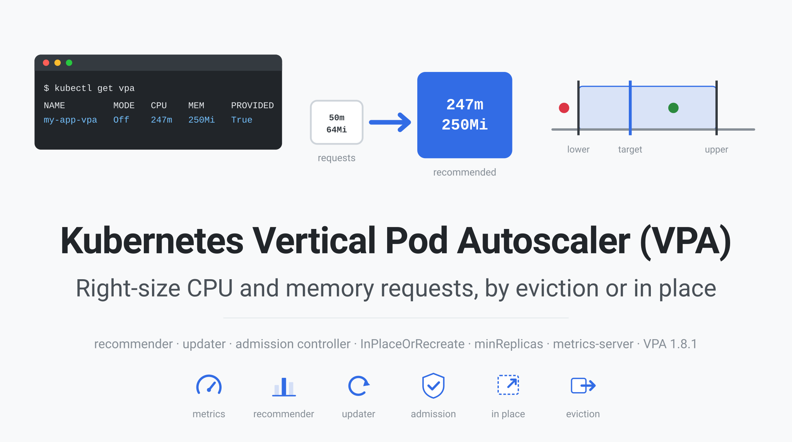
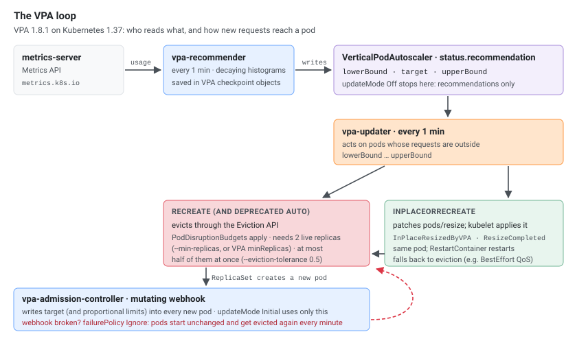
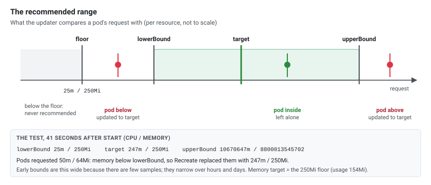

# Kubernetes Vertical Pod Autoscaler (VPA)



Everything below was tested with VPA 1.8.1 and metrics-server v0.9.1 on a three-node kind cluster running Kubernetes 1.37.0. The test workload keeps one CPU thread busy and holds about 150 MiB of memory.

## What VPA Does

The Vertical Pod Autoscaler adjusts the CPU and memory **requests** (and, proportionally, the limits) of pods based on observed usage. Instead of adding more pods (HPA), VPA right-sizes each pod.

```
VPA observes usage → recommends new requests → evicts the pod (or resizes it in place) → the pod runs with updated requests
```

## VPA vs HPA

| Aspect | VPA | HPA |
|--------|-----|-----|
| **Scales** | Pod resources (CPU/memory requests) | Pod count (replicas) |
| **Direction** | Vertical — bigger/smaller pods | Horizontal — more/fewer pods |
| **Disruption** | Evicts and recreates pods, or resizes them in place | No pod disruption |
| **Best for** | Workloads that can't scale horizontally (stateful, single-instance) | Stateless workloads with variable traffic |
| **Metric source** | Usage history from metrics-server (decaying histograms) | Current metrics |

> **Important:** Don't use VPA and HPA on the same metric (e.g., both on CPU). They'll fight each other. You can combine them if HPA uses custom metrics and VPA manages CPU/memory.

## Components

VPA consists of three components, all Deployments in `kube-system`:

| Component | Role |
|-----------|------|
| **Recommender** | Reads usage from the Metrics API every minute and computes recommended requests |
| **Updater** | Once a minute, evicts or resizes running pods whose requests are outside the recommended range |
| **Admission Controller** | A mutating webhook: sets the recommended requests on pods when they're created |

[](vpa-loop.svg "Open the diagram full size")

The updater never writes the new values itself in `Recreate` mode: it evicts the pod, and the admission controller sets the requests on its replacement. If the admission controller doesn't work, the updater keeps evicting pods that come back unchanged (see [Installation](#installation)).

## Installation

VPA is not built into Kubernetes — you install it separately, together with metrics-server. Check out a release tag rather than the default branch:

```bash
# Clone the autoscaler repository at a VPA release
git clone --depth 1 --branch vertical-pod-autoscaler-1.8.1 https://github.com/kubernetes/autoscaler.git
cd autoscaler/vertical-pod-autoscaler

# Install VPA components (needs kubectl and OpenSSL 1.1.1 or later)
./hack/vpa-up.sh

# Verify installation
kubectl get pods -n kube-system | grep vpa
```

```
vpa-admission-controller-54bf55d747-4rz4r        1/1     Running   0          13s
vpa-recommender-785f59768d-xd5cc                 1/1     Running   0          14s
vpa-updater-7d644d7885-mrh9x                     1/1     Running   0          14s
```

> **Warning:** on macOS, `openssl` is LibreSSL. `vpa-up.sh` ran without an error, but the CA certificate it generated had no `CA:TRUE`, so the API server rejected the webhook (`http: TLS handshake error ...: remote error: tls: bad certificate` in the admission controller's log). The webhook's `failurePolicy` is `Ignore`, so nothing failed visibly: new pods were created with their old requests, and the updater evicted them again every minute. Run the script with OpenSSL 3 (`PATH=/opt/homebrew/opt/openssl@3/bin:$PATH ./hack/vpa-up.sh`), or from Linux.

On managed clusters:
- **EKS** — no add-on: AWS's guide deploys it yourself with `./hack/vpa-up.sh` from the GitHub repository, with metrics-server as a prerequisite.
- **GKE** — Google's own implementation of the VPA API; enabled by default on Autopilot clusters, enabled per cluster on Standard.
- **AKS** — `az aks update --name <cluster> --resource-group <rg> --enable-vpa`.

## VPA Resource Structure

```yaml
apiVersion: autoscaling.k8s.io/v1
kind: VerticalPodAutoscaler
metadata:
  name: my-app-vpa
  namespace: default
spec:
  targetRef:
    apiVersion: apps/v1
    kind: Deployment
    name: my-app
  updatePolicy:
    updateMode: "Recreate"        # Off | Initial | Recreate | InPlaceOrRecreate | InPlace | Auto
    minReplicas: 2                # per-VPA override of the updater's --min-replicas
  resourcePolicy:
    containerPolicies:
    - containerName: "*"          # Apply to all containers
      minAllowed:
        cpu: 50m
        memory: 64Mi
      maxAllowed:
        cpu: 2000m
        memory: 4Gi
      controlledResources: ["cpu", "memory"]
      controlledValues: RequestsAndLimits   # RequestsOnly | RequestsAndLimits
```

## Update Modes

VPA 1.8.1 accepts six modes. Without `updatePolicy`, the default is `Recreate`.

| Mode | Behavior | Use Case |
|------|----------|----------|
| `Off` | Only generates recommendations, never applies them | Monitoring — see what VPA would do without risk |
| `Initial` | Applies recommendations only when pods are created | Safe for production — no evictions, only new pods get updated resources |
| `Recreate` | Evicts pods whose requests are outside the recommended range; their replacements get the new values | Auto-tuning for workloads that tolerate restarts |
| `Auto` | **Deprecated**: currently the same as `Recreate` | Use `Recreate` or `InPlaceOrRecreate` instead |
| `InPlaceOrRecreate` | Resizes running pods through the `resize` subresource; evicts when that isn't possible | Stateful apps, long-running jobs, anything sensitive to restarts |
| `InPlace` | Resizes in place only, never evicts | Alpha: needs `--feature-gates=InPlace=true` on the updater and admission controller |

`InPlaceOrRecreate` needs no VPA feature gate in 1.8.1; it needs in-place pod resize in the cluster, which is GA since Kubernetes 1.35.

> **Production tip:** Start with `Off` to observe recommendations, then move to `Initial`, `Recreate` or `InPlaceOrRecreate` once you trust the values.

## In-Place Pod Resize

Since Kubernetes 1.35, in-place pod resize is GA. CPU and memory requests and limits of a running pod can change without deleting or recreating it: the kubelet updates the container's cgroup.

### How It Works with VPA

```
metrics-server → VPA Recommender (calculates target) → VPA Updater (patches the pod's resize subresource) → kubelet (updates the cgroup) → pod runs with new resources
```

With `updateMode: InPlaceOrRecreate`:
1. The recommender finds the pod's requests outside the recommended range
2. The updater patches the pod's `resize` subresource instead of evicting it (event `InPlaceResizedByVPA`)
3. The kubelet applies the change (events `ResizeStarted`, `ResizeCompleted`)
4. If the resize isn't possible, the updater falls back to eviction

In the test, two replicas were resized one after the other, a minute apart; both kept their pod names:

```
ResizeStarted         inplace-5df5b9c98c-g962w     kubelet       Pod resize started: {"containers":[{"name":"app","resources":{"limits":{"cpu":"100m","memory":"1000Mi"},"requests":{"cpu":"25m","memory":"250Mi"}}}],...
InPlaceResizedByVPA   inplace-5df5b9c98c-g962w     vpa-updater   Pod was resized in place by VPA Updater.
Killing               inplace-5df5b9c98c-g962w     kubelet       Container app resize requires restart
ResizeCompleted       inplace-5df5b9c98c-g962w     kubelet       Pod resize completed: ...
```

The `Killing` line comes from the memory `resizePolicy` below (`RestartContainer`).

### Container resizePolicy

The `resizePolicy` field tells the kubelet what to do when a resource changes:

```yaml
spec:
  containers:
  - name: my-app
    image: my-image
    resources:
      requests:
        cpu: 100m
        memory: 256Mi
      limits:
        cpu: 100m
        memory: 256Mi
    resizePolicy:
    - resourceName: cpu
      restartPolicy: NotRequired        # Update cgroup without restart
    - resourceName: memory
      restartPolicy: RestartContainer   # Restart container after memory change
```

| restartPolicy | Behavior |
|---------------|----------|
| `NotRequired` | Cgroup is updated while the container keeps running (default) |
| `RestartContainer` | Container is restarted after the resource change (pod stays running) |

With this policy, the in-place resize above changed CPU without a restart and memory with one: `RESTARTS` went from `0` to `1` on both pods, with the same pod names. The nginx example below (`NotRequired` for both) kept `0` restarts.

> **When to use `RestartContainer`:** JVM-based apps read max heap size at startup. Increasing memory cgroup without restart means the JVM won't use the extra memory. Same applies to any runtime that reads resource limits only once at init.

### VPA with InPlaceOrRecreate Example

```yaml
apiVersion: apps/v1
kind: Deployment
metadata:
  name: nginx
spec:
  replicas: 1
  selector:
    matchLabels:
      app: nginx-resize
  template:
    metadata:
      labels:
        app: nginx-resize
    spec:
      containers:
      - name: nginx
        image: nginx:latest
        resources:
          requests:
            cpu: 50m
            memory: 64Mi
          limits:
            cpu: 50m
            memory: 64Mi
        resizePolicy:
        - resourceName: cpu
          restartPolicy: NotRequired
        - resourceName: memory
          restartPolicy: NotRequired
---
apiVersion: autoscaling.k8s.io/v1
kind: VerticalPodAutoscaler
metadata:
  name: nginx-vpa
spec:
  targetRef:
    apiVersion: apps/v1
    kind: Deployment
    name: nginx
  updatePolicy:
    updateMode: "InPlaceOrRecreate"
    minReplicas: 1
  resourcePolicy:
    containerPolicies:
    - containerName: nginx
      minAllowed:
        cpu: 100m
        memory: 200Mi
      maxAllowed:
        cpu: 500m
        memory: 500Mi
      controlledResources: ["cpu", "memory"]
```

Applied as is, the single nginx pod went from `50m`/`64Mi` to `100m`/`250Mi` in place: same pod name, `0` restarts, QoS still `Guaranteed`. CPU landed on `minAllowed` (nginx is idle); memory landed on `250Mi`, the recommender's floor (see [Reading Recommendations](#reading-recommendations)). `minReplicas: 1` is what allows the updater to touch a single replica: its log said `Overriding minReplicas from global to per-VPA value globalMinReplicas=2 vpaMinReplicas=1`.

> **Important:** Always set initial `requests` on your pods. A pod without any is `BestEffort`, and adding requests would change its QoS class, which a resize can't do. In the test, the updater logged `In-place resize failed, falling back to eviction` with `Pod QOS Class may not change as a result of resizing`, evicted both `BestEffort` pods, and their replacements started with the recommended requests (and still no limits).

### Downsizing Considerations

- **CPU downsizing** — CPU is compressible. The kernel throttles it without killing the process. Safe to downsize.
- **Memory downsizing** — Memory is not compressible. Setting a limit below what the container uses ends in `OOMKilled`, and `RestartContainer` doesn't change that.

Tested by resizing a pod that uses about 150 MiB from a 256Mi to a 100Mi memory limit (`kubectl patch pod ... --subresource resize`):

| Memory `restartPolicy` | What happened |
|---|---|
| `NotRequired` | `ResizeStarted`, `ResizeCompleted`, then the container was `OOMKilled` (exit 137) and went into `BackOff` |
| `RestartContainer` | First `ResizeError`: `cannot decrease memory limits: attempting to set pod memory limit (104857600) below current usage (161656832)`; then the kubelet restarted the container to apply it (`resize requires restart`), and the restarted app ran out of memory and went into `BackOff` |

VPA's memory target comes from a high percentile of the observed memory peaks plus a safety margin, so it doesn't normally land below current usage; the usual causes are a too-low `maxAllowed.memory` or a manual resize.

### Prerequisites for In-Place Resize

- Kubernetes 1.35 or later for GA in-place resize (VPA's mode also says it requires the `InPlacePodVerticalScaling` cluster feature, which is on by default there).
- Nodes on cgroup v2:

```bash
# On a node:
stat -fc %T /sys/fs/cgroup/
# cgroup2fs = cgroup v2; tmpfs = cgroup v1
```

The test nodes returned `cgroup2fs`. Their kubelet configuration has `failCgroupV1: true` (`kubectl get --raw /api/v1/nodes/<node>/proxy/configz`): on a cgroup v1 node this kubelet refuses to start at all, not just to resize.

Source: [VPA In-Place Pod Resize (DevOpsCube)](https://devopscube.com/vpa-in-place-pod-resize/)

## Reading Recommendations

```bash
kubectl get vpa my-app-vpa
kubectl describe vpa my-app-vpa
```

The first recommendation appeared 41 seconds after the pods were running:

```
NAME         MODE   CPU    MEM     PROVIDED   AGE
my-app-vpa   Off    247m   250Mi   True       67s
```

`kubectl describe vpa` shows it in its own format:

```
Status:
  Conditions:
    Last Transition Time:  2026-11-25T14:20:04Z
    Status:                True
    Type:                  RecommendationProvided
  Observed Generation:     1
  Recommendation:
    Container Recommendations:
      Container Name:  my-app
      Lower Bound:
        Cpu:     25m
        Memory:  250Mi
      Target:
        Cpu:     247m
        Memory:  250Mi
      Uncapped Target:
        Cpu:     247m
        Memory:  250Mi
      Upper Bound:
        Cpu:     10670647m
        Memory:  8800013545702
```

[](vpa-bounds.svg "Open the diagram full size")

| Field | Meaning |
|-------|---------|
| `lowerBound` | Lower end of the recommended range; a pod requesting less is updated |
| `target` | What VPA recommends and applies (constrained by `minAllowed`/`maxAllowed`) |
| `uncappedTarget` | What VPA would recommend without `minAllowed`/`maxAllowed` |
| `upperBound` | Upper end of the recommended range; a pod requesting more is updated |

What the numbers in the test mean:

- **The pods used `200m` CPU** (their limit) and `154Mi` memory (`kubectl top pods`). The CPU target is usage plus a safety margin.
- **`250Mi` is the floor, not the usage.** The recommender never goes below `--pod-recommendation-min-cpu-millicores=25` and `--pod-recommendation-min-memory-mb=250` per pod, so small containers all get `250Mi`.
- **The bounds start wide.** With a minute of data the upper bound was 10670 cores and 8.8 TB; they narrow as samples accumulate. That's why early recommendations are unreliable, not because nothing is shown.
- **The updater acts on the bounds, not on the target.** The pods requested `64Mi`, below the `250Mi` lower bound, so they were updated to the target.

## Examples

### Recommendation Only (Safe Start)

```yaml
apiVersion: autoscaling.k8s.io/v1
kind: VerticalPodAutoscaler
metadata:
  name: my-app-vpa
spec:
  targetRef:
    apiVersion: apps/v1
    kind: Deployment
    name: my-app
  updatePolicy:
    updateMode: "Off"
```

### Auto-Tuning with Guardrails

```yaml
apiVersion: autoscaling.k8s.io/v1
kind: VerticalPodAutoscaler
metadata:
  name: my-app-vpa
spec:
  targetRef:
    apiVersion: apps/v1
    kind: Deployment
    name: my-app
  updatePolicy:
    updateMode: "Recreate"
  resourcePolicy:
    containerPolicies:
    - containerName: my-app
      minAllowed:
        cpu: 100m
        memory: 128Mi
      maxAllowed:
        cpu: 4000m
        memory: 8Gi
    - containerName: sidecar
      mode: "Off"                 # Don't touch the sidecar container
```

Switching the test VPA from `Off` to `Recreate` evicted the pods one at a time (`EvictedByVPA`), and the replacements came up with the target as requests and limits scaled in the same proportion:

```
POD                       CPU_REQ   MEM_REQ   CPU_LIM   MEM_LIM   RESTARTS
my-app-69969cf598-9vzgq   247m      250Mi     988m      1000Mi    0
my-app-69969cf598-g68fk   247m      250Mi     988m      1000Mi    0
```

The limits were `200m`/`256Mi` against requests of `50m`/`64Mi` (4×); after the update they're `988m`/`1000Mi`, still 4× (see pitfall 7).

### VPA for a StatefulSet

```yaml
apiVersion: autoscaling.k8s.io/v1
kind: VerticalPodAutoscaler
metadata:
  name: postgres-vpa
spec:
  targetRef:
    apiVersion: apps/v1
    kind: StatefulSet
    name: postgres
  updatePolicy:
    updateMode: "Initial"         # Only apply on new pods (safe for databases)
  resourcePolicy:
    containerPolicies:
    - containerName: postgres
      minAllowed:
        cpu: 500m
        memory: 1Gi
      maxAllowed:
        cpu: 8000m
        memory: 32Gi
      controlledValues: RequestsOnly   # Don't touch limits
```

With `Initial` and `RequestsOnly` on a two-replica Deployment, the running pods kept `50m`/`64Mi` through two updater cycles. After one was deleted, its replacement started with the recommended requests (`25m`/`250Mi`) and the original limits (`200m`/`256Mi`).

## VPA + HPA Together (Multidimensional Autoscaling)

You can use both if they don't compete on the same metric:

```yaml
# HPA scales replicas based on custom metric (requests per second)
apiVersion: autoscaling/v2
kind: HorizontalPodAutoscaler
metadata:
  name: my-app-hpa
spec:
  scaleTargetRef:
    apiVersion: apps/v1
    kind: Deployment
    name: my-app
  minReplicas: 2
  maxReplicas: 10
  metrics:
  - type: Pods
    pods:
      metric:
        name: http_requests_per_second
      target:
        type: AverageValue
        averageValue: "100"
---
# VPA right-sizes CPU/memory requests
apiVersion: autoscaling.k8s.io/v1
kind: VerticalPodAutoscaler
metadata:
  name: my-app-vpa
spec:
  targetRef:
    apiVersion: apps/v1
    kind: Deployment
    name: my-app
  updatePolicy:
    updateMode: "Recreate"
  resourcePolicy:
    containerPolicies:
    - containerName: my-app
      controlledResources: ["cpu", "memory"]
      minAllowed:
        cpu: 100m
        memory: 128Mi
      maxAllowed:
        cpu: 2000m
        memory: 4Gi
```

The HPA needs a metrics adapter (Prometheus Adapter or similar) that serves `http_requests_per_second`; both objects pass a server-side dry run without one.

> **Rule:** HPA on custom/external metrics + VPA on CPU/memory = safe combination.
> HPA on CPU + VPA on CPU = conflict (VPA changes requests, which changes HPA's utilization percentage).

## Common Pitfalls

1. **Pod eviction disruption** — In `Recreate` mode (and the deprecated `Auto`), VPA evicts pods to apply new resources. The updater evicts at most half of the replicas at a time (`--eviction-tolerance=0.5`) and goes through the eviction API, so PodDisruptionBudgets are respected. Prefer `InPlaceOrRecreate` where you can.
2. **Not every change can be made in place** — `InPlaceOrRecreate` still evicts when a resize is impossible, such as a `BestEffort` pod that would get requests. Memory changes restart containers that use `RestartContainer`.
3. **VPA + HPA on CPU** — They conflict. VPA changes requests, which changes the utilization percentage HPA uses. Pods scale up/down erratically.
4. **Missing metrics-server** — VPA needs the Metrics API. Without it, the recommendation is **not** empty: in the test, a new VPA reported `RecommendationProvided=True` within 10 seconds, with `lowerBound`, `target` and `upperBound` all at the `25m`/`250Mi` floor and no samples in its checkpoint, while the recommender logged `Cannot get ContainerMetricsSnapshot from MetricsClient`. In `Recreate` mode that would shrink pods to the floor. All four values equal and `kubectl top pods` failing (`Metrics API not available`) are the giveaways.
5. **History** — With metrics-server, the recommender keeps decaying histograms (24-hour half-life, `--cpu-histogram-decay-half-life`/`--memory-histogram-decay-half-life`) saved in `VerticalPodAutoscalerCheckpoint` objects; the 8-day `--history-length` applies only when it reads history from Prometheus. The first recommendation came within a minute, with very wide bounds that narrow over the following hours and days.
6. **OOM before VPA reacts** — If memory usage spikes faster than VPA can react, pods get OOMKilled. Set `minAllowed.memory` high enough for startup peaks.
7. **Limits ratio** — With `controlledValues: RequestsAndLimits`, VPA keeps the original request-to-limit ratio. The test pods went from `50m`/`200m` to `247m`/`988m`; a process that uses all the CPU it gets (the test's busy thread) then raised the next CPU target to `1168m`. Use `RequestsOnly` if the limits should stay as they are.
8. **Single replica won't be evicted** — The updater skips workloads with fewer than `--min-replicas` (default `2`) live pods; its log says `Too few replicas ... livePods=1 requiredPods=2`. Set `updatePolicy.minReplicas: 1` on the VPA to allow it (accepting the downtime of a recreate), use `InPlaceOrRecreate` with it, or delete the pod yourself.

## Useful Commands

```bash
# List all VPA objects
kubectl get vpa

# View recommendations for a specific VPA
kubectl describe vpa my-app-vpa

# Check VPA status and conditions
kubectl get vpa my-app-vpa -o yaml | grep -A 20 status

# Pods evicted by VPA, and pods resized in place by VPA
kubectl get events --field-selector reason=EvictedByVPA
kubectl get events --field-selector reason=InPlaceResizedByVPA

# Check VPA admission controller is running, and that its webhook works
kubectl get pods -n kube-system | grep vpa-admission
kubectl logs -n kube-system deploy/vpa-admission-controller | grep -i "bad certificate"

# Why the updater skipped a pod
kubectl logs -n kube-system deploy/vpa-updater | grep -E "Too few replicas|falling back|Not updating"

# Check VPA recommender logs
kubectl logs -n kube-system -l app=vpa-recommender --tail=50

# How much history a recommendation is based on
kubectl get verticalpodautoscalercheckpoints -n <namespace>

# Get recommendations in JSON (useful for scripting)
kubectl get vpa my-app-vpa -o jsonpath='{.status.recommendation.containerRecommendations[0].target}'
```

Every eviction creates two events: `EvictedByVPA` on the pod and `EvictedPod` on the VPA object (`VPA Updater evicted Pod my-app-69969cf598-pvl2v to apply resource recommendation.`).

## See Also

- [VPA on GitHub](https://github.com/kubernetes/autoscaler/tree/master/vertical-pod-autoscaler)
- [Kubernetes CPU and Memory Requests and Limits: What Each Value Really Does](../kubernetes-cpu-memory-requests-limits/index.md)
- [Kubernetes Cluster Autoscaler: Scale-Up, Scale-Down, Expanders and EKS Setup](../kubernetes-cluster-autoscaler-guide/index.md)
