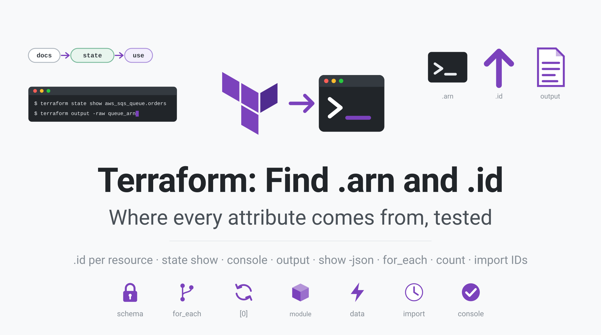
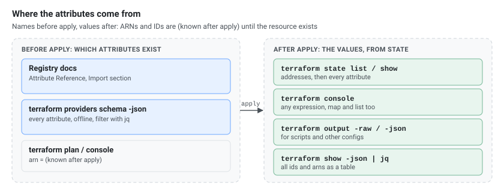
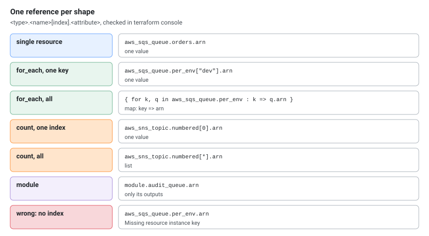
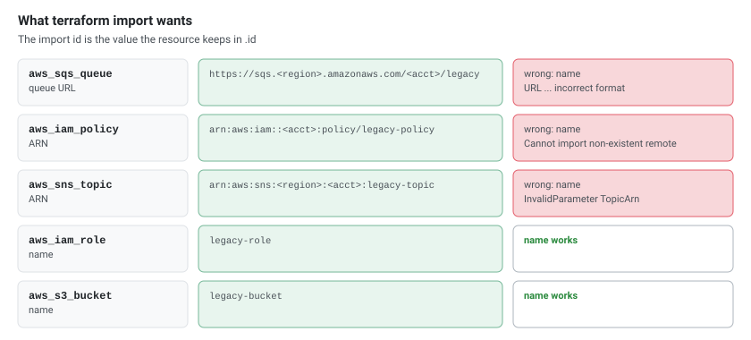

# Terraform: How to Find a Resource's .arn and .id



Almost every Terraform configuration passes one resource's identifier to another: a role ARN into a policy, a VPC ID into a security group, a queue ARN into a subscription. The attribute is usually called `arn` or `id`, but **what `id` contains depends on the resource type**, and the value only exists after the resource is created. This article shows where to look it up, how to read it from state, and how to reference it from `for_each`, `count` and modules. Everything was run with Terraform 1.17.2 and the AWS provider 5.100.0 against LocalStack, an AWS emulator, which is why the account ID is `000000000000`.

[](tf-arn-sources.svg "Open the diagram full size")

## 1. The Short Answer

```hcl
resource "aws_iam_role_policy_attachment" "app" {
  role       = aws_iam_role.app.name           # <TYPE>.<NAME>.<ATTRIBUTE>
  policy_arn = aws_iam_policy.read_logs.arn
}
```

A reference is `<resource type>.<local name>.<attribute>`. To find out which attributes exist and what they hold:

```bash
terraform state list                                  # every resource address
terraform state show aws_sqs_queue.orders             # every attribute of one resource
echo 'aws_sqs_queue.orders.arn' | terraform console   # one value
terraform output -raw queue_arn                       # an output, for scripts
```

## 2. What .id Actually Holds

`id` is the provider's own identifier for the resource, the value it uses to read it back from AWS. It isn't always an AWS "ID":

| Resource | `id` | `arn` |
|---|---|---|
| `aws_vpc` | `vpc-87e79899a99af5b29` | `arn:aws:ec2:eu-central-1:000000000000:vpc/vpc-87e7...` |
| `aws_security_group` | `sg-b00d94055c6430554` | `arn:aws:ec2:...:security-group/sg-b00d...` |
| `aws_s3_bucket` | `demo-logs-bucket` (the name) | `arn:aws:s3:::demo-logs-bucket` |
| `aws_iam_role` | `app-role` (the name) | `arn:aws:iam::000000000000:role/app-role` |
| `aws_iam_policy` | **the ARN** | `arn:aws:iam::000000000000:policy/read-logs` |
| `aws_sns_topic` | **the ARN** | `arn:aws:sns:eu-central-1:000000000000:alerts` |
| `aws_sqs_queue` | **the queue URL** | `arn:aws:sqs:eu-central-1:000000000000:orders` |
| `aws_iam_role_policy_attachment` | generated: `app-role-20261124211423903500000001` | none |

So `aws_sqs_queue.orders.id` is the URL (the same value as `.url`), not the queue's name or ARN, and a role's `.id` is its name. When a resource has an `arn` attribute, use `.arn` for anything that needs an ARN, even where `.id` happens to hold the same value: the meaning of `.arn` doesn't change between resource types or provider versions.

Some resources have no `arn` at all. An attachment, an association or a rule (`aws_iam_role_policy_attachment`, `aws_route_table_association`, `aws_vpc_security_group_ingress_rule`...) only links two things, and asking for `.arn` fails with `This object has no argument, nested block, or exported attribute named "arn"`.

Some have **two** identifiers: an IAM role has `unique_id` (`AROA...`) next to its name-based `id`, and an IAM policy has `policy_id` next to its ARN-based `id`. The unique IDs are generated by AWS and change when the role or policy is deleted and recreated under the same name; other resources almost always want the ARN or the name.

## 3. Before Apply: the Docs and the Provider Schema

The **Attribute Reference** section of each resource's page in the Terraform Registry lists everything the resource exports (`arn`, `id`, `url`...) and, for many resources, what `id` contains. The **Import** section at the bottom gives the exact ID format `terraform import` expects.

The same list comes from the provider itself, offline, once `terraform init` has run:

```bash
# Attributes the provider computes for aws_sqs_queue (set by AWS, not by you)
terraform providers schema -json \
  | jq -r '.provider_schemas["registry.terraform.io/hashicorp/aws"].resource_schemas.aws_sqs_queue.block.attributes
           | to_entries[] | select(.value.computed == true and (.value.optional|not)) | .key'

# All attributes of a resource
terraform providers schema -json \
  | jq -r '.provider_schemas["registry.terraform.io/hashicorp/aws"].resource_schemas.aws_iam_role_policy_attachment.block.attributes | keys[]'
```

For `aws_sqs_queue` that printed `arn` and `url`; for `aws_iam_role_policy_attachment` only `id`, `policy_arn` and `role`, so you know there's no `.arn` before you write the reference. The AWS provider 5.100 schema describes 1526 resource types (6.x: 1771), so filter it with jq rather than reading it.

**Before apply, ARNs and IDs don't exist yet.** `terraform plan` shows them as `(known after apply)`, and so does the console:

```bash
echo 'aws_sqs_queue.orders.arn' | terraform console      # (known after apply)
```

References still work: Terraform orders the resources so the one that produces the ARN is created first. What doesn't work is using such a value where Terraform needs it **during planning**:

```hcl
# Fails: Invalid for_each argument ... aws_sqs_queue.new.arn is a string, known only after apply
for_each = toset([aws_sqs_queue.new.arn])

# Works: keys are known, the ARN is only a value
for_each = { orders = aws_sqs_queue.new.arn }
```

`for_each` keys and `count` must be known at plan time; unknown values are fine as map values or as ordinary arguments.

## 4. After Apply: State, Console, Outputs and JSON

### terraform state list and state show

```bash
terraform state list
terraform state show aws_sqs_queue.orders
terraform state show 'aws_sqs_queue.per_env["dev"]'           # for_each: quote the address
terraform state show 'module.audit_queue.aws_sqs_queue.this'  # inside a module
terraform state show aws_iam_role.app | grep -E '^\s+(arn|id|unique_id)\s'
```

`state list` shows the exact addresses to use, including `[0]`, `["dev"]` and `module.` prefixes. `state show` prints every attribute of one instance. It works only on instances that exist: for a resource that failed to create it said `No instance found for the given address!`.

### terraform console

The console evaluates any expression against the current state, which makes it the fastest way to try a reference before writing it into a file:

```bash
terraform console
> aws_sqs_queue.orders.arn
> aws_sqs_queue.per_env["dev"].arn
> { for k, q in aws_sqs_queue.per_env : k => q.arn }
> aws_sns_topic.numbered[*].arn
> module.audit_queue.arn
> data.aws_caller_identity.current.account_id
```

Each line returned the value it names: the ARN, a map of ARNs by key, a list of ARNs, and so on. Typing just the resource address (`aws_sqs_queue.per_env`) prints the whole object with all its attributes. In scripts, pipe the expression in: `echo 'aws_sqs_queue.orders.arn' | terraform console`.

### Outputs

```hcl
output "queue_arn"          { value = aws_sqs_queue.orders.arn }
output "per_env_queue_arns" { value = { for k, q in aws_sqs_queue.per_env : k => q.arn } }
```

```bash
terraform output                          # all outputs
terraform output -raw queue_arn           # a plain string, no quotes: for scripts
terraform output -json per_env_queue_arns # maps and lists
```

`-raw` only works for strings, numbers and booleans: on the map it failed with `Unsupported value for raw output`, and `-json` returned `{"dev":"arn:aws:sqs:...:jobs-dev","prod":"arn:aws:sqs:...:jobs-prod"}`. Outputs are also how another configuration reads your ARNs, through `terraform_remote_state` or a data source.

### terraform show -json

Every address with its `id` and `arn` in one table:

```bash
terraform show -json | jq -r '.values.root_module.resources[] | [.address, .values.id // "-", .values.arn // "-"] | @tsv' | column -t
terraform show -json | jq -r '.values.root_module.child_modules[].resources[] | [.address, .values.arn] | @tsv'
terraform state pull | jq -r '.resources[] | select(.type=="aws_sqs_queue") | .instances[] | [(.index_key // "-"), .attributes.arn] | @tsv'
```

Resources inside modules are under `child_modules`, not `root_module`. `terraform state pull` gives the raw state file, where instances of `for_each` and `count` carry their `index_key`.

## 5. References With for_each, count and Modules

[](tf-arn-references.svg "Open the diagram full size")

```hcl
aws_sqs_queue.orders.arn                         # single resource
aws_sqs_queue.per_env["dev"].arn                 # for_each: by key
{ for k, q in aws_sqs_queue.per_env : k => q.arn }  # for_each: all, as a map
values(aws_sqs_queue.per_env)[*].arn             # for_each: all, as a list
aws_sns_topic.numbered[0].arn                    # count: by index
aws_sns_topic.numbered[*].arn                    # count: all, as a list
module.audit_queue.arn                           # a module's output
```

The errors you get when the reference doesn't fit the resource:

| Reference | Error |
|---|---|
| `aws_sqs_queue.per_env.arn` (has `for_each`) | `Missing resource instance key` ... `its attributes must be accessed on specific instances` |
| `aws_sns_topic.numbered.arn` (has `count`) | `Missing resource instance key`, suggests `aws_sns_topic.numbered[count.index]` |
| `module.audit_queue.aws_sqs_queue.this.arn` | `This object does not have an attribute named "aws_sqs_queue"` |
| `aws_iam_role_policy_attachment.app_read_logs.arn` | `This object has no argument, nested block, or exported attribute named "arn"` |
| `aws_sqs_queue.orders.arm` (typo) | `... named "arm". Did you mean "arn"?` |

A module's resources are private: from outside you can only read what the module declares as an `output`. If a module doesn't export the ARN you need, add the output to the module (or read the resource with a data source).

## 6. Resources Terraform Doesn't Manage: Data Sources

For an ARN of something created elsewhere (by hand, by another team, by another state), read it with a data source instead of hard-coding it:

```hcl
data "aws_caller_identity" "current" {}      # account_id, arn of the caller
data "aws_region" "current" {}               # .name in provider 5.x, .region in 6.x
data "aws_partition" "current" {}            # aws, aws-cn, aws-us-gov

data "aws_iam_role" "existing" {
  name = "app-role"                          # look it up by name, get .arn, .unique_id
}
```

`data.aws_iam_role.existing.arn` returned `arn:aws:iam::000000000000:role/app-role`, and `data.aws_caller_identity.current` gave the account ID and the caller's ARN. The region attribute moved between major provider versions: `data.aws_region.current.name` works in 5.x, and in 6.x it's `.region` (5.x rejected `.region` with `Unsupported attribute`).

### Building an ARN Yourself

When a resource doesn't export the ARN another resource needs (or it isn't in Terraform at all), build it from the parts instead of hard-coding the account or partition:

```hcl
locals {
  orders_arn = format("arn:%s:sqs:%s:%s:%s",
    data.aws_partition.current.partition,
    data.aws_region.current.name,
    data.aws_caller_identity.current.account_id,
    aws_sqs_queue.orders.name)
}
```

The AWS provider also has provider functions for this (Terraform 1.8 and later):

```hcl
provider::aws::arn_build("aws", "sqs", "eu-central-1", "000000000000", "orders")
provider::aws::arn_parse(aws_iam_role.app.arn)   # { account_id, partition, region, resource, service }
```

`arn_build` returned the same `arn:aws:sqs:eu-central-1:000000000000:orders` as the queue's own `.arn`, and `arn_parse` split the role ARN into `service = "iam"`, `resource = "role/app-role"` and the account. Prefer the resource's own `.arn` when it exists; build ARNs only for what Terraform doesn't know.

## 7. IDs for terraform import

[](tf-arn-import.svg "Open the diagram full size")

The `id` in an `import` block is the same identifier the resource stores as `.id`, so the table in section 2 is also an import table. Five resources created outside Terraform (with the AWS CLI), imported in one plan:

```hcl
import {
  to = aws_sqs_queue.legacy
  id = "https://sqs.eu-central-1.amazonaws.com/123456789012/legacy"   # the queue URL
}
import {
  to = aws_iam_policy.legacy
  id = "arn:aws:iam::123456789012:policy/legacy-policy"              # the ARN
}
import {
  to = aws_iam_role.legacy
  id = "legacy-role"                                                  # the name
}
import {
  to = aws_s3_bucket.legacy
  id = "legacy-bucket"                                                # the name
}
import {
  to = aws_sns_topic.legacy
  id = "arn:aws:sns:eu-central-1:123456789012:legacy-topic"           # the ARN
}
```

```bash
aws sqs get-queue-url --queue-name legacy --query QueueUrl --output text
aws iam get-policy --policy-arn arn:aws:iam::123456789012:policy/legacy-policy --query Policy.Arn --output text
aws sns list-topics --query 'Topics[?ends_with(TopicArn, `legacy-topic`)].TopicArn' --output text
terraform plan          # "will be imported" for each
terraform apply
```

With those IDs the plan said `5 to import` and the apply `Import complete` for each. With **names everywhere** instead, three of them failed, each differently:

| Resource | Wrong ID | Error |
|---|---|---|
| `aws_sqs_queue` | `legacy` (name) | `SQS Queue URL (legacy) is in the incorrect format` |
| `aws_sns_topic` | `legacy-topic` (name) | `InvalidParameter: Invalid parameter: TopicArn` |
| `aws_iam_policy` | `legacy-policy` (name) | `Cannot import non-existent remote object` |

The IAM policy error is the misleading one: the policy existed, but the provider looked it up by ARN, found nothing for a bare name, and reported it as missing. Check the resource's **Import** section in the docs for the format before guessing.

## 8. Quick Reference

| You need | Command or expression |
|---|---|
| Which attributes a resource exports | Registry docs, Attribute Reference; or `terraform providers schema -json \| jq ...` |
| Every resource address | `terraform state list` |
| All attributes of one resource | `terraform state show <address>` |
| One value, interactively | `terraform console`, then the expression |
| One value in a script | `terraform output -raw <name>` or `echo '<expr>' \| terraform console` |
| All IDs and ARNs as a table | `terraform show -json \| jq ...` |
| An ARN of something not in Terraform | A data source (`data.aws_iam_role`...), or `format()` / `provider::aws::arn_build` |
| The import ID format | Registry docs, Import section; equals what the resource stores as `.id` |

## Gotchas

- **`.id` means something different per resource:** a name (S3, IAM role), a URL (SQS), an ARN (IAM policy, SNS topic), an AWS ID (VPC, security group) or a generated string (attachments). Use `.arn` when you need an ARN.
- **Not every resource has `.arn`.** Attachments and associations don't.
- **ARNs are `(known after apply)` during plan**, so they can't be `for_each` keys or a `count`.
- **`for_each` and `count` resources need an index:** `["key"]` or `[0]`, or a splat / `for` expression for all of them.
- **A module only exposes its outputs**, not its resources.
- **`terraform output -raw` refuses maps and lists**; use `-json`.
- **Import IDs follow `.id`**: queue URL, policy ARN, topic ARN, role or bucket name.
- **`data.aws_region` changed attribute names** between AWS provider 5.x (`.name`) and 6.x (`.region`).
- **Don't hard-code account IDs or partitions** in ARNs; take them from `aws_caller_identity` and `aws_partition`.

## See Also

- [Terraform Variables: Declaration, Validation, Precedence and Sensitive Values](../terraform-variables-guide/index.md)
- [terraform.tfstate vs .terraform/terraform.tfstate](../terraform-tfstate-vs-terraform-directory-state/index.md)
- [Terraform Cheatsheet](../terraform-cheatsheet/index.md)
- [Terraform docs: References to Named Values](https://developer.hashicorp.com/terraform/language/expressions/references)
- [Terraform docs: Import blocks](https://developer.hashicorp.com/terraform/language/import)
